<p align="center">
  
</p>

<h1 align="center">Restock</h1>

<p align="center">
  <strong>Half price? Prove it.</strong><br>
  A free, open-source Android app that watches prices at the Australian supermarkets, bottle shops and chemists you choose,<br>
  and tells you when a special is real, when to wait, and when to swap.
</p>

<p align="center">
  
  
  
  
</p>

<p align="center">
  <a href="https://github.com/d-plenty/Restock/releases/latest/download/restock.apk"></a>
  <a href="https://d-plenty.github.io/Restock/"></a>
  <a href="https://apps.obtainium.imranr.dev/redirect?r=obtainium://add/https://github.com/d-plenty/Restock"></a>
</p>

<p align="center">
  <a href="#get-it">Get it</a> ·
  <a href="#new-in-0910">New in 0.9.10</a> ·
  <a href="#your-own-restock-server">Restock server</a> ·
  <a href="#restock-on-iphone">On iPhone</a> ·
  <a href="#questions">Questions</a> ·
  <a href="#how-you-can-help">How you can help</a> ·
  <a href="BUILD.md">Build it</a> ·
  <a href="PRIVACY.md">Privacy</a>
</p>

<p align="center">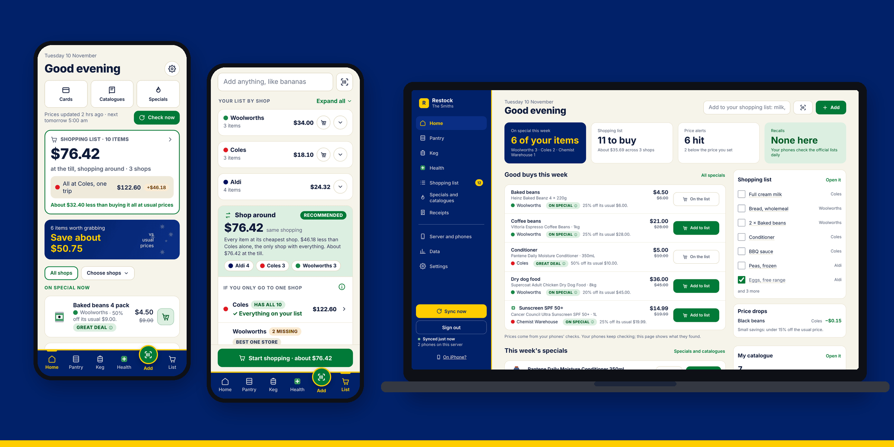</p>

| | | | |
|---|---|---|---|
| 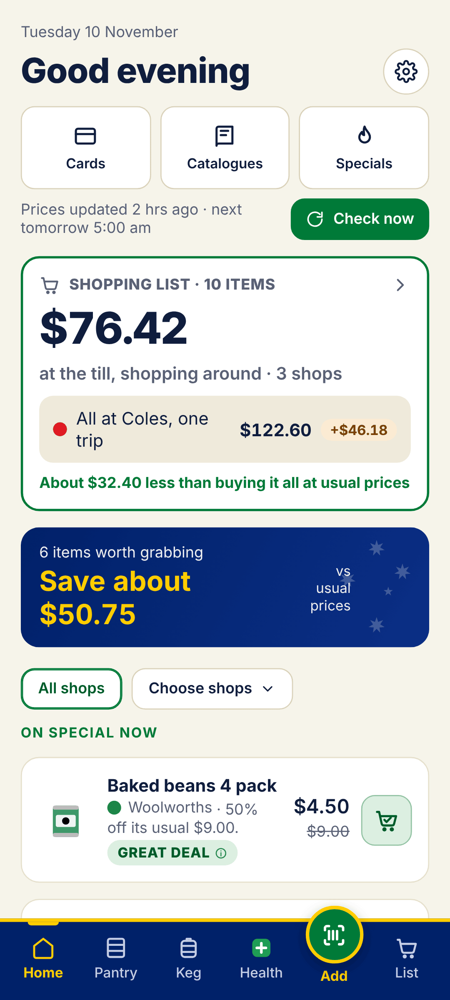 | 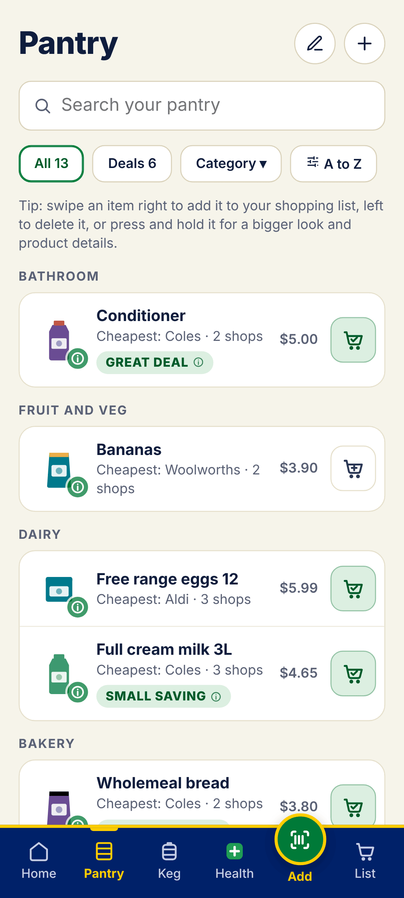 | 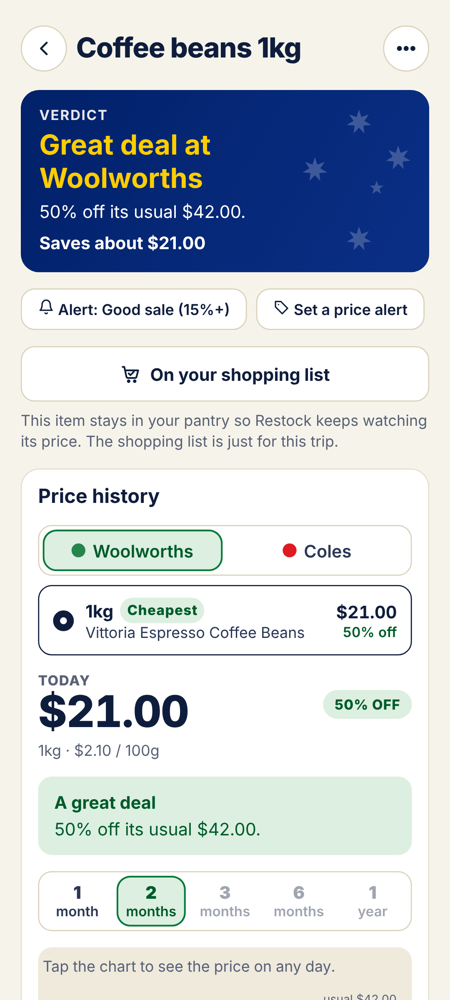 | 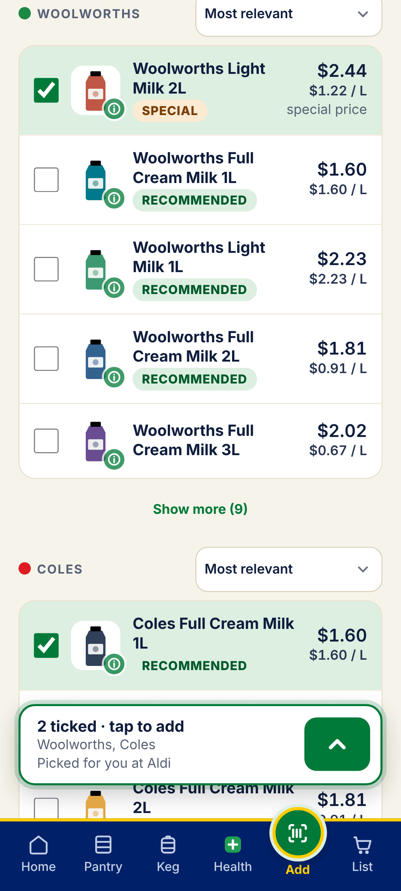 |
| 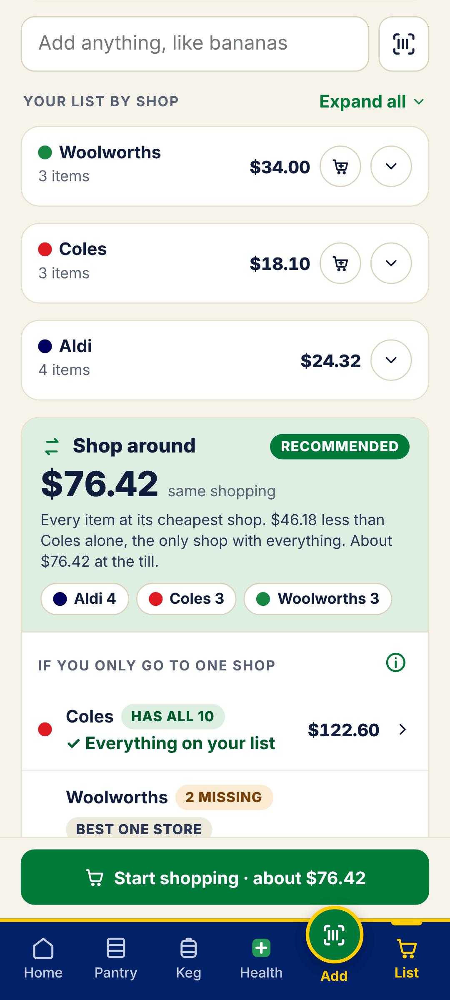 | 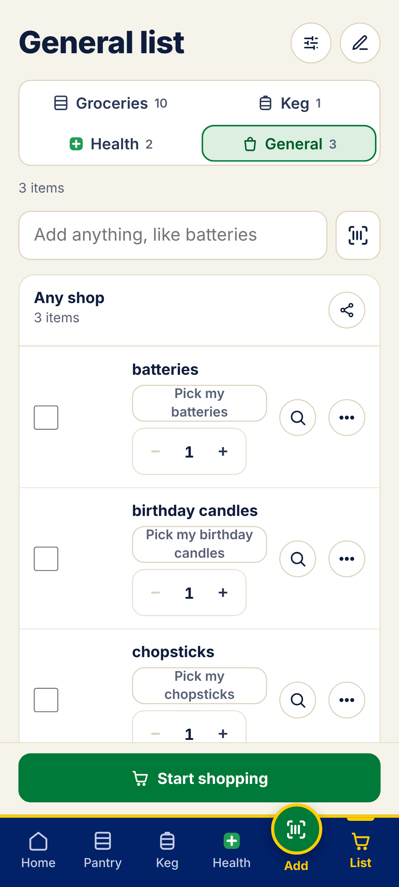 | 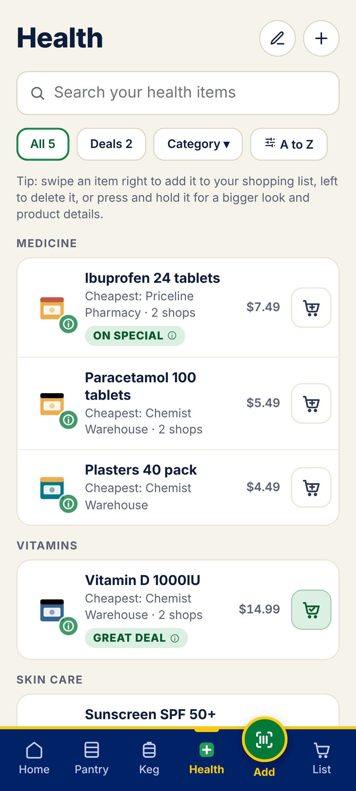 | 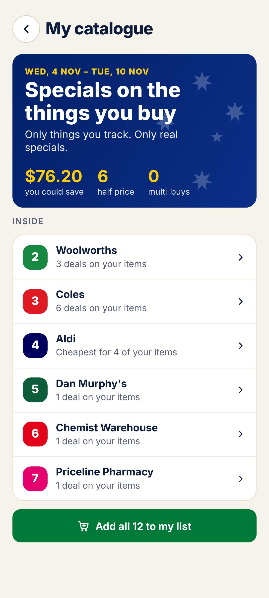 |
| 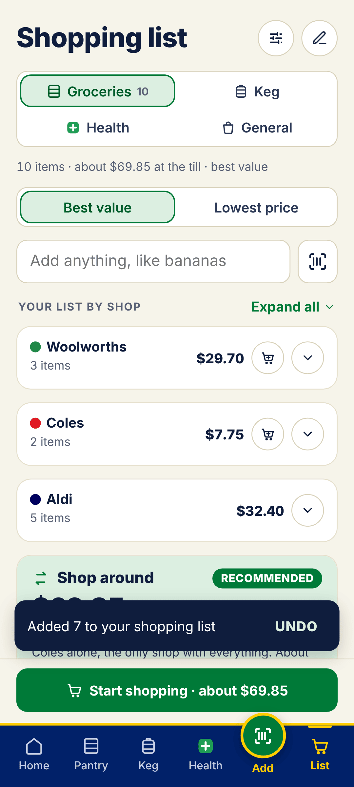 | 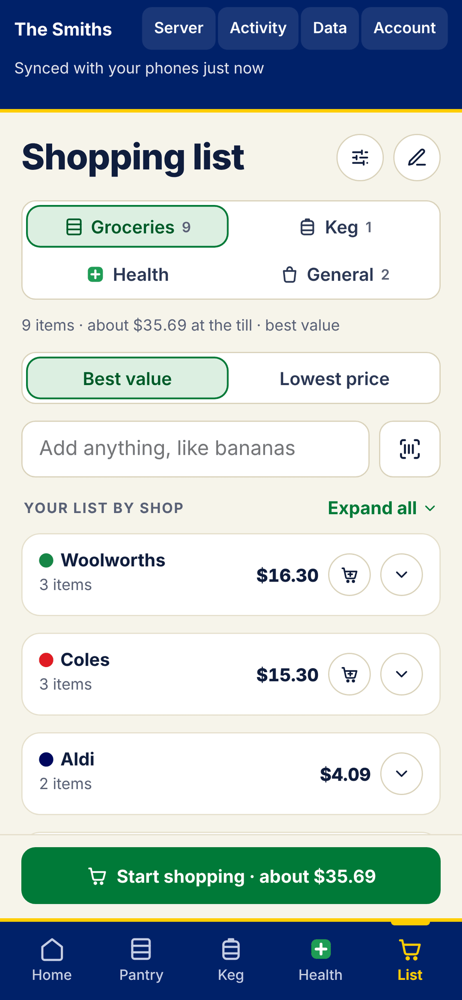 | 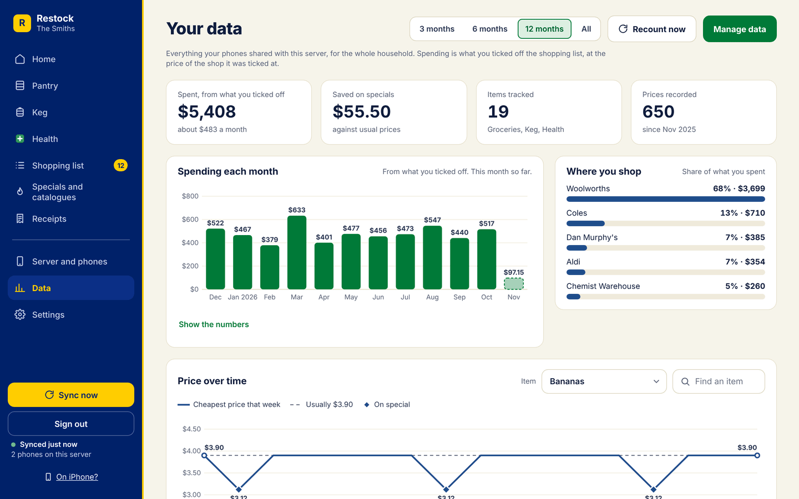 | 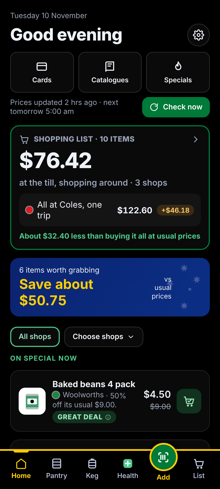 |

> **Local first. Works without signal.** Your list, pantry and prices live on your phone, not in a cloud. In a shopping centre with no reception, your list still opens straight away, and you can tick things off, add items from your pantry or type new ones. It all syncs when you're back online. Only searching the shops for new products and live prices needs the internet. **A server is optional:** Restock works fully on its own, and your own Restock server adds things on top.

## Why

A yellow ticket doesn't tell you whether the price is actually low. Restock keeps the price history of the things **you** buy, at the shops **you** use, and answers one question in plain words: *is this special worth it?*

It's made in Australia, for Australian shoppers. It's free, it always will be, and it doesn't collect anything about you.

## What it tells you

| Label | Means |
|---|---|
| **Great deal** | 30% or more below its usual price |
| **On special** | 15% or more below its usual price |
| **Small saving** | Any drop below its usual price, even 5 cents |
| **Wait for a better sale** | On special, but it's been cheaper lately and usually comes back down |
| **Fake sale** | Marked as a special at its usual price |
| **Swap & save** | Something you'd happily buy instead is on special and cheaper per 100 g, litre or item |

The **usual price** is the middle of the prices when it wasn't on special, over the history you keep (8 weeks to start with, up to 12 months). New items show a "still learning" note until there's about 4 weeks of history.

## Highlights

- **Your shops, your items.** Coles, Woolworths and Aldi, plus bottle shops (Keg tab, 18+) and chemists (Health tab) if you want them, and any other shop's website.
- **Four shopping lists.** Groceries, Keg, Health and **General**. General is a list only, for things that aren't in your pantry: Home Assistant puts anything there that matches nothing you track, or you add to it yourself.
- **Scan to add.** An open-source barcode scanner built in, with Open Food Facts lookup. Restock finds the same product at each of your shops and ticks it for you.
- **Undo.** After most changes (Add to list, a tick, a delete, an edit, "Add all to my list"), a small **Undo** shows for a few seconds. One tap puts it all back, however many things changed.
- **Save settings.** Settings changes wait for a big green **Save settings** button, so you know when they're saved. Leaving with unsaved changes asks first.
- **Your own Restock server** (optional). Run [Restock server](https://github.com/d-plenty/restock-server) on a NAS, mini PC or Raspberry Pi, or as an app in Home Assistant. **Your server is the house:** you name it, add phones from its web page, and each phone chooses what it shares. It syncs around the clock, runs your Home Assistant shopping list, shows your spending and price charts in its **Data** tab, and gives you Restock on your computer and [on iPhone](#restock-on-iphone). See [Your own Restock server](#your-own-restock-server).
- **Other sizes of this.** Tick a product and Restock shows the same thing in other packs (375 mL cans × 10, × 24, × 30), compared per litre or per 100 g, so a 10-pack on special doesn't slip past your usual 30-pack.
- **Sync with your household, no server needed.** Up to 6 phones in the same house share one pantry and shopping list, straight from one phone to another on your Wi-Fi. Away from home, phones can also sync through Nextcloud, another WebDAV server or a Syncthing folder, sealed so only your phones can read it. You pick what's shared: groceries, Keg and Health, each on or off.
- **My catalogue.** Specials on the things you buy: a page for each shop with this week's specials on your items (40% OFF, HALF PRICE, 2 FOR $5), and for a shop with no specials, a page of what it's cheapest for.
- **Shop around, or one shop.** Your list puts each item at its cheapest shop and suggests shopping around, unless it saves less than your minimum (a dollar to start with). Then it suggests the one shop that has everything, comparing the *same shopping* at each shop.
- **Background price checks** on Android's own scheduler, with alerts only for the deals you care about, plus a weekly deals summary on catalogue day.
- **Recall alerts.** Once a day Restock checks the official Australian recall lists (FSANZ, Product Safety Australia, TGA) against what you have.
- **Receipts** (optional). Scan, straighten and read receipts on the phone, and keep them as long as you choose.
- **Your own branch's prices.** Sign in to Woolworths inside Restock (on Woolworths' own page; your password never reaches Restock), or choose your Coles branch, and prices and stock are for your local shop.
- **Widgets, shortcuts, share-to-list**, automatic backups, Australian green-and-gold or plain themes, and accessibility settings.
- **Works without Google.** No Google Play services, so it runs on GrapheneOS, CalyxOS, /e/OS and other de-Googled phones.

<details>
<summary><strong>Every feature, in detail</strong></summary>

- **Three tabs, kept apart**: **Pantry** for supermarkets, **Keg** for bottle shops and **Health** for chemists. Keg and Health only appear if you switch them on. Each tab has its own items, categories, list and shops, and a search only goes to that tab's shops. Keg asks once that you're 18 or over.
- **General list**: a fourth shopping list, with no pantry of its own. A Home Assistant add that matches nothing in your Pantry, Keg or Health goes there. You can add to it yourself too. Adding by hand to Groceries, Keg or Health works as before, even for words that match nothing (like "chips", to buy whatever's on special). Nothing else moves to General by itself. It's shared with the groceries.
- **Bottle shops**: Dan Murphy's, BWS, Liquorland, Liquorland Warehouse, Liquorland Cellars, The Bottle-O, Cellarbrations, Thirsty Camel and Porters Liquor. Beers say whether they're a single, a 6 pack or a case.
- **Chemists**: Chemist Warehouse, My Chemist (with Chemist Warehouse's prices), Amcal, Discount Drug Stores, Guardian / PharmaSave, Priceline Pharmacy, Soul Pattinson, TerryWhite Chemmart, Blooms The Chemist, Good Price Pharmacy, Pharmacy 4 Less, Direct Chemist Outlet, Star Discount Chemist, Capital Chemist, National Pharmacies and Chempro.
- **Costco** (off until you pick it with your supermarkets): everything Costco sells online, next to Woolworths, Coles and Aldi, shared with your household and server like any shop. Sign in to Costco in the app for member prices (optional). **Please read this first:** Costco's website terms say automated collection of product listings isn't allowed. Restock only looks when you search, one page at a time. It never checks Costco in the background or with Check now, and never in bulk. Costco may block it or change its pages, so it may stop working. Treat it as a test feature. It's your choice to turn this on, and your responsibility. Prices are Costco's online prices, which include delivery. They can differ from warehouse to warehouse and from the shelf. The shelf price in the warehouse can be typed in by hand.
- **Any other shop**: add its website and Restock finds its search page and reads the products and prices, with Save and test to check it works.
- **Pantry**: each item has My picks (what you buy at each shop, which can differ shop to shop) and Would also take (others you'd buy when they're cheaper, for Swap & save), on This size or Any size, and shops marked Not at this shop. Listed by shop then size, cheapest first, or A to Z. Swipe to add to your list or delete.
- **Add**: search all your shops at once. Tap a result to tick it into the bar at the bottom ("1 ticked · tap to add"); nothing jumps up in your way. The green arrow opens the details (name, and Picked for you at your other shops) when you're ready.
- **Picked for you**: tick a product from a search and Restock searches your other shops again for the same product, or the ones most like it in kind, size and price, ready to tick.
- **Search**: ranked by what you most likely mean: type "butter" and butter comes first, with peanut butter and butter chicken sauce further down; children's medicines only when you ask for them. Unit prices worked out the same way everywhere, a best-value sort, "On special only", recent searches, and fixes for Aussie names (snags, loo paper).
- **Scanning**: zxing-cpp inside the app. Normal barcodes, GS1 QR codes, Data Matrix and DataBar, from the camera or a photo, or type the number. **Scan several** walks your cupboard and fills your shopping list. Unknown barcodes fall back to the supermarkets' own data, a general search (an ingredient and strength for medicines) or reading the front of the pack.
- **Best match**: after a scan, the same product (brand, variant and size) is ticked at each shop. If the barcode only names the brand, you pick which one it is once and Restock ticks it everywhere and remembers.
- **Your branch's prices and stock**: sign in to your Woolworths account inside Restock, on Woolworths' own page, so your password only ever goes to Woolworths, and Restock shows your branch's prices and stock and can fill your Woolworths trolley. For Coles, tap **Choose your Coles branch** in My shops and tap your branch in Coles' own store finder; Restock picks up its number by itself. Without these, Restock shows online prices and leaves stock out.
- **Hold to preview**: press and hold any product for a bigger photo, its full name, size, price, ingredients, allergens and nutrition.
- **Shopping list**: Shop around first, with its stops and what it saves, then "If you only go to one shop" with HAS ALL or N MISSING for each, and what the missing ones would cost elsewhere. Views: **By shop · Aisle group · One list**. Quantities, A to Z, Best value or Lowest price, share as text, or send to the Coles or Woolworths app. Type in the list and your pantry items come up first; or add the words as they are, or **Find the cheapest** to search the shops for a one-off buy.
- **Pick my milk**: a line added as words (by voice through Home Assistant, say) has a **Pick my milk** button. Pick the pantry item, and tick *Always use this for "milk"* to match it straight away next time. If nothing in your pantry matches ("chopsticks"), the picker searches the shops for it, the same as adding a new item.
- **Undo**: a small Undo after adding to the list, ticking, removing, editing and bulk changes. One tap undoes all of it, on every phone and the server too.
- **Save settings**: changes on a settings screen wait for **Save settings**. If you leave with changes not saved, Restock asks.
- **Price history**: a tab for each shop (always in the same order), then that shop's products smallest first. A chart over **1 month · 2 months · 3 months · 6 months · 1 year**, where today's price sits against the lowest, the usual special and the usual price, how often it's on special and when the next special is likely, and multi-buys counted at their price each.
- **This week**: deals, small savings and "wait for a better sale" for all your shops, or one shop at a time.
- **Specials**: this week's specials at your shops (Woolworths and Coles half price, Aldi Special Buys), filtered to **Things I buy** or **All specials**.
- **Alert me under $X** per item, and **stock-up tips** for things that rarely go on special.
- **Near me**: find every supermarket, bottle shop or chemist nearby from OpenStreetMap and pick your branch.
- **Shop health**: Home tells you if a shop hasn't worked for a day, and Settings → Troubleshooting → Test connections shows what went wrong.
- **Diagnostics**: what went wrong lately, shop by shop, **Send search details** to capture exactly what a shop sent back, and a recording of what a shop's website does when you add something to its trolley yourself (sign-in and personal details left out), so connections can be fixed.
- **Receipts** (optional): finds the receipt's edges, straightens it, makes it crisp black and white, and reads the shop, date and total with Tesseract on the phone. The reader is built in and works offline. Photos stay inside Restock, not in your gallery.
- **Recall alerts**: on by default, checked every 24 hours separately from price checks, matched against your Pantry, Keg, Health, lists and kept receipts, with the official notice one tap away.
- **Cards**: loyalty cards (member prices only count if you've added the card) and gift cards, with the barcode, card number, a PIN that stays hidden until you tap it, the balance and what you spent, an expiry reminder and photos. Cards stay on your phone.
- **My catalogue**: specials on the things you buy, a page per shop, Wednesday to Tuesday, with what you could save, half prices and multi-buys on the cover. **Add all to my list** says how many, and Undo takes them all back off.
- **Catalogues**: a link to the catalogue of every shop you use.
- **Home screen widgets**: Deals, Shopping list and Quick actions, with your choice of background, transparency and text colour.
- **App icon shortcuts** (Scan, List, Receipt) and **Share to Restock** from any app.
- **Local sync**: up to 6 phones in a household pair by scanning a one-time QR code from the owner phone (it works once, for 10 minutes, and never contains the household's key), then sync straight to each other on the same Wi-Fi: when you open Restock, shortly after a change, and every 15 minutes or so in the background. Pantry, lists (ticks too), prices, categories and alerts, plus loyalty cards if you choose. The owner picks what the household shares (groceries, Keg, Health) and each phone picks what it takes. Encrypted with a key only your phones have; no server and no account needed. If two phones change the same thing, the later change wins, except that a tick and a new amount on the same line both survive, and deleting something beats an edit made without knowing about it. **Sync away from home** (optional): Nextcloud, another WebDAV server, or the same folder on each phone (one Syncthing keeps in sync), sealed with the household's key, prices and photos aside. **Recovery key**: if the owner phone is ever lost, another phone takes over as owner with it.
- **Start fresh, restore, or join your household** on the first screen; **Erase everything and start fresh** at the bottom of Settings (it asks twice).
- **Sync and backups in one place**: a strip that says whether everything is kept somewhere else (phone sync, a folder backup or your Restock server all count), then your server, Wi-Fi and away from home, then backups.
- **Backups**: export and restore exactly the parts you pick, plus optional automatic backups into a folder you choose. Lock any backup with a password (encrypted on the phone). Restock also keeps a copy from just before each update, so an update can be undone.
- **Spreadsheets**: export your pantry, shopping list and price history as CSV files for Excel, Google Sheets, LibreOffice or Numbers.
- **Look and colours**: Light, Dark or System, with true black for OLED screens; Australian or Plain; 24 accent colours; 16 app icon colours.
- **Accessibility**: bigger text, high contrast, less motion and bigger buttons, checked with an automatic accessibility audit.
- **Updates**: Settings → About and updates → Check for updates, or turn on **Tell me when there's an update** to check every 24 hours (or every 7 days) when you open Restock. Or install through [Restock's own F-Droid repo](https://d-plenty.github.io/Restock/) or Obtainium and let them handle updates.
- **Sharing prices**: product prices (shop, name, size, barcode and the prices on each day) are kept ready in your backups for a future shared price network. Nothing is sent anywhere yet, nothing about you is ever included, and the data will never be sold. Turn it off in Settings → Shared prices. See [Shared prices](#shared-prices).
- **Shared price history (Beta)**: optionally download months of Coles and Woolworths history from [hotprices.org](https://hotprices.org) ([source](https://github.com/Javex/hotprices-au), MIT) so new items get a fair verdict from day one. Off by default.

</details>

## New in 0.9.10

- **Find a shop's branches from its Edit sheet:** "Find Woolworths near you" shows only Woolworths branches (the same for Coles, Aldi, Costco, the bottle shops and the chemists). Tap Primary or 2nd. "Enter a branch yourself" is there for typing it in.
- **Lines that aren't one of your items yet** (from Home Assistant, or typed) say **Pick my cordial** on the phone and the web page alike.

## New in 0.9.9

- **Every shop works the same:** on every tab, each shop has one line about how it works and an **Edit** button. Edit opens the same sheet for every shop, inside the app: branches, sign-in (or why there isn't one), stock and about.
- **Stock on every item:** pantry items and shopping list lines say In stock, Out at a branch, or Stock unknown. Tap it to see each shop and branch, and when it was checked.
- **Start shopping names the branch** ("Coles Thuringowa"), and suggests your other branch when your usual one is out of things.
- The BETA tag is gone from Coles.

## New in 0.9.8

- **My shops, tidied up:** every supermarket shows its sign-in (optional), its branch and an "About" with what works and what doesn't, right under its tick. Settings has one row per tab of shops.
- **Costco is searched with your other shops** every time you search, with **Get more from Costco** for more results.
- **Notifications open what they're about:** a deal opens that item, catalogue day opens your catalogue, a gift card reminder opens Cards.
- **Back works better:** Settings keeps your place when you come back, and leaving the app from Home takes a second press of back.
- **The server's web page has the same Settings groups as the phone,** in the same order. What only a phone can do is shown greyed, saying where to do it.

## New in 0.9.7

- **Costco is one of the supermarkets.** Pick it next to Woolworths, Coles and Aldi, in setup or in Settings under shops (it's off until you do, and the notice shows first). It's shared with your household and server like any shop, and searches everything Costco sells online, not just food.
- **Sign in to Costco** (optional) in the app, like Woolworths, so searches show your member prices.
- **Costco searching works differently:** Restock now asks from inside Costco's own page in the app, which is what makes it get past Costco's checks. It still only looks when you press Search.
- The "I buy from Costco online" tick is gone: Costco prices count like any shop's.

## New in 0.9.6

- **Two prices on every product:** per item ("$0.98 each") so you can picture it, and a **comparison price** (per litre, per 100 g or per kg) that decides the cheapest shop. If a shop leaves the size out, Restock works it out from the same barcode or a matching pack elsewhere and says **estimated**, or says **size unknown** rather than guess.
- **Price checks at a set time:** every day at **5:00 am** by default, at a time you choose in Settings. **Check now** is an extra check and never moves the schedule. Android may run it a few minutes late.
- **Last updated** on every product's Price history card, and **Enter a price** for any shop, saved as "entered by hand".
- **Move to another list:** a button moves a line between Groceries, Keg, Health and General, with Undo. It never happens by itself.
- **Cards:** Loyalty cards is now **Cards**, with **gift cards** next to them (barcode, PIN, balance, expiry reminder). They stay on your phone. On your server's web page and on iPhone, cards are kept only in that browser.
- **Costco** (off until you pick it): see the notice under [Every feature](#highlights). Restock only looks when you search.
- **Wi-Fi sync is its own option.** A phone on a Restock server no longer shows it, and the X on that card can't disconnect you from the server. **Leave this server** is a separate button on the server screen.
- **Import data** on the server's Data tab: add products and prices from a file on top of what's there, with a preview first.
- **A proper phone layout on iPhone**, with a bottom tab bar like the Android app, and the Pantry, all four lists and Cards open with no signal.
- The "Backup from before" list is gone from Settings. Use **Export a backup** or **Back up automatically**.

## New in 0.9.5

- **General**, a fourth shopping list, for Home Assistant adds that match nothing you track.
- **Pharmacy is now Health.** The same green plus, and the same items. Chemists are the shops on it.
- **Undo** on the phone and the web, for one change or a hundred.
- **Save settings**: settings wait for a big green button, on the phone and the web.
- **Add tab**: tapping a result ticks it into the bottom bar. The details open from the green arrow.
- **Pick my item** searches the shops when nothing in your pantry matches.
- **On your server's web page:**
  - a **Data** tab with spending and price charts, downloads (.xlsx, CSV and a full export file), and Manage data;
  - **Let the web page search the shops**, off unless you turn it on;
  - **Previous** and **Next** above and below catalogue pages (and the arrow keys), products that open when clicked, and a big photo at the top of an item;
  - **Restock on iPhone**: add the server's page to your home screen.

## Private by design

- Everything lives in a database **on your phone**, and works offline. No account, no ads, no analytics, no tracking.
- If you run your own Restock server, it holds your household's data (what each phone chooses to share) so it can work around the clock. It's yours, at home; keep its data folder private. Card numbers and shop sign-ins stay on your phones unless you choose to share cards.
- No Google Play services, Firebase or ML Kit, so it runs on de-Googled phones (GrapheneOS, CalyxOS, /e/OS).
- Every permission is optional and explained, and asked for only when a feature needs it.
- The app talks directly to the shops and a few open services (Open Food Facts, OpenStreetMap, the official recall lists, and GitHub if you check for updates), and to your own Home Assistant and Restock server if you connect them. **Nothing goes to the people who make Restock.**
- **Your server only contacts the shops if you turn on Let the web page search the shops**, and then only when someone presses Search on its web page. Nothing runs in the background, and no shop sign-ins are kept.
- **Erase everything** (at the bottom of Settings) deletes your data, signs you out of the shops inside Restock and clears what the app saved, files it shared included. Backups can be locked with a password.

Read the full **[privacy policy](PRIVACY.md)** and the **[fine print](DISCLAIMER.md)**.

## Get it

Android 8.0 or newer, including de-Googled phones. Pick one:

- **Download the APK:** **[restock.apk](https://github.com/d-plenty/Restock/releases/latest/download/restock.apk)** is always the newest version, or pick one from **[Releases](../../releases)**. Open it on your phone and allow the install. Restock can then update itself: **Settings → About and updates → Check for updates** (or turn on *Tell me when there's an update*).
- **F-Droid (Restock's own repo):** open **[d-plenty.github.io/Restock](https://d-plenty.github.io/Restock/)** on your phone and tap *Add to F-Droid*, or scan its QR code in F-Droid → Settings → Repositories. Then install Restock from F-Droid and it keeps it up to date. Works with F-Droid, Droid-ify and Neo Store. Restock isn't in the main F-Droid repository yet.
- **Obtainium:** tap the Obtainium badge at the top on your phone, or add `https://github.com/d-plenty/Restock` in [Obtainium](https://github.com/ImranR98/Obtainium).
- **iPhone:** there's no iPhone app, but with your own Restock server you can use Restock on iPhone from the home screen. See [Restock on iPhone](#restock-on-iphone).

All three Android ways are the same APK, signed with the same key, so you can switch between them and updates install over the top. Nothing is lost.

**Check your download (optional):** each release lists the APK's SHA-256 checksum. On Linux, `sha256sum restock-0.9.10.apk` (on macOS, `shasum -a 256 restock-0.9.10.apk`) should print the same.

**Moving to a new phone?** Settings → Sync and backups → **Export a backup** on the old phone, then **Restore from a backup** on the new phone's first screen. If your household syncs, the new phone can simply **Join your household** (or **Join your server**) instead.

**Build it yourself:** see **[BUILD.md](BUILD.md)**. About 20 minutes the first time, on Linux, macOS or Windows.

### Updating from 0.9.4

- **No server, phones on Wi-Fi, or a cloud folder:** install 0.9.5 over 0.9.4. Nothing is lost. 0.9.4 and 0.9.5 phones keep syncing with each other.
- **On a Restock server:** update the server to 0.9.5 first, then the phones. Nothing to scan or hand over this time.
- **Phones still on 0.9.4** keep working and syncing. They don't show the General list yet: its lines wait on the server and the other phones, and come in when that phone updates.
- **Pharmacy is now called Health.** Your items, list and settings are the same; only the name changed.
- **Older versions (0.8.9 to 0.9.3):** install 0.9.5 as usual. On a server with Restock 0.9.3 phones, do the [0.9.4 handover](https://github.com/d-plenty/restock-server#already-using-the-server-with-restock-093) first.

## Your own Restock server

[Restock server](https://github.com/d-plenty/restock-server) is optional. It's a small server you run at home: on a NAS (TrueNAS, Synology, QNAP, Unraid), a Raspberry Pi 4 or 5, a mini PC, or as an app in Home Assistant. One `docker run` command, or a Compose file for Dockge, Portainer and TrueNAS. Then:

- **It's the house.** You name it on its web page and add each phone with a one-time code. Each phone chooses what it shares: groceries always; Keg, Health, receipts and loyalty cards only if you turn them on. Gift cards never leave the phone.
- **It syncs around the clock,** at home and away, and keeps your household's history.
- **It runs your Home Assistant shopping list** for everyone, even with every phone closed.
- **Restock on your computer:** the Shopping list, pantry, specials and catalogues, laid out for a big screen.
- **Data:** spending each month and where you shop (from what you tick off, not receipts), price over time for each item, and what you buy most. Download it all as a spreadsheet (.xlsx), CSV files or a full export file. **Manage data** shows what's on the server and lets you delete older data, with two checks first. **Auto delete** is off unless you turn it on.
- **Let the web page search the shops** (off unless you turn it on): add things from the web page that aren't in your pantry yet. The server searches the shops only when someone presses Search. Some shops may block a server; then search on a phone.
- **Restock on iPhone,** from the server's https address. See [Restock on iPhone](#restock-on-iphone).

The server can read what your phones share with it, so it can do all this. It's your server, so keep its data folder and backups private. Traffic between phones and the server is encrypted, even on plain http at home. The [server's README](https://github.com/d-plenty/restock-server) has the install steps for each machine.

## Restock on iPhone

There's no iPhone app, but with your own Restock server you can put Restock on your iPhone's home screen. It opens like an app, and your Shopping list works with no signal.

**It needs the server's https address.** iPhones only keep a web app for offline use, and only let it use the camera, on https. A Cloudflare tunnel or Tailscale's https (`tailscale serve`) both work. See [at home and away](https://github.com/d-plenty/restock-server#at-home-and-away) in the server's README.

1. Open the server's https address in Safari.
2. Tap Share, then **Add to Home Screen**.
3. Tap **Add**. Open Restock from your home screen and sign in.
4. Tick **Keep me signed in**, so it still opens when you're offline.

The steps are also on the server's sign-in page, under **On iPhone?**. On Android, open the https address in Chrome and tap the menu, then **Add to Home screen** (or **Install app**).

**With no signal:**

- Your Shopping list opens, and you can tick things off, add and remove them.
- Scanning a barcode adds things you already have in your pantry.
- Your changes go to the server when you're back online. The list shows when it was last updated.
- Prices, specials and settings need the server.

**Good to know:**

- **Open it once with a connection** after you sign in (with **Keep me signed in** ticked), so it can keep a copy for offline. Offline, it opens what this phone last saved: the Pantry, Keg and Health tabs, all four lists (tick, add, edit, Move to and Undo), your cards with their barcodes, and specials, catalogues and price history as last saved. Changes sync when you're back online. Searching the shops, the Data tab (and Import), Server and phones, and Activity need signal.
- **Sign out** takes the saved copy off that iPhone. If the iPhone runs low on space, iOS can clear what Restock saved: it loads again next time you're online, but changes not sent yet are lost. A sign-in made by scanning with a phone isn't kept for offline: sign in with your passphrase.
- **No background price checks, alerts or widgets** on iPhone, and no Wi-Fi sync between phones. Those need a real iPhone app: see [Wanted](#wanted-someone-to-bring-restock-to-iphone).

## Home Assistant

Your shopping list in [Home Assistant](https://www.home-assistant.io), both ways: add, tick or take something off in Restock and Home Assistant's list changes too, and the other way round. Say *"Okay Nabu, add milk to my shopping list"* and milk is on your Restock list.

1. In Home Assistant, open your profile (your name, bottom left) → **Security** → **Long-lived access tokens** → **Create token**. Call it Restock and copy it.
2. In Restock, go to **Settings → Home Assistant**. Type the address you open Home Assistant with (`http://homeassistant.local:8123`, its IP address like `http://192.168.1.50:8123`, your Nabu Casa `https://….ui.nabu.casa` address or a Tailscale one), paste the token and tap **Test connection**.
3. Pick the list (`todo.shopping_list` unless you use another), turn on **Sync with Home Assistant**, and tap **Save settings**.

Good to know:

- **Voice adds:** if what you said is clearly one of your items (Pantry first, then Keg, then Health), it's added to that list, with its price and cheapest shop. If it could be more than one, it's added as the words on that list, with a **Pick my milk** button on every phone and on the web. If it matches nothing at all ("chopsticks"), it goes on the **General** list.
- **Pick my milk:** pick the item, and tick *Always use this for "milk"* to have it match straight away next time, for the whole household. Or keep it as just "milk".
- **One phone per household.** Without a server, only one phone syncs with Home Assistant, so nothing gets added twice; your other phones get the changes through your household's sync. Turning it on on another phone asks to move it there.
- **With a Restock server,** Home Assistant is set up on the server's web page instead, and runs around the clock for everyone on the server. Phones on a server don't run their own.
- **If Home Assistant's list comes back empty** (while Home Assistant is starting up, say), Restock changes nothing and looks again. Only if it's still empty a couple of minutes later does it take those lines off your Restock list too.
- **Needs Home Assistant 2024.8 or newer**, with a to-do list such as the Shopping list integration. The Shopping list and General sync, plus any line that came from Home Assistant wherever it went.
- **Private:** without a server, the phone talks straight to your Home Assistant. Only the list's lines and ticks go there. The token stays on that phone, sealed, and is never shown again, synced or put in a backup. Plain `http://` only works for a Home Assistant at home or on Tailscale; anywhere else use `https://`.

## Questions

<details>
<summary><strong>Do I need a server?</strong></summary>

No. Restock is local first: it works fully on your phone, with no account and no server. Phones in the same house can sync straight to each other on your Wi-Fi. A [Restock server](#your-own-restock-server) is optional: it adds sync around the clock, Home Assistant for everyone, Restock on your computer and on iPhone, and the Data tab.
</details>

<details>
<summary><strong>Is it on Google Play or the App Store?</strong></summary>

Not at the moment. Android phones can install it from [GitHub](https://github.com/d-plenty/Restock/releases/latest/download/restock.apk), [Restock's own F-Droid repo](https://d-plenty.github.io/Restock/) or Obtainium (see [Get it](#get-it)). It isn't in the main F-Droid repository yet. On iPhone, use it through your own Restock server: see [Restock on iPhone](#restock-on-iphone).
</details>

<details>
<summary><strong>Is it really free? What's the catch?</strong></summary>

No catch. No ads, no account, no subscription, no data collection, nothing to sell. It's [open source (GPL-3.0)](LICENSE), so anyone can read the code and check.
</details>

<details>
<summary><strong>Is installing an APK safe?</strong></summary>

Android asks you to allow installs from your browser or file app the first time; that's normal for any app outside Google Play. Every official release is built from this code and signed with Restock's own key, so Android only installs updates that come from the same place. Each release lists the APK's checksum so you can check the file you downloaded.
</details>

<details>
<summary><strong>Which shops does it work with?</strong></summary>

Coles, Woolworths and Aldi; bottle shops (Dan Murphy's, BWS, Liquorland, The Bottle-O, Cellarbrations, Thirsty Camel, Porters and more); chemists (Chemist Warehouse, Priceline, TerryWhite Chemmart, Amcal and many more); and any other shop's website you add. The full list is under [Every feature, in detail](#highlights). It's made for Australian shops.
</details>

<details>
<summary><strong>Where do the prices come from?</strong></summary>

Your phone asks each shop's own website, the same way you would by visiting it, one item at a time with a pause in between, and only for the things you track. Nothing goes through Restock's makers. With a Restock server, the server only asks the shops if you turn on **Let the web page search the shops**, and only when someone presses Search on its web page. See [Private by design](#private-by-design).
</details>

<details>
<summary><strong>Can my partner and I share one list?</strong></summary>

Yes. With **local sync**, up to 6 phones share one pantry and shopping list, straight from phone to phone on your home Wi-Fi, with no account and no server needed. Start a household on one phone (Settings → Sync and backups → **Start a household**), pick what it shares (groceries, Keg, Health), and scan its one-time code with the others. Changes made away from home catch up when you're both back on the Wi-Fi, or straight away through Nextcloud, another WebDAV server or a Syncthing folder. Or run your own [Restock server](#your-own-restock-server): phones sync through it from anywhere, and you can use Restock in a browser and on iPhone.
</details>

<details>
<summary><strong>The phones won't find each other</strong></summary>

Both need to be on the same Wi-Fi at the same time, with Restock allowed to find devices on the network. Guest networks and some routers stop phones seeing each other ("client isolation" or "AP isolation"); turn that off or use your main network. If Android is strict about battery, let Restock run in the background when it asks. Still stuck? [Open an issue](../../issues/new/choose).
</details>

<details>
<summary><strong>Will it drain my battery or data?</strong></summary>

Not noticeably. Background price checks run on Android's own scheduler, only when there's a connection and the battery isn't low, and only for the items you track. You choose how often, or turn them off. Shared price history, if you turn it on, downloads roughly 10 to 40 MB a week, on Wi-Fi only unless you change that.
</details>

<details>
<summary><strong>A price is wrong, or a shop stopped working</strong></summary>

Shops change their websites without warning, so connections break now and then. Open a [**Shop stopped working**](../../issues/new?template=store-broken.yml) or [**Wrong product or price**](../../issues/new?template=product-mismatch.yml) issue. Settings → Troubleshooting → Diagnostics → **Send search details** makes a file that usually lets it be fixed fast.
</details>

<details>
<summary><strong>I added something by mistake</strong></summary>

Tap **Undo**. It shows for a few seconds after most changes, on the phone and on the web, and puts back everything that one change did, even "Add all to my list".
</details>

<details>
<summary><strong>How do I keep my data safe?</strong></summary>

Everything lives on your phone, so keep a copy somewhere else. Any of these counts, and you can use one, two or all of them:

1. **Phone-to-phone sync:** the other phones in your household hold a copy. Works offline, with no server.
2. **Automatic backups into a folder:** a folder on the phone, or one that Nextcloud, Syncthing or a drive app keeps in the cloud.
3. **Your own Restock server in Docker,** on a Raspberry Pi, mini PC or NAS: [step-by-step guides for each](https://github.com/d-plenty/restock-server#which-machine).
4. **The same Restock server as a Home Assistant app,** if you run Home Assistant OS: [how to install it](https://github.com/d-plenty/restock-server#as-a-home-assistant-app-no-docker-needed).

Settings → **Sync and backups** shows at a glance whether everything is kept somewhere else, and names anything that needs you. With only sync or a server, Restock suggests a backup on the phone as well: sync copies mistakes to every phone, and a server can be down when you need it. Even weekly backups kept for 4 weeks (one tap: **Back up weekly, keep 4**) cover that. You can also **Export a backup** any time. Backups can include loyalty card numbers, so keep them private. Uninstalling Restock deletes its data.
</details>

## How you can help

Restock is built by one person in their spare time. Prices, shops and websites are different all over Australia, so the most useful help is often just **trying it where you live and telling us what you find**.

| If you... | You can help by... |
|---|---|
| **Shop anywhere in Australia** | Using it for a couple of weeks and [reporting anything wrong](../../issues/new/choose). We especially want people in every state and territory, and in regional towns. |
| **Notice a shop isn't working** | Opening a [**Shop stopped working**](../../issues/new?template=store-broken.yml) issue. In the app, Settings → Troubleshooting → Diagnostics → **Send search details** saves exactly what the shop sent back. Attach that file and it can usually be fixed fast. |
| **See the wrong product or price** | Opening a [**Wrong product or price**](../../issues/new?template=product-mismatch.yml) issue with the barcode and what the shelf says. |
| **Use a bottle shop or chemist** | Testing it! These connections are the newest and least tested. |
| **Run a Restock server** | Running `docker compose exec restock-server node scripts/try-search.mjs` and telling us which shops answer your server. Problems with the server itself go in [its own issues](https://github.com/d-plenty/restock-server/issues). |
| **Have a computer** | Running the [search test tools](tools/README.md): they search every shop from your computer and save what came back, so searches can be checked and fixed against real results. |
| **Know your way around Apple** | Building a real iPhone app. See [Wanted: someone to bring Restock to iPhone](#wanted-someone-to-bring-restock-to-iphone). |
| **Write code** | Picking up an issue labelled [`good first issue`](../../labels/good%20first%20issue) or [`help wanted`](../../labels/help%20wanted). Shop connections, accessibility and the features still to come are all open. Start with [CONTRIBUTING.md](CONTRIBUTING.md). |
| **Have an idea** | Starting a thread in [Discussions → Ideas](../../discussions/categories/ideas). |
| **Like it** | Starring the repo and telling a mate. That's how a free app gets found. |

Please don't post anything private (card numbers, PINs, backup files, export files, your address) in issues. Crop screenshots if you need to.

## Wanted: someone to bring Restock to iPhone

Restock already works on iPhone through your own server ([Restock on iPhone](#restock-on-iphone)). A real iPhone app would add what a web app can't do: background price checks, alerts, widgets and Wi-Fi sync between phones, with no server needed. I'm looking for a developer who knows their way around the Apple side and is willing to build it and put it on the App Store.

Why I'm asking: publishing on the App Store means paying Apple every year for a developer account, and beta testing means getting everyone onto TestFlight. As one person doing this for free, I'm not keen to take that on myself. If you already have an Apple developer account (or are happy to), this could be a good fit.

**What's there already:** Restock is a [Capacitor](https://capacitorjs.com) app, so the screens, database, shop connections and verdicts are shared TypeScript that mostly runs on iPhone as it is. What needs iPhone versions of their own is the Android-only native side: background price checks, notifications, widgets, local sync between phones, and the barcode scanner.

**What I'll do:** help with the code, explain how everything fits together, test, and keep the shared parts working on both. It stays free, open source, with no ads, no account and no tracking, and we'd sort out the details (name, licence wording for the App Store, who publishes it) together.

Interested? Say hello in [Discussions](../../discussions) or on the [iPhone issue](../../issues?q=is%3Aissue+label%3Aios).

## Roadmap

Restock is in its **release candidate** stage. There are no dates and no version numbers for what's next: each feature comes out when it's ready, and fixes come out in small updates in between, as soon as they're done. Found something? [Report a problem](../../issues/new/choose).

**✅ Out now**
- **Your own Restock server, as the house:** name it, add phones from its web page, and each phone chooses what it shares. It syncs around the clock, runs Home Assistant for everyone, and gives you Restock on your computer.
- **Restock on iPhone,** through your server: add its page to your home screen, and use your lists, pantry and cards offline in the shop too.
- **Data on the server:** spending from what you tick off, price charts, downloads, and Manage data with Auto delete.
- **Let the web page search the shops** (opt-in), and a shop search when Pick my item finds nothing.
- **General, Health, Undo and Save settings.**
- **Your shopping list in Home Assistant, both ways** (add by voice with Assist). See [Home Assistant](#home-assistant).
- **My catalogue, Shop around**, household-wide settings, a household recovery key, backup passwords, 12 months of price history, and a full security and privacy review.

**🛠️ Still to come** (in no particular order)
- **Permission from the price-history sources,** and a final read-through of the privacy policy.
- **The main F-Droid repository,** built by F-Droid from the source, alongside GitHub and Obtainium.
- **What you have at home**, **spending on your phone** and **shared prices**: see [Coming soon](#coming-soon).
- **Google Drive and other big-name drives,** if people want them.
- **A real iPhone app,** if someone with an Apple developer account takes it on.
- **Polish:** the last fixes and adjustments testers ask for.

Restock stays focused on saving money on what you buy. Bigger ideas, like full budgeting, will be separate apps that work with it.

## Coming soon

These are planned, and each has its own page in the app under **Settings → Coming soon**. Want one sooner, or have a better idea? Say so in [Discussions → Ideas](../../discussions/categories/ideas).

### What you have at home
Tell Restock roughly how much of something you've got (a full bottle, two left, nearly out) and it keeps track as you buy and use things. It learns how fast you get through each one, so it can put things on your shopping list before you run out, and time it with a good price: *"You're nearly out of coffee, and it's half price at Coles this week."* Ticking things off in the shop or scanning a receipt tops your stock back up.

### Spending on your phone
With a Restock server it's here now, in the server's **Data** tab: what you spent each month, where you shop and what you saved on specials, from what you tick off. Still to come: the same simple summary on the phone, with no server. Later, when reading receipts is better, a switch to use your receipts for spending instead. Full budgeting is planned as a separate app, so this stays light.

### An iPhone app
Restock works on iPhone now, through your server ([Restock on iPhone](#restock-on-iphone)). A real iPhone app, with background checks, alerts, widgets and Wi-Fi sync, needs a developer with an Apple developer account: see [Wanted: someone to bring Restock to iPhone](#wanted-someone-to-bring-restock-to-iphone).

### Shared prices
Every price Restock sees can help everyone else. With shared prices, a new item arrives with months of history, so you know straight away whether its "special" is real.

The plan is a **shared, decentralised network** of shop price data: Restock servers share prices with each other, instead of sending them to one central website or company. The prices will never be sold.

- **Only prices and products:** each product's shop, name, brand, size and barcode, and its prices by day (the usual price, any special or multi-buy, the date).
- **Never anything personal:** who you are, your loyalty or gift cards, your branch or location, what you searched for, your pantry, your shopping list or what you ticked off, or your receipts. No account and no phone ID.
- **Opt-in:** nothing is shared unless you turn it on.

**The first step is here:** a Restock server can download a full export file in an open, documented format (`restock-export`, in [docs/server-protocol.md](docs/server-protocol.md)). On the phone, since 0.9.0, Restock keeps a "shared prices" part in your backups, ready for later. Nothing leaves your phone or your server for this yet. Restock will check the shops' terms and ask the data sources for permission before any prices are shared publicly.

### The main F-Droid repository
Restock in the main [F-Droid](https://f-droid.org) repository, built by F-Droid from the source. Until then, [Restock's own F-Droid repo](https://d-plenty.github.io/Restock/) has every release.

## How it works

Restock is a [Capacitor](https://capacitorjs.com) app: React and TypeScript for the screens, SQLite on the phone for storage, and native Android (Java) for background price checks, recall checks, widgets and notifications. It reads each shop's own public website data from the phone, one request at a time, and only for the items people track.

```
src/
  lib/          database, the verdict engine, notifications, backups, receipts, recalls, barcode lookup, undo
  stores/       the shop connections (Woolworths, Coles, Aldi, Endeavour, the general shop-website reader) and result ranking
  ui/           screens and components
  server-mode/  the Restock server's web app (and its iPhone home screen version, in pwa/)
  server-core/  what the server runs from this repo: the merge engine and the shop search
  shops.ts      every shop, which tab it's on and how it's reached
android/app/src/main/java/family/plenty/restock/
                background checks, the SQLite bridge, recalls, widgets, local sync (Sync*.java),
                and Java twins of the verdict and shop code
tools/          search test tools for a computer (see tools/README.md), and the sync scenarios
docs/           screenshots, the F-Droid recipe, the release guide, the server's protocol and design
```

**Local sync**, briefly: every change to a synced table is logged in the phone's database with a time and the phone it came from. Phones find each other on the Wi-Fi with Android's network service discovery (under a random name and a tag that changes every day, so a phone can't be followed from place to place), swap whatever the other hasn't seen over a direct connection encrypted with AES-256-GCM, and the later change wins; ticks and amounts are merged separately, and a delete wins over an edit that didn't know about it. The household key is made on the owner phone and handed over only through a one-time, 10-minute pairing code, with a fresh key exchange (ECDH) so even someone who saw the code can't read the hand-over; removing a phone changes the key. Changes only the owner may make are signed by the owner phone, and each phone checks the signature. Folder and WebDAV sync use the same sealed format, one file per phone, through Restock's own small WebDAV client (https only, except for servers at home or on Tailscale). The household's keys and any drive password are sealed with a key in Android's Keystore. `tools/sync-test` runs whole households of phones through the real Java code.

**Restock server**, briefly: a small Node server ([d-plenty/restock-server](https://github.com/d-plenty/restock-server)) that owns the household. Phones and browsers exchange the same sealed one-file-per-phone format as folder sync, so traffic is encrypted even over plain http; each phone joins with a one-time code and signs every request with its own ECDSA key. The server holds the household's key, merges every file into its own SQLite database with the same TypeScript merge rules the web app uses (checked against the Java code in `tools/sync-test`), and writes its own file as one more member of the household. Its web search, when turned on, runs the phone's own shop code. The protocol is in [docs/server-protocol.md](docs/server-protocol.md), the design in [docs/server-v3-design.md](docs/server-v3-design.md).

**Restock's own F-Droid repo** is built by a GitHub Action ([`fdroid-repo.yml`](.github/workflows/fdroid-repo.yml)) from each release's APK and published on GitHub Pages.

`npm test` runs the unit tests. The Java background code mirrors parts of the TypeScript (`Deals.java` ↔ `verdict.ts`, `StoreClient.java` ↔ `src/stores/`, `Shops.java` ↔ `shops.ts`), so change both together. More in [CONTRIBUTING.md](CONTRIBUTING.md).

Shops change their websites without notice, so connections break from time to time. That's normal, and exactly what the **Shop stopped working** issue is for.

## More

| | |
|---|---|
| [BUILD.md](BUILD.md) | Build the APK yourself on Linux, macOS or Windows |
| [CONTRIBUTING.md](CONTRIBUTING.md) | Report problems, suggest ideas, send code |
| [PRIVACY.md](PRIVACY.md) | The full privacy policy (the same one the app shows) |
| [DISCLAIMER.md](DISCLAIMER.md) | The fine print |
| [SECURITY.md](SECURITY.md) | Report a security problem privately |
| [docs/RELEASING.md](docs/RELEASING.md) | How official releases are made and signed |
| [tools/README.md](tools/README.md) | Search test tools for a computer |
| [Restock server](https://github.com/d-plenty/restock-server) | Your own server, for sync, the web page and Restock on iPhone |
| [Releases](../../releases) | Every version, with what changed |
| [Discussions](../../discussions) | Ideas, questions and help |

## Licence

Restock is free software under the **[GNU General Public License v3.0](LICENSE)**. You can use it, study it, change it and share it. If you share a changed version, it has to stay open source under the same licence, and you need to say what you changed.

The licence covers the code, not the name or logo. **If you publish your own version, please give it a different name and icon**, so nobody mistakes it for the official Restock.

## Fine print

Restock isn't connected with, endorsed by or paid by any supermarket, bottle shop, chemist or government agency. Prices can be wrong or out of date. Recall alerts are a helpful extra, not an official alert service. The app comes with no warranty. See [DISCLAIMER.md](DISCLAIMER.md).

## Thanks

[Open Food Facts](https://world.openfoodfacts.org) (product data, ODbL) ·
[OpenStreetMap](https://www.openstreetmap.org/copyright) contributors (shop locations, ODbL) ·
[zxing-cpp](https://github.com/zxing-cpp/zxing-cpp) (barcode scanning) ·
[Tesseract](https://github.com/tesseract-ocr/tesseract) and [tesseract.js](https://github.com/naptha/tesseract.js) (receipt reading) ·
[sql.js](https://github.com/sql-js/sql.js) ·
[Capacitor](https://capacitorjs.com) ·
[hotprices-au](https://github.com/Javex/hotprices-au) ·
Food Standards Australia New Zealand, Product Safety Australia and the TGA for publishing recalls openly.

<p align="center"><sub>Made in Australia, for Australian shoppers. A <strong>Plenty Technologies</strong> project.</sub></p>
