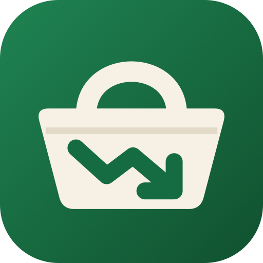
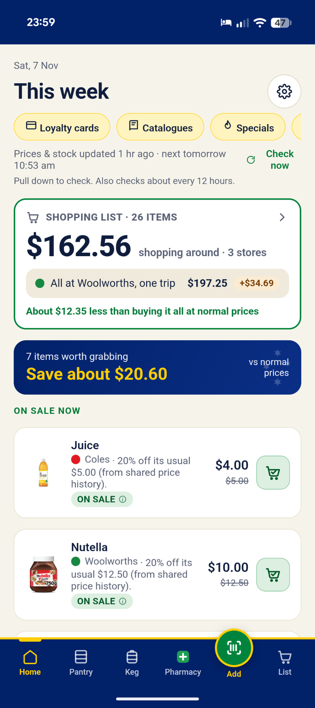
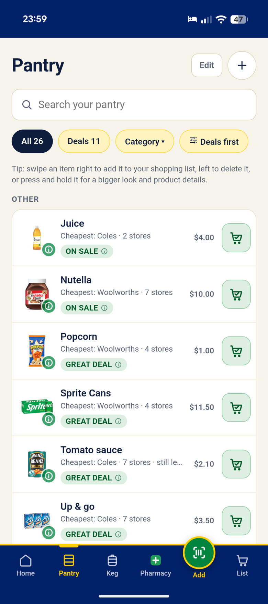
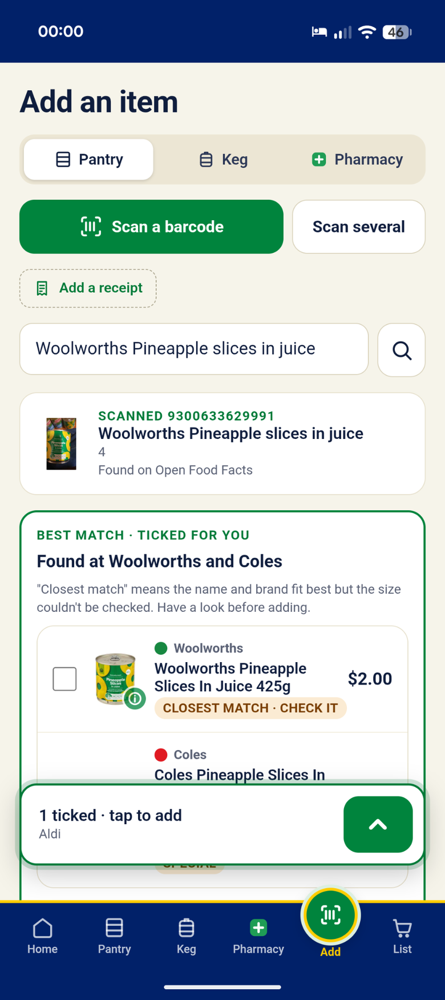
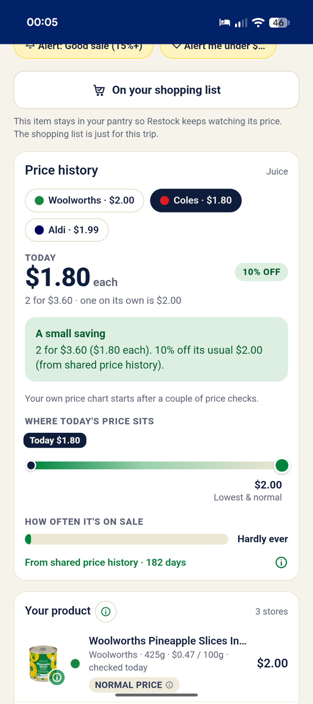
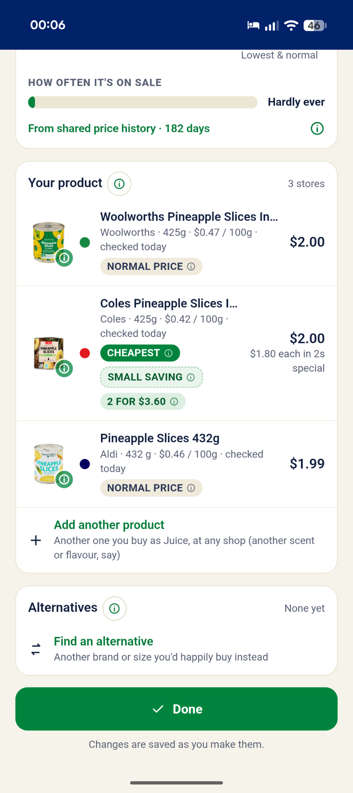
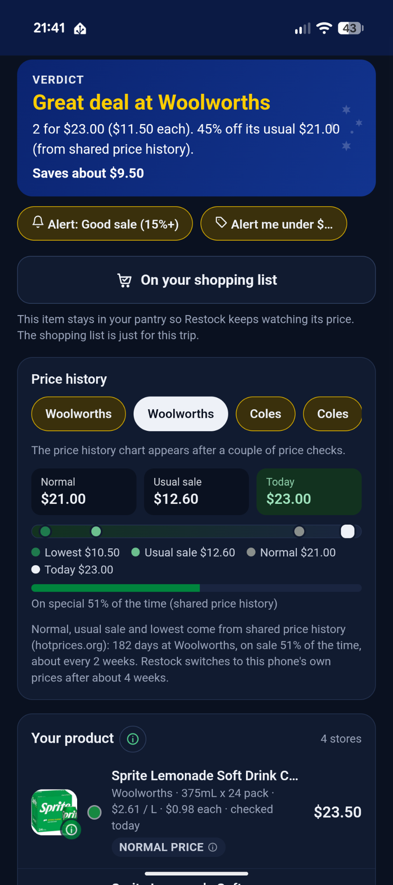

<p align="center">
  
</p>

<h1 align="center">Restock</h1>

<p align="center">
  <strong>Half price? Prove it.</strong><br>
  A free, open-source Android app that watches prices at the Australian supermarkets, bottle shops and pharmacies you choose,<br>
  and tells you when a special is real, when to wait, and when to swap.
</p>

<p align="center">
  
  
  
  
</p>

<p align="center">
  <a href="#get-it">Get it</a> ·
  <a href="#how-you-can-help">How you can help</a> ·
  <a href="BUILD.md">Build it</a> ·
  <a href="PRIVACY.md">Privacy</a> ·
  <a href="CONTRIBUTING.md">Contributing</a>
</p>

| | | |
|---|---|---|
|  |  |  |
|  |  |  |

## Why

A yellow ticket doesn't tell you whether the price is actually low. Restock keeps the price history of the things **you** buy, at the shops **you** use, and answers one question in plain words: *is this special worth it?*

It's made in Australia, for Australian shoppers. It's free, it always will be, and it doesn't collect anything about you.

## What it tells you

| Label | Means |
|---|---|
| **Great deal** | 30% or more below its normal price |
| **On sale** | 15% or more below its normal price |
| **Small saving** | Any drop below normal, even 5 cents |
| **Wait** | On sale, but it's been cheaper recently and usually comes back down |
| **Fake sale** | Marked as a special at its normal price |
| **Swap & save** | Something you'd happily buy instead is on sale and cheaper per 100 g, litre or item |

The **normal price** is the middle of the non-sale prices over the history you keep (8 weeks by default, up to 6 months). New items show a "still learning" note until there's about 4 weeks of history.

## Highlights

- **Your shops, your items.** Coles, Woolworths and Aldi, plus bottle shops (Keg tab, 18+) and pharmacies if you want them, and any other shop's website.
- **Scan to add.** An open-source barcode scanner built in, with Open Food Facts lookup. Restock finds the same product at each of your shops and ticks it for you.
- **Honest shopping list.** "If you only go to one store" compares the *same shopping* at each store, every item at the size you usually buy, so one bulk deal can't tip the result. Tap ⓘ to see the working.
- **Background price checks** on Android's own scheduler, with alerts only for the deals you care about, plus a weekly deals summary on catalogue day.
- **Specials** this week (Woolworths and Coles half price, Aldi Special Buys), filtered to things like what you buy.
- **Recall alerts.** Once a day Restock checks the official Australian recall lists (FSANZ, Product Safety Australia, TGA) against what you have.
- **Receipts** (optional). Scan, straighten and read receipts on the phone, and keep them as long as you choose.
- **Your own store's prices.** Sign in to Woolworths inside Restock (on Woolworths' own page; your password never reaches Restock), or give your Coles store number, and prices and stock are for your local shop.
- **Shopping mode** with big ticks, aisle groups, a running total and your loyalty card one tap away.
- **Widgets, shortcuts, share-to-list**, automatic backups, Australian green-and-gold or plain themes, and accessibility settings.

<details>
<summary><strong>Every feature, in detail</strong></summary>

- **Three tabs, kept apart**: **Pantry** for supermarkets, **Keg** for bottle shops and **Pharmacy** for pharmacies. Keg and Pharmacy only appear if you switch them on. Each tab has its own items, categories, list and shops, and a search only goes to that tab's shops. Keg asks once that you're 18 or over.
- **Bottle shops**: Dan Murphy's, BWS, Liquorland, Liquorland Warehouse, Liquorland Cellars, The Bottle-O, Cellarbrations, Thirsty Camel and Porters Liquor.
- **Pharmacies**: Chemist Warehouse, My Chemist, Amcal, Discount Drug Stores, Guardian / PharmaSave, Priceline Pharmacy, Soul Pattinson, TerryWhite Chemmart, Blooms The Chemist, Good Price Pharmacy, Pharmacy 4 Less, Direct Chemist Outlet, Star Discount Chemist, Capital Chemist, National Pharmacies and Chempro.
- **Any other shop**: add its website and Restock finds its search page and reads the products and prices, with Save and test to check it works.
- **Pantry**: each item is your product (linked at every store that sells it) plus alternatives you'd accept. Swipe to add to your list or delete (with undo).
- **Scanning**: zxing-cpp inside the app. Normal barcodes, GS1 QR codes, Data Matrix and DataBar, from the camera or a photo, or type the number. **Scan several** walks your cupboard and fills your shopping list. Unknown barcodes fall back to the supermarkets' own data, a generic search (an ingredient and strength for medicines) or reading the front of the pack.
- **Best match**: after a scan, the same product (brand, variant and size) is ticked at each shop. If the barcode only names the brand, you pick which one it is once and Restock ticks it everywhere and remembers.
- **Your store's prices and stock**: Woolworths shows your own store's prices and stock, and Restock can fill your Woolworths trolley, once you sign in to your Woolworths account inside Restock. You sign in on Woolworths' own page in Restock's built-in browser, so your password only ever goes to Woolworths; Restock just remembers that you're signed in and which store. For Coles, type your store number (and a second store's, if you like) in My shops. Without these, Restock shows online prices and leaves stock out, since online stock isn't reliable for your shop.
- **Hold to preview**: press and hold any product for a bigger photo, its full name, size, price, ingredients, allergens and nutrition.
- **Search**: all your stores at once, ranked by how well each result matches, unit prices worked out the same way everywhere, a best-value sort, "On special only", recent searches, and fixes for Aussie names (snags, loo paper).
- **Shopping list**: quantities, by shop or all together, Best value / Lowest price, one-store totals with a "why this one?", share as text, or send to the Coles or Woolworths app.
- **Price history**: a chart over 1 month to 6 months, where today's price sits against the lowest, usual sale and normal price, how often it's on special, sale-cycle detection, and multi-buys counted at their price each.
- **Alert me under $X** per item, and **stock-up tips** for things that rarely go on sale.
- **Near me**: find every supermarket, bottle shop or pharmacy nearby from OpenStreetMap and pick your branch.
- **Store health**: Home tells you if a store hasn't worked for a day, and Settings → Troubleshooting → Test connections shows what went wrong.
- **Diagnostics**: what went wrong lately, shop by shop, **Send search details** to capture exactly what a shop sent back, and a recording of what a shop's website does when you add something to its trolley yourself (sign-in and personal details left out), so connections can be fixed.
- **Receipts** (optional add-on): finds the receipt's edges, straightens it, makes it crisp black and white, and reads the shop, date and total with Tesseract on the phone. A one-off download of about 7 MB. Photos stay inside Restock, not in your gallery.
- **Recall alerts**: on by default, checked every 24 hours separately from price checks, matched against your Pantry, Keg, Pharmacy, list and kept receipts, with the official notice one tap away.
- **Loyalty cards**: member prices only count if you've added the card.
- **Catalogues**: a link to the catalogue of every shop you use.
- **Home screen widgets**: Deals, Shopping list and Quick actions, with your choice of background, transparency and text colour.
- **App icon shortcuts** (Scan, List, Receipt) and **Share to Restock** from any app.
- **Backups**: export and restore exactly the parts you pick, plus optional automatic backups into a folder you choose.
- **Look and colours**: Light, Dark or System; Australian or Plain; 24 accent colours; 16 app icon colours.
- **Accessibility**: bigger text, high contrast, less motion and bigger buttons, checked with an automatic accessibility audit.
- **Shared price history (testing)**: optionally download months of Coles and Woolworths history from [hotprices.org](https://hotprices.org) ([source](https://github.com/Javex/hotprices-au), MIT) so new items get a fair verdict from day one. Off by default.

</details>

## Private by design

- Everything lives in a database **on your phone**. No account, no ads, no analytics, no tracking.
- No Google Play services, Firebase or ML Kit, so it runs on de-Googled phones (GrapheneOS, CalyxOS, /e/OS).
- Every permission is optional and explained, and asked for only when a feature needs it.
- The app talks directly to the shops and a few open services (Open Food Facts, OpenStreetMap, the official recall lists, and jsDelivr once if you download the receipt reader). **Nothing goes to the people who make Restock.**

Read the full **[privacy policy](PRIVACY.md)** and the **[fine print](DISCLAIMER.md)**.

## Get it

**Download: [restock.apk](https://github.com/d-plenty/Restock/releases/latest/download/restock.apk)** (always the newest version), or pick a version from **[Releases](../../releases)**. Open it on your phone and allow the install. Android 8.0 or newer.

**Stay up to date:** add this repository to [Obtainium](https://github.com/ImranR98/Obtainium) and it'll tell you when a new version is out.

**Build it yourself:** see **[BUILD.md](BUILD.md)**. About 20 minutes the first time, on Linux, macOS or Windows.

F-Droid is planned once Restock is out of beta.

## How you can help

Restock is built by one person in their spare time. Prices, shops and websites are different all over Australia, so the most useful help is often just **trying it where you live and telling us what you find**.

| If you... | You can help by... |
|---|---|
| **Shop anywhere in Australia** | Using it for a couple of weeks and [reporting anything wrong](../../issues/new/choose). We especially want people in every state and territory, and in regional towns. |
| **Notice a shop isn't working** | Opening a [**Store stopped working**](../../issues/new?template=store-broken.yml) issue. In the app, Settings → Troubleshooting → Diagnostics → **Send search details** saves exactly what the shop sent back. Attach that file and it can usually be fixed fast. |
| **See the wrong product or price** | Opening a [**Wrong product or price**](../../issues/new?template=product-mismatch.yml) issue with the barcode and what the shelf says. |
| **Use a bottle shop or pharmacy** | Testing it! These connections are the newest and least tested. |
| **Write code** | Picking up an issue labelled [`good first issue`](../../labels/good%20first%20issue) or [`help wanted`](../../labels/help%20wanted). Shop connections, accessibility and the coming features below are all open. Start with [CONTRIBUTING.md](CONTRIBUTING.md). |
| **Have an idea** | Starting a thread in [Discussions → Ideas](../../discussions/categories/ideas). |
| **Like it** | Starring the repo and telling a mate. That's how a free app gets found. |

Please don't post anything private (loyalty card numbers, backup files, your address) in issues. Crop screenshots if you need to.

## What's next

- What you have at home, and "running low" suggestions
- A monthly spending summary
- Sync and household sharing, on a small Docker server you run yourself
- An iPhone version
- Home Assistant: your shopping list both ways
- F-Droid
- Opt-in shared prices, so new items arrive with months of history

Each one has its own page in the app under Settings → Coming soon.

## How it works

Restock is a [Capacitor](https://capacitorjs.com) app: React and TypeScript for the screens, SQLite on the phone for storage, and native Android (Java) for background price checks, recall checks, widgets and notifications. It reads each shop's own public website data from the phone, one request at a time, and only for the items people track.

```
src/
  lib/        database, the verdict engine, notifications, backups, receipts, recalls, barcode lookup
  stores/     the shop connections (Woolworths, Coles, Aldi, Endeavour, the general shop-website reader) and result ranking
  ui/         screens and components
  shops.ts    every shop, which tab it's on and how it's reached
android/app/src/main/java/family/plenty/restock/
              background checks, the SQLite bridge, recalls, widgets, and Java twins of the verdict and shop code
```

`npm test` runs the unit tests. The Java background code mirrors parts of the TypeScript (`Deals.java` ↔ `verdict.ts`, `StoreClient.java` ↔ `src/stores/`, `Shops.java` ↔ `shops.ts`), so change both together. More in [CONTRIBUTING.md](CONTRIBUTING.md).

Shops change their websites without notice, so connections break from time to time. That's normal, and exactly what the **Store stopped working** issue is for.

## Licence

Restock is free software under the **[GNU General Public License v3.0](LICENSE)**. You can use it, study it, change it and share it. If you share a changed version, it has to stay open source under the same licence, and you need to say what you changed.

The licence covers the code, not the name or logo. **If you publish your own version, please give it a different name and icon**, so nobody mistakes it for the official Restock.

## Fine print

Restock isn't connected with, endorsed by or paid by any supermarket, bottle shop, pharmacy or government agency. Prices can be wrong or out of date. Recall alerts are a helpful extra, not an official alert service. The app comes with no warranty. See [DISCLAIMER.md](DISCLAIMER.md).

## Thanks

[Open Food Facts](https://world.openfoodfacts.org) (product data, ODbL) ·
[OpenStreetMap](https://www.openstreetmap.org/copyright) contributors (shop locations, ODbL) ·
[zxing-cpp](https://github.com/zxing-cpp/zxing-cpp) (barcode scanning) ·
[Tesseract](https://github.com/tesseract-ocr/tesseract) and [tesseract.js](https://github.com/naptha/tesseract.js) (receipt reading) ·
[sql.js](https://github.com/sql-js/sql.js) ·
[Capacitor](https://capacitorjs.com) ·
[hotprices-au](https://github.com/Javex/hotprices-au) ·
Food Standards Australia New Zealand, Product Safety Australia and the TGA for publishing recalls openly.

<p align="center"><sub>Made in Australia, for Australian shoppers. A <strong>Plenty Technologies</strong> project.</sub></p>
