<p align="center">
  
</p>

<h1 align="center">Restock</h1>

<p align="center">
  <strong>Half price? Prove it.</strong><br>
  A free, open-source Android app that watches prices at the Australian supermarkets, bottle shops and pharmacies you choose,<br>
  and tells you when a special is real, when to wait, and when to swap.
</p>

<p align="center">
  
  
  
  
</p>

<p align="center">
  <a href="https://github.com/d-plenty/Restock/releases/latest/download/restock.apk"></a>
  <a href="https://d-plenty.github.io/Restock/"></a>
  <a href="https://apps.obtainium.imranr.dev/redirect?r=obtainium://add/https://github.com/d-plenty/Restock"></a>
</p>

<p align="center">
  <a href="#get-it">Get it</a> ·
  <a href="#questions">Questions</a> ·
  <a href="#how-you-can-help">How you can help</a> ·
  <a href="#wanted-someone-to-bring-restock-to-iphone">iPhone</a> ·
  <a href="BUILD.md">Build it</a> ·
  <a href="PRIVACY.md">Privacy</a> ·
  <a href="CONTRIBUTING.md">Contributing</a>
</p>

<p align="center">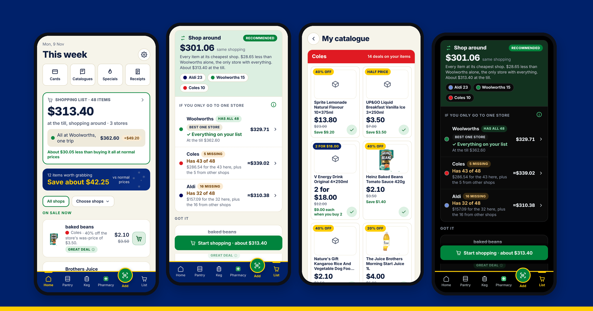</p>

| | | | |
|---|---|---|---|
| 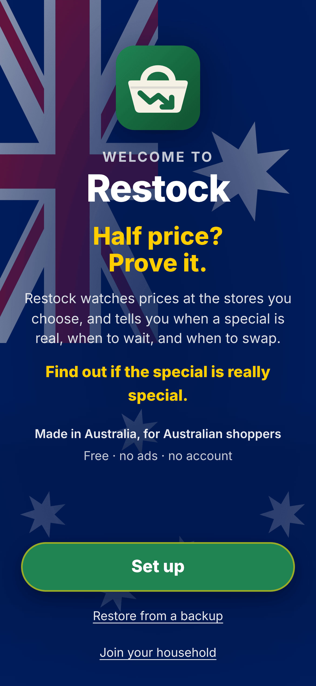 | 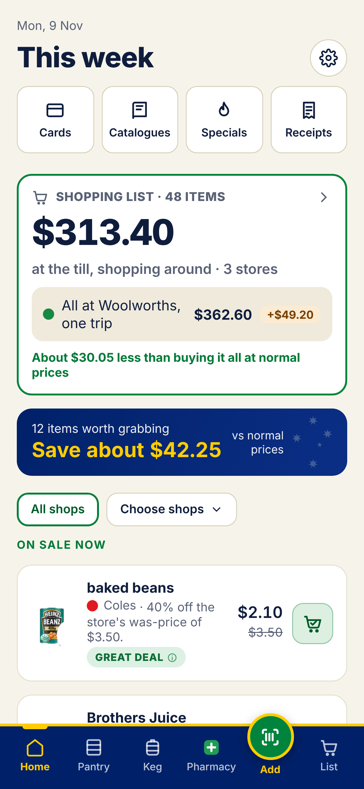 | 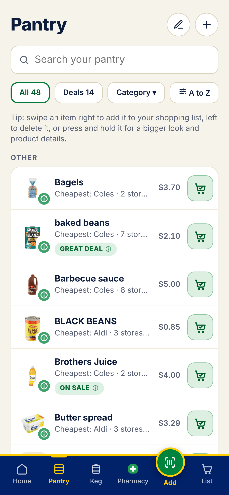 | 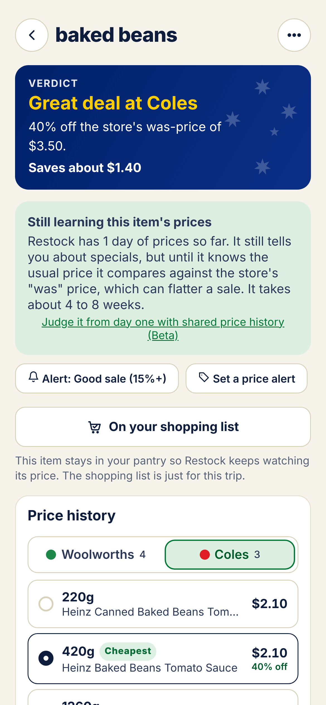 |
| 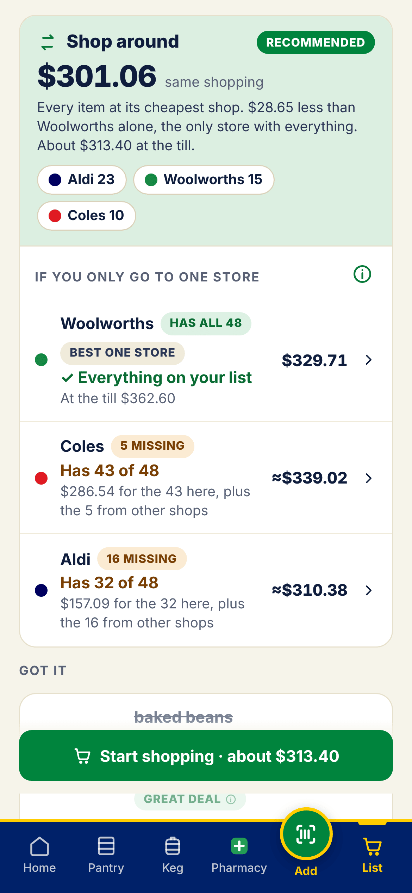 | 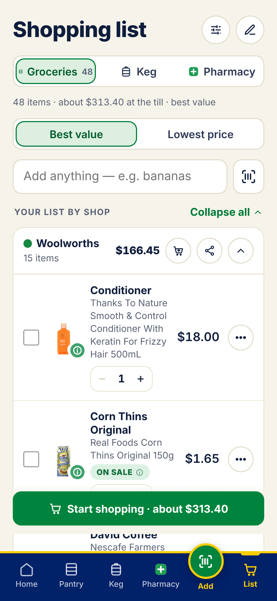 | 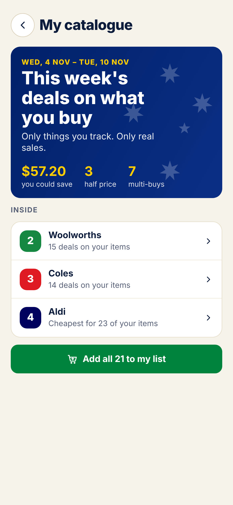 | 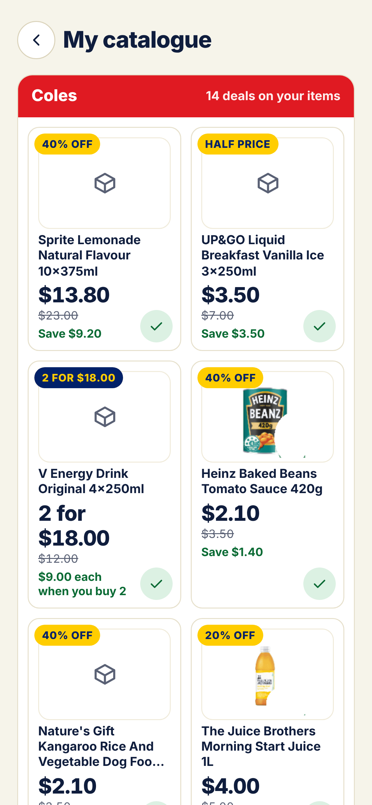 |
| 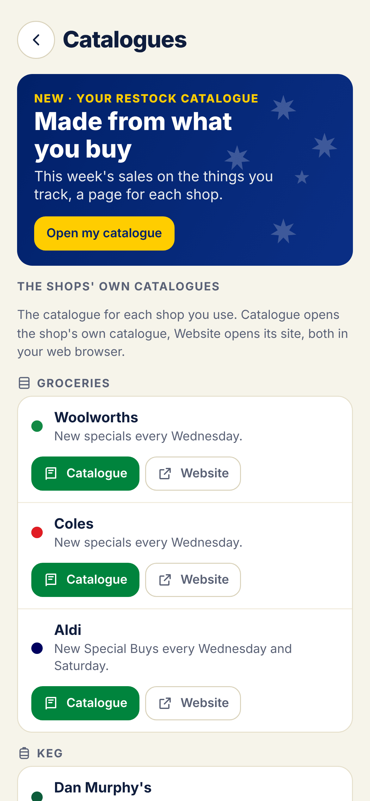 | 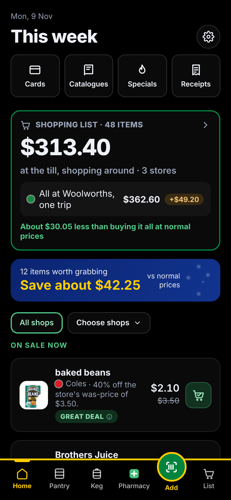 | 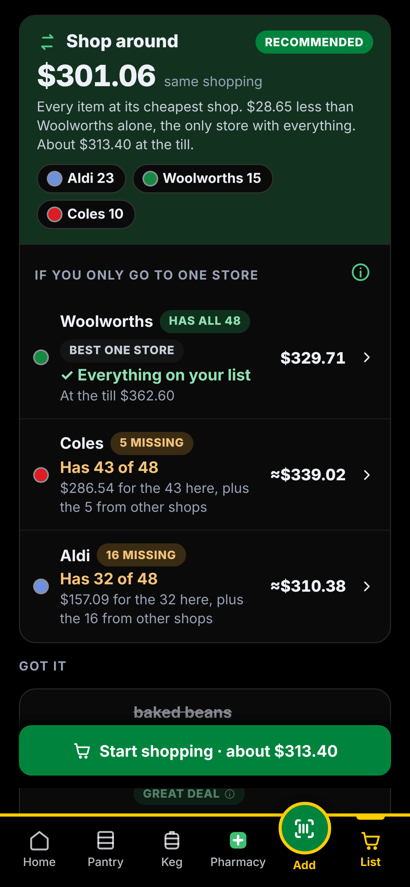 | 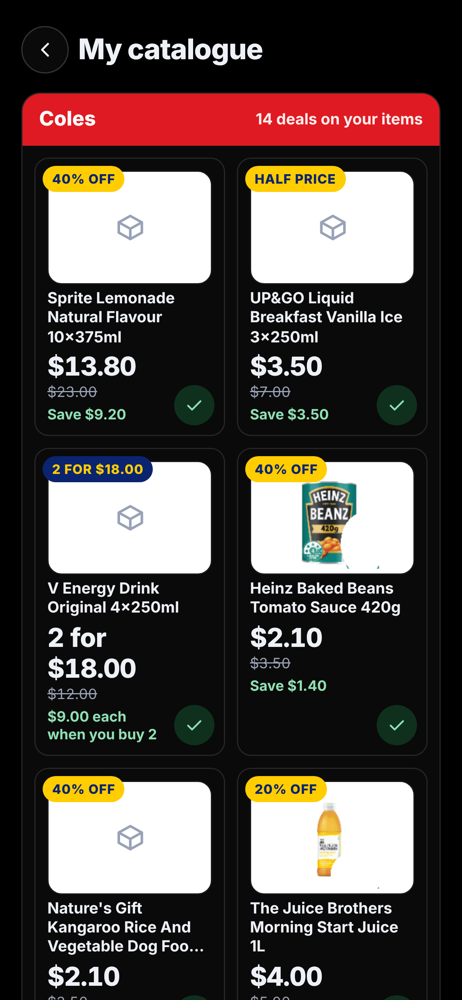 |

> **Local first. Works without signal.** Your list, pantry and prices live on your phone, not in a cloud. In a shopping centre with no reception, your list still opens instantly, and you can tick things off, add items from your pantry or type new ones. It all syncs when you're back online. Only searching the shops for new products and live prices needs the internet. A server is never required.

## Why

A yellow ticket doesn't tell you whether the price is actually low. Restock keeps the price history of the things **you** buy, at the shops **you** use, and answers one question in plain words: *is this special worth it?*

It's made in Australia, for Australian shoppers. It's free, it always will be, and it doesn't collect anything about you.

## What it tells you

| Label | Means |
|---|---|
| **Great deal** | 30% or more below its normal price |
| **On sale** | 15% or more below its normal price |
| **Small saving** | Any drop below normal, even 5 cents |
| **Wait** | On sale, but it's been cheaper recently and usually comes back down |
| **Fake sale** | Marked as a special at its normal price |
| **Swap & save** | Something you'd happily buy instead is on sale and cheaper per 100 g, litre or item |

The **normal price** is the middle of the non-sale prices over the history you keep (8 weeks by default, up to 6 months). New items show a "still learning" note until there's about 4 weeks of history.

## Highlights

- **Your shops, your items.** Coles, Woolworths and Aldi, plus bottle shops (Keg tab, 18+) and pharmacies if you want them, and any other shop's website.
- **Scan to add.** An open-source barcode scanner built in, with Open Food Facts lookup. Restock finds the same product at each of your shops and ticks it for you.
- **Your own Restock server** (optional). Run [Restock server](https://github.com/d-plenty/restock-server) on a NAS, mini PC or Raspberry Pi with one `docker run` command, or as an app in Home Assistant. **Your server is the house:** you name it, add phones from its web page, and each phone chooses what it shares (groceries always; Keg, Pharmacy, receipts and loyalty cards only if you say so). Removing a phone stops it syncing but keeps everything it shared. The server syncs around the clock, keeps your history for as long as you choose (3 to 12 months, or until you delete it), runs your Home Assistant shopping list, and gives you Restock on your computer, laid out for a big screen. It's your own server, so it can read your household's data to do this; traffic between phones and the server is encrypted, even on plain http at home.
- **Other sizes of this.** Tick a product and Restock shows the same thing in other packs (375mL cans × 10, × 24, × 30), compared per litre or per 100g, so a 10-pack on special doesn't slip past your usual 30-pack. Bottles and other container sizes only if you switch them on.
- **Local sync with your household.** Up to 6 phones in the same house share one pantry and shopping list, straight from one phone to another on your Wi-Fi. No account and no server. Away from home, phones can also sync through your Nextcloud, another WebDAV server (ownCloud, Synology, QNAP, TrueNAS and others) or a folder Syncthing keeps the same, sealed so only your phones can read it. The owner can also share kept receipts with the household. A recovery key lets another phone take over if the owner phone is lost. You pick what's shared: groceries, bottle shops (Keg) and pharmacy, each on or off, so a share house can share groceries and keep the rest separate. Tick something off and it's off everyone's list.
- **My catalogue.** A catalogue made only from the things you buy: a page for each shop with this week's sales on your items (40% OFF, HALF PRICE, 2 FOR $5), and for a shop with no sales, a page of what it's cheapest for. Add one or all of them to your list.
- **Shop around, or one store.** Your list puts each item at its cheapest shop and recommends shopping around, unless it saves less than your minimum (a dollar to start with, change it in Settings); then it recommends the one store that has everything.
- **Honest shopping list.** "If you only go to one store" compares the *same shopping* at each store, every item at the size you usually buy, so one bulk deal can't tip the result. Tap ⓘ to see the working.
- **Background price checks** on Android's own scheduler, with alerts only for the deals you care about, plus a weekly deals summary on catalogue day.
- **Specials** this week (Woolworths and Coles half price, Aldi Special Buys), filtered to things like what you buy.
- **Recall alerts.** Once a day Restock checks the official Australian recall lists (FSANZ, Product Safety Australia, TGA) against what you have.
- **Receipts** (optional). Scan, straighten and read receipts on the phone, keep them as long as you choose, and share them with your household if you like.
- **Your own store's prices.** Sign in to Woolworths inside Restock (on Woolworths' own page; your password never reaches Restock), or choose your Coles store (Restock picks up its store number from Coles' store finder by itself), and prices and stock are for your local shop.
- **Shopping mode** with big ticks, aisle groups, a running total, your loyalty card one tap away, and ⓘ on every item to see what it looks like on the shelf.
- **Widgets, shortcuts, share-to-list**, automatic backups, Australian green-and-gold or plain themes, and accessibility settings.
- **Updates your way.** Restock can update itself from GitHub, or get it through F-Droid (Restock's own repo) or Obtainium.
- **Works without Google.** No Google Play services, so it runs on GrapheneOS, CalyxOS, /e/OS and other de-Googled phones.

<details>
<summary><strong>Every feature, in detail</strong></summary>

- **Three tabs, kept apart**: **Pantry** for supermarkets, **Keg** for bottle shops and **Pharmacy** for pharmacies. Keg and Pharmacy only appear if you switch them on. Each tab has its own items, categories, list and shops, and a search only goes to that tab's shops. Keg asks once that you're 18 or over.
- **Bottle shops**: Dan Murphy's, BWS, Liquorland, Liquorland Warehouse, Liquorland Cellars, The Bottle-O, Cellarbrations, Thirsty Camel and Porters Liquor. Beers say whether they're a single, a 6 pack or a case.
- **Pharmacies**: Chemist Warehouse, My Chemist (with Chemist Warehouse's prices), Amcal, Discount Drug Stores, Guardian / PharmaSave, Priceline Pharmacy, Soul Pattinson, TerryWhite Chemmart, Blooms The Chemist, Good Price Pharmacy, Pharmacy 4 Less, Direct Chemist Outlet, Star Discount Chemist, Capital Chemist, National Pharmacies and Chempro.
- **Any other shop**: add its website and Restock finds its search page and reads the products and prices, with Save and test to check it works.
- **Pantry**: each item has My picks (what you buy at each shop, which can differ shop to shop) and Would also take (others you'd buy when they're cheaper, for Swap & save), on This size or Any size, and shops marked Not at this shop. Listed by shop then size, cheapest first, or A to Z. Swipe to add to your list or delete (with undo).
- **Scanning**: zxing-cpp inside the app. Normal barcodes, GS1 QR codes, Data Matrix and DataBar, from the camera or a photo, or type the number. **Scan several** walks your cupboard and fills your shopping list. Unknown barcodes fall back to the supermarkets' own data, a generic search (an ingredient and strength for medicines) or reading the front of the pack.
- **Picked for you**: tick a product from a search and Restock searches your other shops again for the same product, or the ones most like it in kind, size and price, ready to tick.
- **Best match**: after a scan, the same product (brand, variant and size) is ticked at each shop. If the barcode only names the brand, you pick which one it is once and Restock ticks it everywhere and remembers.
- **Your store's prices and stock**: Woolworths shows your own store's prices and stock, and Restock can fill your Woolworths trolley, once you sign in to your Woolworths account inside Restock. You sign in on Woolworths' own page in Restock's built-in browser, so your password only ever goes to Woolworths; Restock just remembers that you're signed in and which store. For Coles, tap Choose your Coles store in My shops and tap your store in Coles' own store finder; Restock picks up its store number by itself (you can add a second store for its stock, or type the number by hand). Without these, Restock shows online prices and leaves stock out, since online stock isn't reliable for your shop.
- **Hold to preview**: press and hold any product for a bigger photo, its full name, size, price, ingredients, allergens and nutrition.
- **Search**: all your stores at once, ranked by what you most likely mean: type "butter" and butter comes first, with peanut butter, butter chicken sauce and butter-flavoured popcorn further down; children's medicines only when you ask for them. Slower shops show a loading bar. Unit prices worked out the same way everywhere, a best-value sort, "On special only", recent searches, and fixes for Aussie names (snags, loo paper).
- **Shopping list**: Shop around first, with its stops and what it saves, then "If you only go to one store" with HAS ALL or N MISSING for each, and what the missing ones would cost elsewhere. Shops fold up, with Expand all. Quantities, by shop or all together, A to Z, Best value / Lowest price, one-store totals with a "why this one?", share as text, or send to the Coles or Woolworths app. Type in the list and your pantry items come up first; or add a plain name, or **Find cheapest** to search the shops for a one-off buy without adding it to your pantry.
- **Price history**: a tab for each shop (always in the same order), then that shop's products smallest first, so you always know which one you're looking at. A chart over 1 month to 6 months, where today's price sits against the lowest, usual sale and normal price, how often it's on special and when the next sale is likely, and multi-buys counted at their price each.
- **This week**: deals, small savings and "wait for a better sale" for all your shops, or one shop at a time.
- **Alert me under $X** per item, and **stock-up tips** for things that rarely go on sale.
- **Near me**: find every supermarket, bottle shop or pharmacy nearby from OpenStreetMap and pick your branch.
- **Store health**: Home tells you if a store hasn't worked for a day, and Settings → Troubleshooting → Test connections shows what went wrong.
- **Diagnostics**: what went wrong lately, shop by shop, **Send search details** to capture exactly what a shop sent back, and a recording of what a shop's website does when you add something to its trolley yourself (sign-in and personal details left out), so connections can be fixed.
- **Receipts** (optional): finds the receipt's edges, straightens it, makes it crisp black and white, and reads the shop, date and total with Tesseract on the phone. The reader is built in and works offline. Photos stay inside Restock, not in your gallery.
- **Recall alerts**: on by default, checked every 24 hours separately from price checks, matched against your Pantry, Keg, Pharmacy, list and kept receipts, with the official notice one tap away.
- **Loyalty cards**: member prices only count if you've added the card.
- **My catalogue**: this week's deals on your items, a page per shop, Wednesday to Tuesday, with what you could save, half prices and multi-buys on the cover.
- **Catalogues**: a link to the catalogue of every shop you use.
- **Home screen widgets**: Deals, Shopping list and Quick actions, with your choice of background, transparency and text colour.
- **App icon shortcuts** (Scan, List, Receipt) and **Share to Restock** from any app.
- **Local sync**: up to 6 phones in a household pair by scanning a one-time QR code from the owner phone (it works once, for 10 minutes, and never contains the household's key), then sync straight to each other whenever they're on the same Wi-Fi: when you open Restock, shortly after a change, and every 15 minutes or so in the background. Pantry, list (ticks too), prices, categories and alerts, plus loyalty cards if you choose. The owner picks what the household shares (groceries, Keg, Pharmacy) and each phone picks what it takes; a phone joining after setup gets the household's shops and settings for those, and is asked if they're 18 or over before Keg. Encrypted with a key only your phones have; no server and no account. If both phones change the same thing, the later change wins, except that a tick and a new amount on the same line both survive, and deleting something beats an edit made without knowing about it. **Sync away from home** (optional): sign in to Nextcloud, use another WebDAV server, or pick the same folder on each phone (one Syncthing keeps in sync); each phone leaves its changes there sealed with the household's key and picks up the others', prices and photos aside. **Receipts** (optional, set by the owner phone): kept receipts go to every phone, photos over the Wi-Fi only. **Recovery key**: the owner phone shows a key to save; if it's ever lost, another phone takes over as owner with it. The owner phone adds and removes phones (removing one changes the household's key) and can hand ownership to another phone. Pull down on Home, Pantry, Keg, Pharmacy or the list to sync; Check now on Home also checks prices.
- **Start fresh, restore, or join your household** on the first screen; **Erase everything and start fresh** at the bottom of Settings (it asks twice).
- **Setup tiles for everything**: sync, price checks, notifications, loyalty cards and shop accounts, widgets, updates and your household name, as well as shops, permissions, look, backups and the rest. Skip any of them.
- **Sync and backups in one place**: your household on top, a strip that says whether everything is kept somewhere else (phone sync, a folder backup or your Restock server all count), then Wi-Fi, away from home and the Restock server, then backups.
- **Backups**: export and restore exactly the parts you pick, plus optional automatic backups into a folder you choose. Lock any backup with a password (encrypted on the phone). Restock also keeps a copy from just before each update, so an update can be undone.
- **Spreadsheets**: export your pantry, shopping list and price history as CSV files for Excel, Google Sheets, LibreOffice or Numbers.
- **Look and colours**: Light, Dark or System, with true black for OLED screens; Australian or Plain; 24 accent colours; 16 app icon colours.
- **Accessibility**: bigger text, high contrast, less motion and bigger buttons, checked with an automatic accessibility audit.
- **Updates**: Settings → About and updates → Check for updates, or turn on **Tell me when there's an update** to check every 24 hours (or every 7 days, if you'd rather) when you open Restock. Android shows its own Install screen, and Restock tries again if GitHub is busy. Or install through [Restock's F-Droid repo](https://d-plenty.github.io/Restock/) or Obtainium and let them handle updates.
- **Sharing prices**: product prices (shop, name, size, barcode and the prices on each day) are kept ready in your backups for a future shared, decentralised price network. Nothing is sent anywhere yet, nothing about you is ever included, and the data will never be sold. Turn it off in Settings → Shared prices.
- **Shared price history (Beta)**: optionally download months of Coles and Woolworths history from [hotprices.org](https://hotprices.org) ([source](https://github.com/Javex/hotprices-au), MIT) so new items get a fair verdict from day one. Off by default.

</details>

## Private by design

- Everything lives in a database **on your phone**, and works offline. No account, no ads, no analytics, no tracking.
- If you run your own Restock server, it holds your household's data (what each phone chooses to share) so it can work around the clock. It's yours, at home; keep its data folder private. Card numbers and shop sign-ins stay on your phones unless you choose to share cards.
- No Google Play services, Firebase or ML Kit, so it runs on de-Googled phones (GrapheneOS, CalyxOS, /e/OS).
- Every permission is optional and explained, and asked for only when a feature needs it.
- The app talks directly to the shops and a few open services (Open Food Facts, OpenStreetMap, the official recall lists, and GitHub if you check for updates), and to your own Home Assistant if you connect it. **Nothing goes to the people who make Restock.**
- **Erase everything** (at the bottom of Settings) deletes your data, signs you out of the shops inside Restock and clears what the app saved, files it shared included. Backups can be locked with a password.

Read the full **[privacy policy](PRIVACY.md)** and the **[fine print](DISCLAIMER.md)**.

## Get it

Android 8.0 or newer, including de-Googled phones. Pick one:

- **Download the APK:** **[restock.apk](https://github.com/d-plenty/Restock/releases/latest/download/restock.apk)** is always the newest version, or pick one from **[Releases](../../releases)**. Open it on your phone and allow the install. Restock can then update itself: **Settings → About and updates → Check for updates** (or turn on *Tell me when there's an update*).
- **F-Droid (Restock repo):** open **[d-plenty.github.io/Restock](https://d-plenty.github.io/Restock/)** on your phone and tap *Add to F-Droid*, or scan its QR code in F-Droid → Settings → Repositories. Then install Restock from F-Droid and it keeps it up to date. Works with F-Droid, Droid-ify and Neo Store.
- **Obtainium:** tap the Obtainium badge at the top on your phone, or add `https://github.com/d-plenty/Restock` in [Obtainium](https://github.com/ImranR98/Obtainium).

<p>
  <a href="https://d-plenty.github.io/Restock/"></a>
  <a href="https://apps.obtainium.imranr.dev/redirect?r=obtainium://add/https://github.com/d-plenty/Restock"></a>
</p>

All three are the same APK, signed with the same key, so you can switch between them and updates install over the top. Nothing is lost.

**Check your download (optional):** each release lists the APK's SHA-256 checksum. On Linux or macOS, `sha256sum restock-0.x.y.apk` (macOS: `shasum -a 256`) should print the same.

**Moving to a new phone?** Settings → Sync and backups → Export a backup on the old phone, then **Restore from a backup** on the new phone's first screen. If your household uses local sync, the new phone can simply **Join your household** instead.

**Build it yourself:** see **[BUILD.md](BUILD.md)**. About 20 minutes the first time, on Linux, macOS or Windows.

## Questions

<details>
<summary><strong>Is it on Google Play or the App Store?</strong></summary>

Not at the moment. Android phones can install it from [GitHub](https://github.com/d-plenty/Restock/releases/latest/download/restock.apk), [Restock's F-Droid repo](https://d-plenty.github.io/Restock/) or Obtainium (see [Get it](#get-it)). It's on its way to the main F-Droid repository. An iPhone version needs someone with an Apple developer account: see [Wanted](#wanted-someone-to-bring-restock-to-iphone).
</details>

<details>
<summary><strong>Is it really free? What's the catch?</strong></summary>

No catch. No ads, no account, no subscription, no data collection, nothing to sell. It's [open source (GPL-3.0)](LICENSE), so anyone can read the code and check.
</details>

<details>
<summary><strong>Is installing an APK safe?</strong></summary>

Android asks you to allow installs from your browser or file app the first time; that's normal for any app outside Google Play. Every official release is built from this code and signed with Restock's own key, so Android only installs updates that come from the same place. Each release lists the APK's checksum so you can check the file you downloaded.
</details>

<details>
<summary><strong>Which shops does it work with?</strong></summary>

Coles, Woolworths and Aldi; bottle shops (Dan Murphy's, BWS, Liquorland, The Bottle-O, Cellarbrations, Thirsty Camel, Porters and more); pharmacies (Chemist Warehouse, Priceline, TerryWhite Chemmart, Amcal and many more); and any other shop's website you add. The full list is under [Every feature, in detail](#highlights). It's made for Australian shops.
</details>

<details>
<summary><strong>How does it get prices if there's no server?</strong></summary>

Your phone asks each shop's own website, the same way you would by visiting it, one item at a time with a pause in between, and only for the things you track. Nothing goes through Restock's makers. See [Private by design](#private-by-design).
</details>

<details>
<summary><strong>Can my partner and I share one list?</strong></summary>

Yes, with **local sync**: up to 6 phones share one pantry and shopping list, straight from phone to phone on your home Wi-Fi. No account and no server. Start a household on one phone (Settings → Sync and backups → **Start a household**), pick what it shares (groceries, Keg, Pharmacy), and scan its one-time code with the others. Each phone can take all of it or just some, like groceries only. Changes made away from home catch up when you're both back on the Wi-Fi, or straight away through your Nextcloud, another WebDAV server or a Syncthing folder if you set one up. Or run your own [Restock server](https://github.com/d-plenty/restock-server): phones sync through it from anywhere, and you can use Restock in a browser.
</details>

<details>
<summary><strong>The phones won't find each other</strong></summary>

Both need to be on the same Wi-Fi at the same time, with Restock allowed to find devices on the network. Guest networks and some routers stop devices seeing each other ("client isolation" or "AP isolation"); turn that off or use your main network. If Android is strict about battery, let Restock run in the background when it asks. Still stuck? [Open an issue](../../issues/new/choose).
</details>

<details>
<summary><strong>Will it drain my battery or data?</strong></summary>

Not noticeably. Background price checks run on Android's own scheduler, only when there's a connection and the battery isn't low, and only for the items you track. You choose how often, or turn them off. Shared price history, if you turn it on, downloads roughly 10 to 40 MB a week, on Wi-Fi only unless you change that.
</details>

<details>
<summary><strong>A price is wrong, or a shop stopped working</strong></summary>

Shops change their websites without warning, so connections break now and then. Open a [**Store stopped working**](../../issues/new?template=store-broken.yml) or [**Wrong product or price**](../../issues/new?template=product-mismatch.yml) issue. Settings → Troubleshooting → Diagnostics → **Send search details** makes a file that usually lets it be fixed fast.
</details>

<details>
<summary><strong>How do I keep my data safe?</strong></summary>

Everything lives on your phone, so keep a copy somewhere else. Any of these counts, and you can use one, two or all of them:

1. **Phone-to-phone sync:** the other phones in your household hold a copy. Works offline, with no server.
2. **Automatic backups into a folder:** a folder on the phone, or one that Nextcloud, Syncthing or a drive app keeps in the cloud.
3. **Your own Restock server in Docker,** on a Raspberry Pi, mini PC or NAS: [step-by-step guides for each](https://github.com/d-plenty/restock-server#which-machine).
4. **The same Restock server as a Home Assistant app,** if you run Home Assistant OS and don't have Docker: [how to install it](https://github.com/d-plenty/restock-server#as-a-home-assistant-app-no-docker-needed).

Settings → **Sync and backups** shows at a glance whether everything is kept somewhere else, and names anything that needs you. With only sync or a server, Restock suggests a backup on the phone as well: sync copies mistakes to every phone, and a server can be down when you need it. Even weekly backups kept for 4 weeks (one tap: **Back up weekly, keep 4**) cover that. You can also **Export a backup** any time. Backups can include loyalty card numbers, so keep them private. Uninstalling Restock deletes its data.
</details>

## Home Assistant

Your groceries list in [Home Assistant](https://www.home-assistant.io), both ways: add, tick or take something off in Restock and Home Assistant's list changes too, and the other way round. Say *"Okay Nabu, add milk to my shopping list"* and milk is on your Restock list.

1. In Home Assistant, open your profile (your name, bottom left) → **Security** → **Long-lived access tokens** → **Create token**. Call it Restock and copy it.
2. In Restock, go to **Settings → Home Assistant**. Type the address you open Home Assistant with (`http://homeassistant.local:8123`, its IP address like `http://192.168.1.50:8123`, your Nabu Casa `https://….ui.nabu.casa` address or a Tailscale one), paste the token and tap **Test connection**.
3. Pick the list (`todo.shopping_list` unless you use another) and turn on **Sync with Home Assistant**.

Good to know:

- **One phone per household.** Only one phone in a household syncs with Home Assistant, so nothing gets added twice; your other phones get the changes through your household's sync. Turning it on on another phone asks *"Home Assistant syncs through Alex's phone. Move it to this phone?"*, and the old one stops by itself (it keeps its token, so you can move it back with **Move it here**). On the web, Settings → Phones shows which phone does it.
- **Voice adds:** if what you said is clearly one of your pantry items, it's added as that item, with its price and cheapest shop. If not (or if it could be more than one), it's added as the words, with a **Pick my milk** button on every phone and on the web: pick the item, and tick *Always use this for "milk"* to have it match straight away next time, for the whole household. Or keep it as just "milk".
- **If Home Assistant's list comes back empty** (while Home Assistant is starting up, say), Restock changes nothing and looks again. Only if it's still empty a couple of minutes later does it take those lines off your Restock list too.
- **With a Restock server,** Home Assistant is set up on the server's web page instead, and runs around the clock for everyone on the server ("Every phone and browser on this server shares this Home Assistant shopping list"). Phones on a server don't run their own.
- **Without a server,** one phone syncs with Home Assistant ("This isn't server-wide: it's just this phone and the phones paired with it"), in the background as well as while Restock is open.
- **Needs Home Assistant 2024.8 or newer**, with a to-do list such as the Shopping list integration. Only the groceries list syncs, not Keg or Pharmacy.
- **Private:** without a server, the phone talks straight to your Home Assistant. Only the list's lines and ticks go there. The token stays on that phone, sealed, and is never shown again, synced or put in a backup. Plain `http://` only works for a Home Assistant at home or on Tailscale; anywhere else use `https://`.

## How you can help

Restock is built by one person in their spare time. Prices, shops and websites are different all over Australia, so the most useful help is often just **trying it where you live and telling us what you find**.

| If you... | You can help by... |
|---|---|
| **Shop anywhere in Australia** | Using it for a couple of weeks and [reporting anything wrong](../../issues/new/choose). We especially want people in every state and territory, and in regional towns. |
| **Notice a shop isn't working** | Opening a [**Store stopped working**](../../issues/new?template=store-broken.yml) issue. In the app, Settings → Troubleshooting → Diagnostics → **Send search details** saves exactly what the shop sent back. Attach that file and it can usually be fixed fast. |
| **See the wrong product or price** | Opening a [**Wrong product or price**](../../issues/new?template=product-mismatch.yml) issue with the barcode and what the shelf says. |
| **Use a bottle shop or pharmacy** | Testing it! These connections are the newest and least tested. |
| **Have a computer** | Running the [search test tools](tools/README.md): they search every shop from your computer and save what came back, so searches can be checked and fixed against real results. |
| **Know your way around Apple** | Bringing Restock to iPhone and the App Store. See [Wanted: someone to bring Restock to iPhone](#wanted-someone-to-bring-restock-to-iphone). |
| **Write code** | Picking up an issue labelled [`good first issue`](../../labels/good%20first%20issue) or [`help wanted`](../../labels/help%20wanted). Shop connections, accessibility and the coming features below are all open. Start with [CONTRIBUTING.md](CONTRIBUTING.md). |
| **Have an idea** | Starting a thread in [Discussions → Ideas](../../discussions/categories/ideas). |
| **Like it** | Starring the repo and telling a mate. That's how a free app gets found. |

Please don't post anything private (loyalty card numbers, backup files, your address) in issues. Crop screenshots if you need to.

## Wanted: someone to bring Restock to iPhone

I'd love Restock on iPhone too, so households with both kinds of phone can share a pantry and list. I'm looking for a developer who knows their way around the Apple side and is willing to build it and put it on the App Store.

Why I'm asking: publishing on the App Store means paying Apple every year for a developer account, and beta testing means getting everyone onto TestFlight. As one person doing this for free, I'm not keen to take that on myself. If you already have an Apple developer account (or are happy to), this could be a good fit.

**What's there already:** Restock is a [Capacitor](https://capacitorjs.com) app, so the screens, database, shop connections and verdicts are shared TypeScript that mostly runs on iPhone as it is. What needs iPhone versions of their own is the Android-only native side: background price checks, notifications, widgets, local sync between phones, and the barcode scanner.

**What I'll do:** help with the code, explain how everything fits together, test, and keep the shared parts working on both. It stays free, open source, with no ads, no account and no tracking, and we'd sort out the details (name, licence wording for the App Store, who publishes it) together.

Interested? Say hello in [Discussions](../../discussions) or on the [iPhone issue](../../issues?q=is%3Aissue+label%3Aios).

## Roadmap

Restock is in its **release candidate** stage. There are no dates and no version numbers for what's next: each feature comes out when it's ready, and fixes come out in small updates in between, as soon as they're done. Found something? [Report a problem](../../issues/new/choose).

**✅ Out now**
- **Your own Restock server, as the house:** name it, add phones from its web page, and each phone chooses what it shares. It syncs around the clock, keeps your history as long as you choose, runs Home Assistant for everyone, and gives you Restock on your computer, including this week's specials your phones found ([Restock server](https://github.com/d-plenty/restock-server)).
- **Simpler sync settings:** your server first, then phones on your Wi-Fi, then a cloud drive folder, with a status strip that only shows what you use.
- **Household-wide settings:** shops, Shop around, alert levels and recall alerts are set once for the whole household, on any phone or the web, and every phone follows. Each phone keeps its own branch.
- **Restock on a big screen:** the server's web app has a desktop layout, with Settings split into Household and Phones.
- **Your cloud drive:** sync through Nextcloud, WebDAV for your own NAS, or a folder you choose. Receipts sync too.
- **My catalogue, Shop around**, a household recovery key, backup passwords, 12 months of price history, and a full security and privacy review.
- **Your shopping list in Home Assistant, both ways** (add by voice with Assist). See [Home Assistant](#home-assistant).

**🛠️ Still to come before 1.0** (in no particular order)
- **Restock on iPhone, through your server:** add the server's page to your iPhone's home screen and use your list and pantry like an app, offline in the shop too.
- **Permission from the price-history sources,** and a final read-through of the privacy policy.
- **Polish:** the last fixes and adjustments testers ask for.

**🏁 1.0: The official release**

| | GitHub and Obtainium | F-Droid |
|---|---|---|
| Where to get it | [Releases](../../releases), or add it to [Obtainium](https://github.com/ImranR98/Obtainium) | The F-Droid app |
| Updates | Built into the app | Through F-Droid |

Both are built from the same open-source code. *Still an idea:* optional add-ons you choose to download. If they happen, they'll probably come with the GitHub version only, to fit F-Droid's rules.

**After 1.0**
Everything else under [Coming soon](#coming-soon): what you have at home, a spending summary, free shared prices for everyone, Google Drive and other big-name drives if people want them, and an iPhone version.

Restock stays focused on saving money on what you buy. Bigger ideas, like full budgeting, will be separate apps that work with it.

## Coming soon

These are planned, and each already has its own page in the app under **Settings → Coming soon**. None of them are switched on yet. Want one sooner, or have a better idea? Say so in [Discussions → Ideas](../../discussions/categories/ideas).

### What you have at home
Tell Restock roughly how much of something you've got (a full bottle, two left, nearly out) and it keeps track as you buy and use things. It learns how fast you get through each one, so it can put things on your shopping list before you run out, and time it with a good price: *"You're nearly out of coffee, and it's half price at Coles this week."* Scanning a receipt or ticking things off in the shop tops your stock back up.

### Spending summary
A simple month-by-month look at what you spent at each shop (from your kept receipts) and what Restock's deals saved you. It stays on your phone like everything else. Full budgeting is planned as a separate app that works with Restock, so this stays light.

### iPhone version
The same Restock on iOS, so a household with both kinds of phone can share a pantry and list. This needs a developer with an Apple developer account: see [Wanted: someone to bring Restock to iPhone](#wanted-someone-to-bring-restock-to-iphone).

### Shared prices, free for everyone
Every price a phone sees can help everyone else. With shared prices, a new item arrives with months of history, so you know straight away whether its "special" is real. Restock will run a **free public price website** that anyone can browse and that every Restock phone can download history from, with no account and no ads.

The plan is a **decentralised** network: phones running Restock share product prices with each other, rather than with one central company. The prices will never be sold.

For now, **nothing leaves your phone**. Since 0.9.0, Restock keeps a "shared prices" part in your backups, ready for when sharing starts: each product's shop, name, size and barcode, and its prices by day ("was" price, special, member price). It's on unless you turn it off in Settings → Shared prices, and before Restock ever sends anything it will tell you, and you can say no.

It **never** includes who you are, your loyalty cards, your branch or location, what you searched for, your shopping list or what you ticked off, or your receipts. The products are ones people track, but nothing links them to a person. There's no account and no phone ID. Restock will ask the shops and data sources for permission before this goes live.

### F-Droid
Restock in the main [F-Droid](https://f-droid.org) repository, built by F-Droid from the source. Until then, [Restock's own F-Droid repo](https://d-plenty.github.io/Restock/) has every release.

## How it works

Restock is a [Capacitor](https://capacitorjs.com) app: React and TypeScript for the screens, SQLite on the phone for storage, and native Android (Java) for background price checks, recall checks, widgets and notifications. It reads each shop's own public website data from the phone, one request at a time, and only for the items people track.

```
src/
  lib/        database, the verdict engine, notifications, backups, receipts, recalls, barcode lookup
  stores/     the shop connections (Woolworths, Coles, Aldi, Endeavour, the general shop-website reader) and result ranking
  ui/         screens and components
  shops.ts    every shop, which tab it's on and how it's reached
android/app/src/main/java/family/plenty/restock/
              background checks, the SQLite bridge, recalls, widgets, local sync (Sync*.java),
              and Java twins of the verdict and shop code
tools/        search test tools for a computer (see tools/README.md)
docs/         screenshots, the F-Droid recipe, the release guide
```

**Local sync**, briefly: every change to a synced table is logged in the phone's database with a time and the phone it came from. Phones find each other on the Wi-Fi with Android's network service discovery (under a random name and a tag that changes every day, so a phone can't be followed from place to place), swap whatever the other hasn't seen over a direct connection encrypted with AES-256-GCM, and the later change wins; ticks and amounts are merged separately, and a delete wins over an edit that didn't know about it. The household key is made on the owner phone and handed over only through a one-time, 10-minute pairing code, with a fresh key exchange (ECDH) so even someone who saw the code can't read the hand-over; removing a phone changes the key. Changes only the owner may make (who's in the household, what it shares, who owns it) are signed by the owner phone, and each phone checks the signature. Folder and WebDAV sync use the same sealed format, one file per phone, through Restock's own small WebDAV client (https only, except for servers at home or on Tailscale); a Nextcloud sign-in uses Nextcloud's Login Flow v2, so Restock gets an app password of its own. The household's keys, secrets and any drive password are sealed with a key in Android's Keystore. Phones only listen for each other on Wi-Fi or Ethernet, and old deletes are tidied from the sync log after 90 days once every phone has seen them. `tools/sync-test` runs whole households of phones through the real Java code.

**Restock server**, briefly: a small Node server ([d-plenty/restock-server](https://github.com/d-plenty/restock-server)) that owns the household. Phones and browsers still exchange the same sealed one-file-per-device format as folder sync, so traffic is encrypted even over plain http; each phone joins with a one-time code and signs every request with its own ECDSA key. The server holds the household's key, merges every file into its own SQLite database with the same TypeScript port of the phones' merge rules the web app uses (checked against the Java code in `tools/sync-test`), and writes its own file as one more device. Removing a phone changes the household's key. The protocol is in [docs/server-protocol.md](docs/server-protocol.md), the design in [docs/server-v3-design.md](docs/server-v3-design.md).

**Restock's F-Droid repo** is built by a GitHub Action ([`fdroid-repo.yml`](.github/workflows/fdroid-repo.yml)) from each release's APK and published on GitHub Pages.

`npm test` runs the unit tests. The Java background code mirrors parts of the TypeScript (`Deals.java` ↔ `verdict.ts`, `StoreClient.java` ↔ `src/stores/`, `Shops.java` ↔ `shops.ts`), so change both together. More in [CONTRIBUTING.md](CONTRIBUTING.md).

Shops change their websites without notice, so connections break from time to time. That's normal, and exactly what the **Store stopped working** issue is for.

## More

| | |
|---|---|
| [BUILD.md](BUILD.md) | Build the APK yourself on Linux, macOS or Windows |
| [CONTRIBUTING.md](CONTRIBUTING.md) | Report problems, suggest ideas, send code |
| [PRIVACY.md](PRIVACY.md) | The full privacy policy (the same one the app shows) |
| [DISCLAIMER.md](DISCLAIMER.md) | The fine print |
| [SECURITY.md](SECURITY.md) | Report a security problem privately |
| [docs/RELEASING.md](docs/RELEASING.md) | How official releases are made and signed |
| [tools/README.md](tools/README.md) | Search test tools for a computer |
| [Releases](../../releases) | Every version, with what changed |
| [Discussions](../../discussions) | Ideas, questions and help |

## Licence

Restock is free software under the **[GNU General Public License v3.0](LICENSE)**. You can use it, study it, change it and share it. If you share a changed version, it has to stay open source under the same licence, and you need to say what you changed.

The licence covers the code, not the name or logo. **If you publish your own version, please give it a different name and icon**, so nobody mistakes it for the official Restock.

## Fine print

Restock isn't connected with, endorsed by or paid by any supermarket, bottle shop, pharmacy or government agency. Prices can be wrong or out of date. Recall alerts are a helpful extra, not an official alert service. The app comes with no warranty. See [DISCLAIMER.md](DISCLAIMER.md).

## Thanks

[Open Food Facts](https://world.openfoodfacts.org) (product data, ODbL) ·
[OpenStreetMap](https://www.openstreetmap.org/copyright) contributors (shop locations, ODbL) ·
[zxing-cpp](https://github.com/zxing-cpp/zxing-cpp) (barcode scanning) ·
[Tesseract](https://github.com/tesseract-ocr/tesseract) and [tesseract.js](https://github.com/naptha/tesseract.js) (receipt reading) ·
[sql.js](https://github.com/sql-js/sql.js) ·
[Capacitor](https://capacitorjs.com) ·
[hotprices-au](https://github.com/Javex/hotprices-au) ·
Food Standards Australia New Zealand, Product Safety Australia and the TGA for publishing recalls openly.

<p align="center"><sub>Made in Australia, for Australian shoppers. A <strong>Plenty Technologies</strong> project.</sub></p>
