<p align="center">
  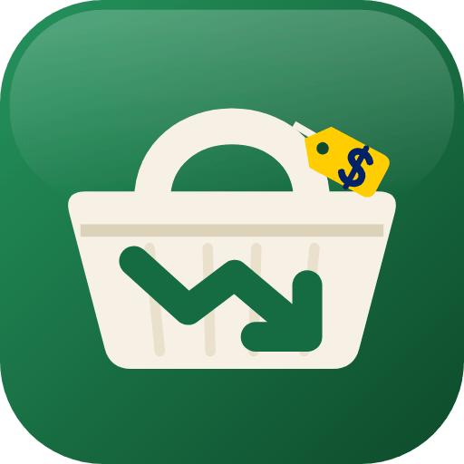
</p>

<h1 align="center">Restock</h1>

<p align="center">
  <strong>Half price? Prove it.</strong><br>
  A free, open-source Android app that watches prices at the Australian supermarkets, bottle shops and chemists you choose,<br>
  and tells you when a special is real, when to wait, and when to swap.
</p>

<p align="center">
  
  
  
  
</p>

<p align="center">
  <a href="https://github.com/d-plenty/Restock/releases/latest/download/restock.apk"></a>
  <a href="https://d-plenty.github.io/Restock/"></a>
  <a href="https://apps.obtainium.imranr.dev/redirect?r=obtainium://add/https://github.com/d-plenty/Restock"></a>
</p>

<p align="center">
  <a href="#get-it">Get it</a> ·
  <a href="#new-in-0190">New in 0.19.0</a> ·
  <a href="#accessibility">Accessibility</a> ·
  <a href="#your-own-restock-server">Restock server</a> ·
  <a href="#iphone-and-ipad">On iPhone</a> ·
  <a href="#questions">Questions</a> ·
  <a href="#how-you-can-help">How you can help</a> ·
  <a href="BUILD.md">Build it</a> ·
  <a href="PRIVACY.md">Privacy</a>
</p>

<p align="center">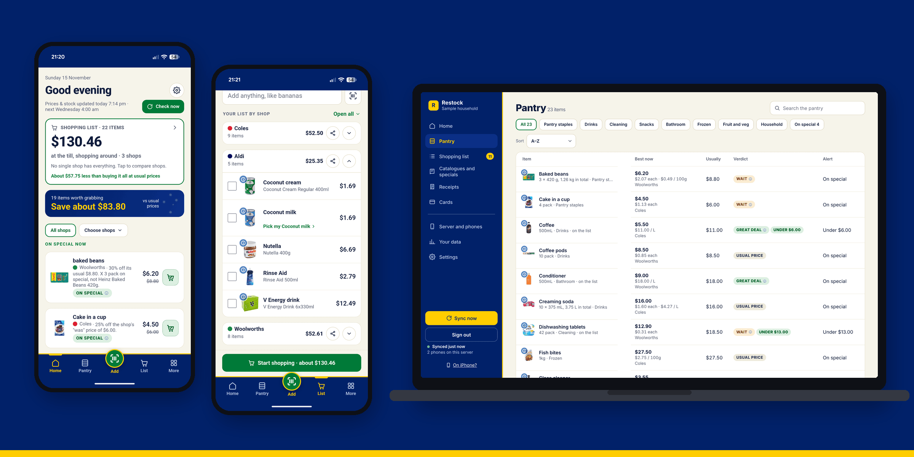</p>

| | | | |
|:---:|:---:|:---:|:---:|
| 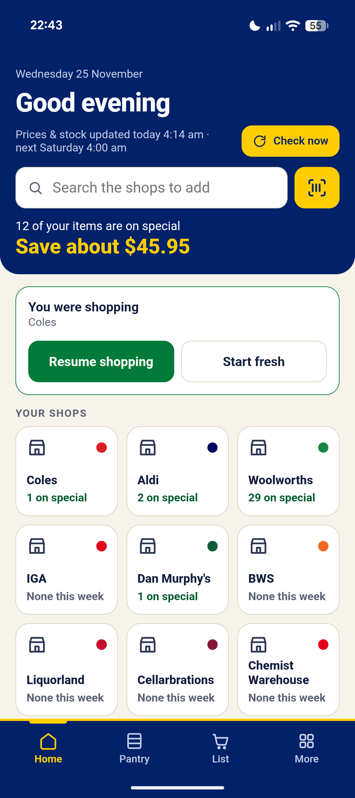 | 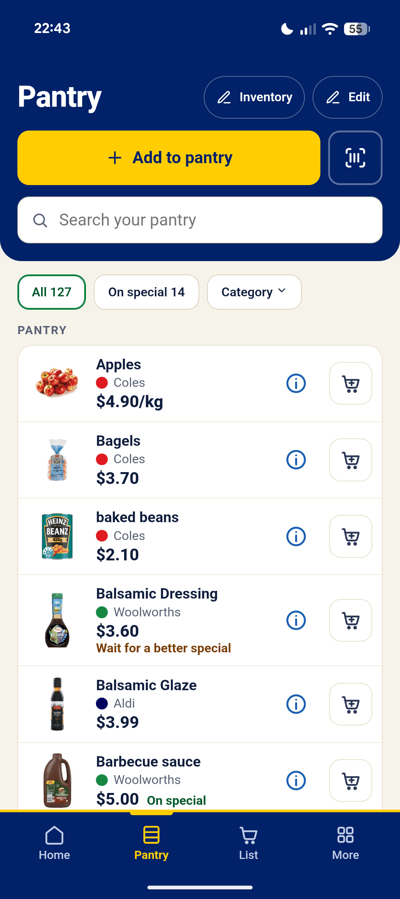 | 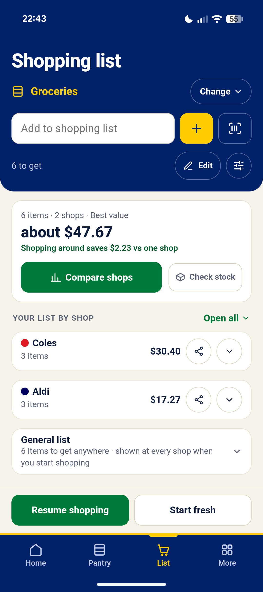 | 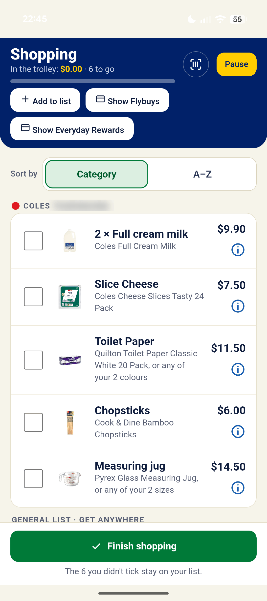 |
| 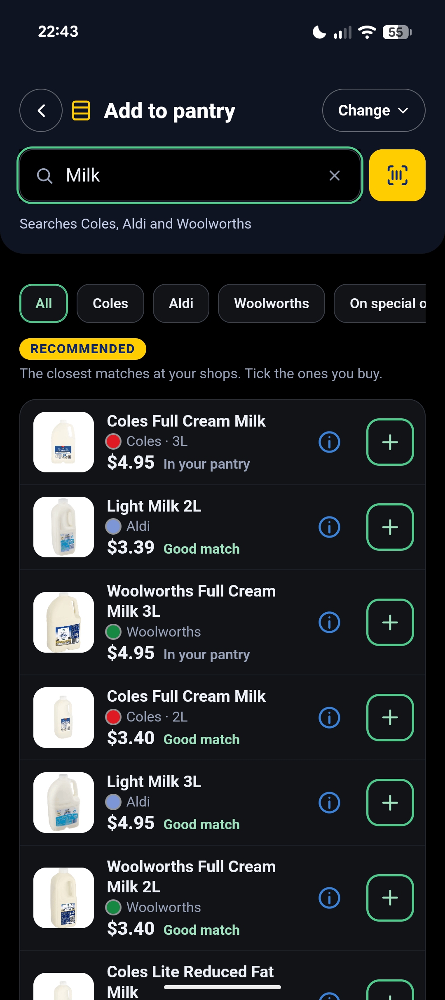 | 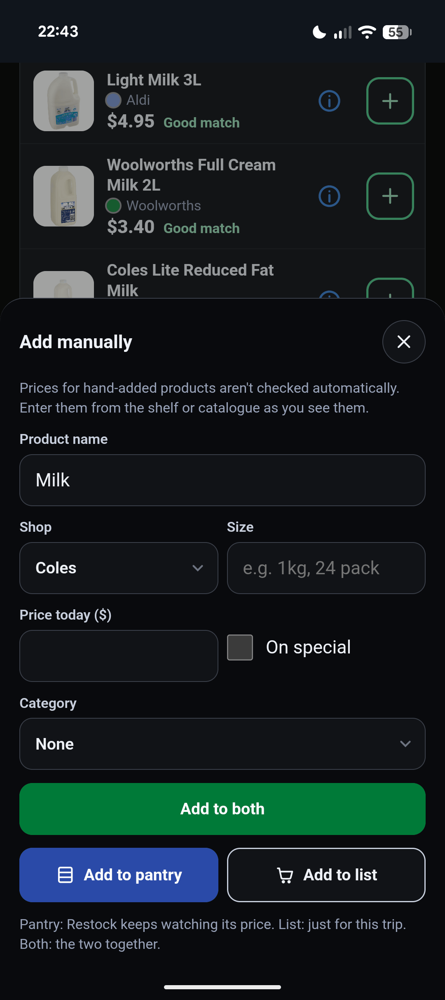 | 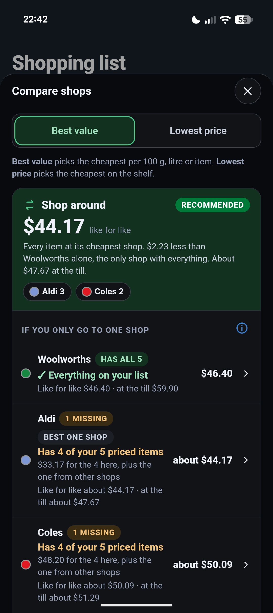 | 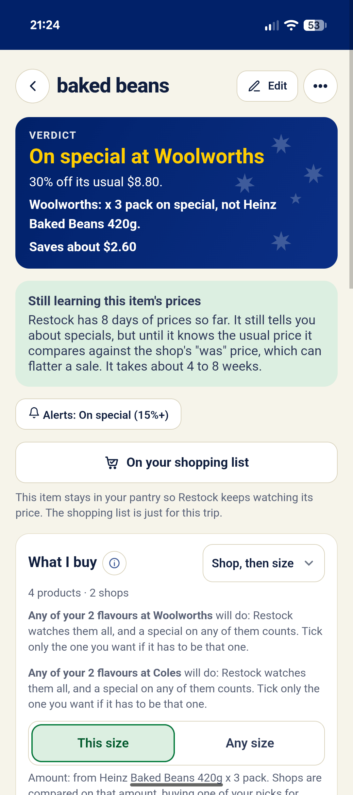 |
| 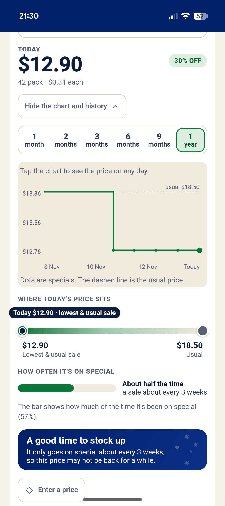 | 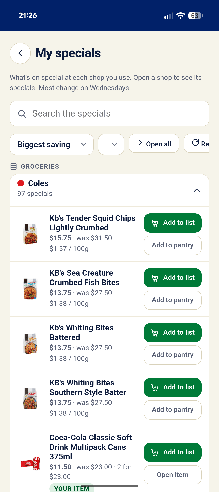 | 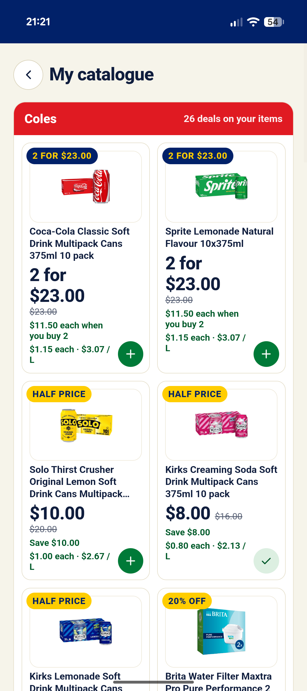 | 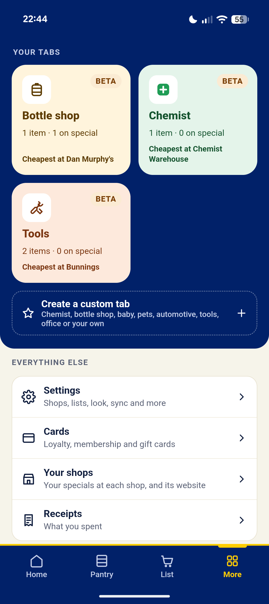 |
| 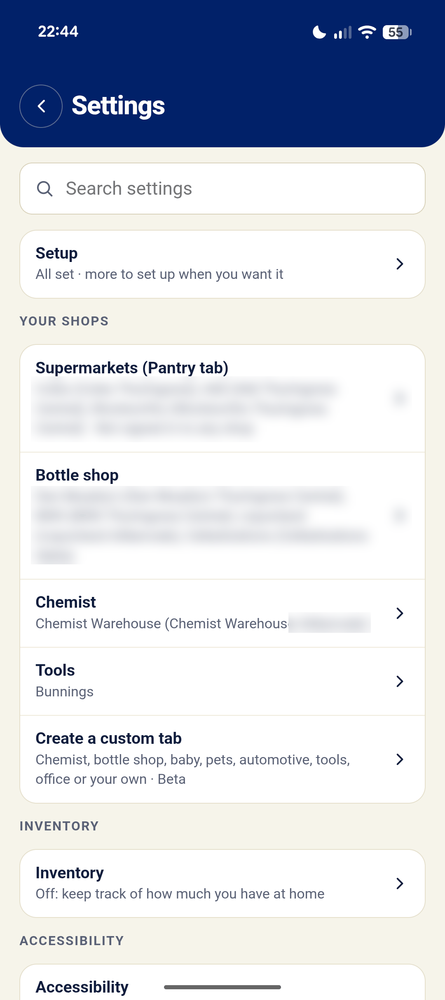 | 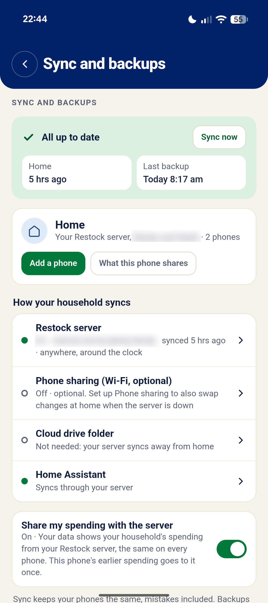 | 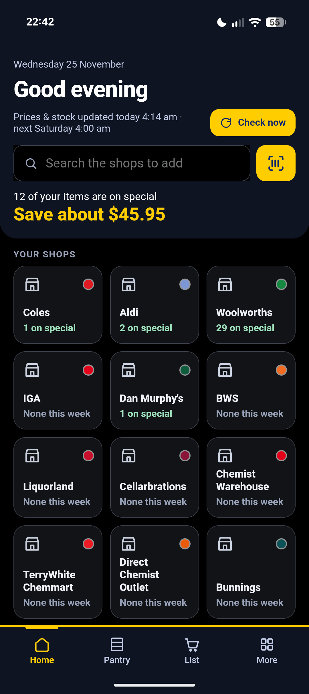 | 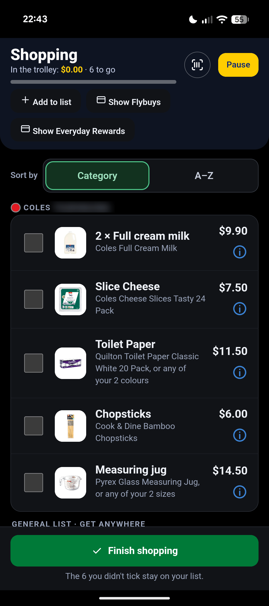 |

The phone pictures are real screenshots from a phone running Restock (shop branches and names blurred).

| | |
|:---:|:---:|
| 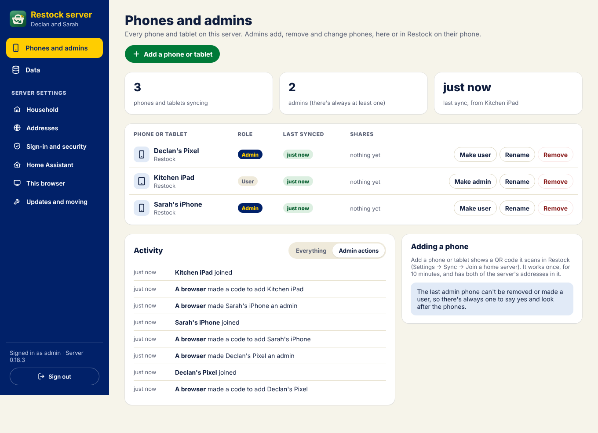 | 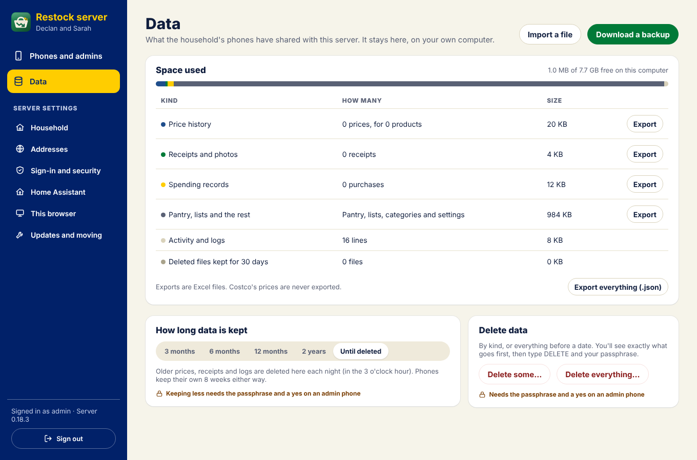 |

The two web pictures use sample data.

> **Local first. Works without signal.** Your list, pantry and prices live on your phone, not in a cloud. In a shopping centre with no reception, your list still opens straight away, and you can tick things off, add items from your pantry or type new ones. It all syncs when you're back online. Only searching the shops for new products and live prices needs the internet. **A server is optional:** Restock works fully on its own, and your own Restock server adds things on top.

## Why

A yellow ticket doesn't tell you whether the price is actually low. Restock keeps the price history of the things **you** buy, at the shops **you** use, and answers one question in plain words: *is this special worth it?*

It's made in Australia, for Australian shoppers. It's free, it always will be, and it doesn't collect anything about you.

## What it tells you

| Label | Means |
|---|---|
| **Great deal** | 30% or more below its usual price |
| **On special** | 15% or more below its usual price |
| **Small saving** | Any drop below its usual price, even 5 cents |
| **Wait for a better sale** | On special, but it's been cheaper lately and usually comes back down |
| **Fake sale** | Marked as a special at its usual price |
| **Swap & save** | Something you'd happily buy instead is on special and cheaper per 100 g, litre or item |

The **usual price** is the middle of the prices when it wasn't on special, over the history you keep (8 weeks to start with, up to 12 months). New items show a "still learning" note until there's about 4 weeks of history.

## Highlights

- **Your shops, your items.** Coles, Woolworths and Aldi, plus Costco (marked Beta), bottle shops (Bottle shop tab, 18+) and chemists (Chemist tab, both marked Beta) if you want them, and any other shop's website.
- **Four shopping lists.** Groceries, Keg, Health and **General**. General is a list only, for things that aren't in your pantry: Home Assistant puts anything there that matches nothing you track, or you add to it yourself.
- **Scan to add.** An open-source barcode scanner built in, with Open Food Facts lookup. A shop that lists that barcode has it ticked; at the others you tick what you buy.
- **Undo.** After most changes (Add to list, a tick, a delete, an edit, "Add all to my list"), a small **Undo** shows for a few seconds. One tap puts it all back, however many things changed.
- **Save settings.** Settings changes wait for a big green **Save settings** button, so you know when they're saved. Leaving with unsaved changes asks first.
- **Your own Restock server** (optional). Run [Restock server](https://github.com/d-plenty/restock-server) on a NAS, mini PC or Raspberry Pi, or as an app in Home Assistant. **Your server is the house:** you name it, add phones with a code, and each phone chooses what it shares. It syncs around the clock, at home and away, runs your Home Assistant shopping list, and keeps your history. Its web page, and Server admin on an admin phone, look after the phones, the data and the server's settings. See [Your own Restock server](#your-own-restock-server).
- **Other sizes of this.** Tick a product and Restock shows the same thing in other packs (375 mL cans × 10, × 24, × 30), compared per litre or per 100 g, so a 10-pack on special doesn't slip past your usual 30-pack.
- **Sync with your household, no server needed.** Up to 6 phones in the same house share one pantry and shopping list, straight from one phone to another on your Wi-Fi. Away from home, phones can also sync through Nextcloud, another WebDAV server or a Syncthing folder, sealed so only your phones can read it. You pick what's shared: groceries, Keg and Health, each on or off.
- **Your specials at each shop.** A button on Home for every shop you use, saying how many of your things are on special there. It opens just the things you buy that are on special at that shop (from your pantry and your shopping list), and nothing you don't. The shop's whole catalogue is one tap away, on its own site.
- **Shop around, or one shop.** Your list puts each item at its cheapest shop and suggests shopping around, unless it saves less than your minimum (a dollar to start with). Then it suggests the one shop that has everything, comparing the *same shopping* at each shop.
- **Background price checks** on Android's own scheduler, with alerts only for the deals you care about, plus a weekly deals summary on catalogue day.
- **Recall alerts.** Once a day Restock checks the official Australian recall lists (FSANZ, Product Safety Australia, TGA) against what you have.
- **Receipts** (optional). Scan, straighten and read receipts on the phone, and keep them as long as you choose.
- **Your own branch's prices.** Sign in to Woolworths inside Restock (on Woolworths' own page; your password never reaches Restock), or choose your Coles branch, and prices and stock are for your local shop.
- **Widgets, shortcuts, share-to-list**, automatic backups, Australian green-and-gold or plain themes, and accessibility settings.
- **Works without Google.** No Google Play services, so it runs on GrapheneOS, CalyxOS, /e/OS and other de-Googled phones.

<details>
<summary><strong>Every feature, in detail</strong></summary>

- **Three tabs, kept apart**: **Pantry** for supermarkets, **Keg** for bottle shops and **Health** for chemists. Keg and Health only appear if you switch them on, and are marked **Beta**: they work the same way as Groceries, they just haven't been tested as thoroughly yet. Each tab has its own items, categories, list and shops, and a search only goes to that tab's shops. Keg asks once that you're 18 or over.
- **General list**: a fourth shopping list, with no pantry of its own. A Home Assistant add that matches nothing in your Pantry, Keg or Health goes there. You can add to it yourself too. Adding by hand to Groceries, Keg or Health works as before, even for words that match nothing (like "chips", to buy whatever's on special). Nothing else moves to General by itself. It's shared with the groceries.
- **Bottle shops**: Dan Murphy's, BWS, Liquorland, Liquorland Warehouse, Liquorland Cellars, The Bottle-O, Cellarbrations, Thirsty Camel and Porters Liquor. Beers say whether they're a single, a 6 pack or a case.
- **Chemists**: Chemist Warehouse, My Chemist (with Chemist Warehouse's prices), Amcal, Discount Drug Stores, Guardian / PharmaSave, Priceline Pharmacy, Soul Pattinson, TerryWhite Chemmart, Blooms The Chemist, Good Price Pharmacy, Direct Chemist Outlet, Star Discount Chemist, Capital Chemist, National Pharmacies and Chempro.
- **Costco** (off until you pick it with your supermarkets): everything Costco sells online, next to Woolworths, Coles and Aldi, shared with your household and server like any shop. Sign in to Costco in the app for member prices (optional). Restock only checks Costco when you search, one page at a time, like you browsing its website. Costco's website terms don't allow automated collection, so it's your choice to switch it on. Prices are Costco's online prices, which include delivery, so the warehouse can differ. If Costco changes or blocks its website, its prices stop until that's sorted. The shelf price in the warehouse can be typed in by hand.
- **Any other shop**: add its website and Restock finds its search page and reads the products and prices, with Save and test to check it works.
- **Pantry**: each item has My picks (what you buy at each shop, which can differ shop to shop) and Would also take (others you'd buy when they're cheaper, for Swap & save), on This size or Any size, and shops marked Not at this shop. Listed by shop then size, cheapest first, or A to Z. Swipe to add to your list or delete.
- **Add**: from Home's search box, a tab's **Add to pantry**, or the barcode button beside either. It searches the shops of the tab you're on. Tick what you buy at each shop, then **Review and add**.
- **You pick at each shop**: tick a product and Restock searches your other shops again for the same thing, so it's near the top there. Nothing is ticked for you: each other shop has **Find it** and **Not sold here**.
- **Search**: ranked by what you most likely mean: type "butter" and butter comes first, with peanut butter and butter chicken sauce further down; children's medicines only when you ask for them. Unit prices worked out the same way everywhere, a best-value sort, "On special only", recent searches, and fixes for Aussie names (snags, loo paper).
- **Scanning**: zxing-cpp inside the app. Normal barcodes, GS1 QR codes, Data Matrix and DataBar, from the camera or a photo, or type the number. **Scan several** walks your cupboard and fills your shopping list. Unknown barcodes fall back to the supermarkets' own data, a general search (an ingredient and strength for medicines) or reading the front of the pack.
- **Best match**: after a scan, the same product (brand, variant and size) is ticked at each shop. If the barcode only names the brand, you pick which one it is once and Restock ticks it everywhere and remembers.
- **Your branch's prices and stock**: sign in to your Woolworths account inside Restock, on Woolworths' own page, so your password only ever goes to Woolworths, and Restock shows your branch's prices and stock and can fill your Woolworths trolley. For Coles, tap **Choose your Coles branch** in My shops and tap your branch in Coles' own store finder; Restock picks up its number by itself. Without these, Restock shows online prices and leaves stock out.
- **Hold to preview**: press and hold any product for a bigger photo, its full name, size, price, ingredients, allergens and nutrition.
- **Shopping list**: Shop around first, with its stops and what it saves, then "If you only go to one shop" with HAS ALL or N MISSING for each, and what the missing ones would cost elsewhere. Views: **By shop · Aisle group · One list**. **Start shopping** sorts each shop **by aisle** (1 to 50, or 50 to 1), category or A–Z, with each thing's aisle at your Coles branch (Aisle: unknown where a shop doesn't say). Quantities, A to Z, Best value or Lowest price, share as text, or send to the Coles or Woolworths app. Type in the list and your pantry items come up first; or add the words as they are, or **Find the cheapest** to search the shops for a one-off buy.
- **Pick my milk**: a line added as words (by voice through Home Assistant, say) has a **Pick my milk** button. Pick the pantry item, and tick *Always use this for "milk"* to match it straight away next time. If nothing in your pantry matches ("chopsticks"), the picker searches the shops for it, the same as adding a new item.
- **Undo**: a small Undo after adding to the list, ticking, removing, editing and bulk changes. One tap undoes all of it, on every phone and the server too.
- **Save settings**: changes on a settings screen wait for **Save settings**. If you leave with changes not saved, Restock asks.
- **Price history**: a tab for each shop (always in the same order), then that shop's products smallest first. A chart over **1 month · 2 months · 3 months · 6 months · 1 year**, where today's price sits against the lowest, the usual special and the usual price, how often it's on special and when the next special is likely, and multi-buys counted at their price each.
- **This week**: deals, small savings and "wait for a better sale" for all your shops, or one shop at a time.
- **Specials**: this week's specials at your shops (Woolworths and Coles half price, Aldi Special Buys), filtered to **Suggested** (ones like what you buy) or **All specials**.
- **Alert me under $X** per item, and **stock-up tips** for things that rarely go on special.
- **Near me**: find every supermarket, bottle shop or chemist nearby from OpenStreetMap and pick your branch.
- **Shop health**: Home tells you if a shop hasn't worked for a day, and Settings → Help → Check my shops are working shows what went wrong.
- **Diagnostics**: what went wrong lately, shop by shop, **Send search details** to capture exactly what a shop sent back, and a recording of what a shop's website does when you add something to its trolley yourself (sign-in and personal details left out), so connections can be fixed.
- **Receipts** (optional): finds the receipt's edges, straightens it, makes it crisp black and white, and reads the shop, date and total with PaddleOCR on the phone. The photo reader (about 21 MB) is downloaded the first time you use it, after asking, and then works offline; Settings can remove it or get it again. The same reader reads a product's name from a photo when you add something without a barcode. Photos stay inside Restock, not in your gallery.
- **Recall alerts**: on by default, checked every 24 hours separately from price checks, matched against your Pantry, Keg, Health, lists and kept receipts, with the official notice one tap away.
- **Cards**: loyalty cards (member prices only count if you've added the card) and gift cards, with the barcode, card number, a PIN that stays hidden until you tap it, the balance and what you spent, an expiry reminder and photos. Cards stay on your phone.
- **Your shops**: a button on Home for every shop you use. Each opens your own things on special there this week (items you track, and one-off lines on your list), with the shop's whole catalogue and its website one tap away.
- **Home screen widgets**: Deals, Shopping list and Quick actions, with your choice of background, transparency and text colour.
- **App icon shortcuts** (Scan, List, Receipt) and **Share to Restock** from any app.
- **Local sync**: up to 6 phones in a household pair by scanning a one-time QR code from the owner phone (it works once, for 10 minutes, and never contains the household's key), then sync straight to each other on the same Wi-Fi: when you open Restock, shortly after a change, and every 15 minutes or so in the background. Pantry, lists (ticks too), prices, categories and alerts, plus loyalty cards if you choose. The owner picks what the household shares (groceries, Keg, Health) and each phone picks what it takes. Encrypted with a key only your phones have; no server and no account needed. If two phones change the same thing, the later change wins, except that a tick and a new amount on the same line both survive, and deleting something beats an edit made without knowing about it. **Sync away from home** (optional): Nextcloud, another WebDAV server, or the same folder on each phone (one Syncthing keeps in sync), sealed with the household's key, prices and photos aside. **Recovery key**: if the owner phone is ever lost, another phone takes over as owner with it.
- **Start fresh, restore, or join your household** on the first screen; **Erase everything and start fresh** at the bottom of Settings (it asks twice).
- **Sync and backups in one place**: a strip that says whether everything is kept somewhere else (phone sync, a folder backup or your Restock server all count), then your server, Wi-Fi and away from home, then backups.
- **Backups**: export and restore exactly the parts you pick, plus optional automatic backups into a folder you choose. Lock any backup with a password (encrypted on the phone). Restock also keeps a copy from just before each update, so an update can be undone.
- **Spreadsheets**: export your pantry, shopping list and price history as CSV files for Excel, Google Sheets, LibreOffice or Numbers.
- **Look and colours**: Light, Dark or System, with true black for OLED screens; the default theme or Simple; an accent colour, a theme colour and an app icon colour, from 13 plain colours or Restock's own colour wheel; and Animations (the opening and the holidays).
- **Accessibility**: the first step of setup and its own page in Settings: text size, bold text, high contrast, easier reading spacing, bigger buttons, no swiping, less motion and more. See [Accessibility](#accessibility).
- **Updates**: Settings → About → Check for updates, or turn on **Tell me when there's an update** to check every 24 hours (or every 7 days) when you open Restock. Or install through [Restock's own F-Droid repo](https://d-plenty.github.io/Restock/) or Obtainium and let them handle updates.
- **Shared prices**: one switch, on unless you turn it off (Settings → Privacy and sharing, or setup). Your phone downloads 8 weeks, 6 months or 12 months of shared history for your shops from [restock-prices](https://github.com/d-plenty/restock-prices) (Restock's own collection of Coles, Woolworths and Aldi prices, from its collector and from phones), weekly or every day, so new items get a fair verdict from day one. In return it shares the shelf prices it reads from those shops (shop, product, size, barcode, the price and the day). Prices you type in yourself never go, nothing about you is ever included, and the data is free on GitHub and will never be sold. See [Shared prices](#shared-prices).
- **Your data**: Settings → Your data shows what you spent (from what you tick off), where, what specials saved, and any item's price over time, on the phone alone or, with **Share my spending with the server** (on unless you turn it off), your household's figures from your Restock server.
- **Feedback**: Settings → Send feedback sends a message (with screenshots and diagnostics if you like) straight to the people who make Restock. No GitHub account needed.

</details>

## iPhone and iPad

Restock runs on iPhone and iPad (one app for both), with the same screens as Android. It is not on the App Store or TestFlight yet, so for now it's installed from a computer, and with a free Apple Account it has to be installed again every 7 days (your data stays). It syncs with a Restock server, with an Android phone over your Wi-Fi, and with other iPhones and iPads through a shared iCloud Drive folder or a Nextcloud or WebDAV folder. Prices are checked in the background too: a little at a time, and a longer check from your set time while the iPhone is charging and on Wi-Fi (iOS picks the exact moment). One thing isn't possible because of Apple's restrictions: the app updating itself. Still to come there: the App Store, and home screen widgets. **[How to install it, the warnings, and what's different](docs/IPHONE.md).** The file is `restock-<version>-unsigned.ipa` on the [releases page](https://github.com/d-plenty/Restock/releases).

## New in 0.19.0

A screen that stays on "Loading…" now says why and keeps trying, Restock opens quicker, and the code for versions before 0.14.0 is taken out. Nothing moves.

- **"Loading…" says why.** On one iPhone joined to a Restock server, Home, Pantry and the list still stay on "Loading…" (0.18.4 didn't cure it). A screen still loading after 6 seconds now shows what it's waiting for, how long, and the last error, with **Copy** for a report and **Try again**. The same lines go to Diagnostics → Quiet problems.
- **Nothing waits for good.** A screen's read with no answer after 20 seconds is tried again by itself (before, one unanswered read kept its screen loading for ever). A database read fails after 30 seconds, saying which. On iPhone and iPad a read that the read-only connection hasn't answered in 6 seconds is also asked on the other connection, an answer that can't cross from the native side is an error in words, and a number that isn't finite crosses as nothing instead of dropping the whole answer. The items still show if the shared prices or the barcode extras can't be read.
- **Quicker to open.** Several screens ask the database for the same things at once; each question is now answered once and shared. Opening to Home on a test iPad with 400 items: 108 trips to the database before, 84 now, and 39,000 rows fetched before, 23,000 now.
- **Outside requests give up.** Checks with GitHub (updates, shared prices) and barcode look-ups stop after 12 to 20 seconds. Closing the share menu without choosing is no longer noted as a problem.
- **Old code out.** Everything that was only for Restock and Restock servers before 0.14.0 is gone: the old way of handing a household to a server, the app that used to run in a browser on the server's page, and about 250 unused pieces of code. Updating a phone from any version still works, and keeps everything.
- **The server's web page.** Addresses → Test both asks the server to try each address (the page itself can only reach the address it's open on, so the other one always said it didn't answer). The page talks to your server and nothing else.
- **Everything pressed.** A script opened about 200 screens and sheets and pressed what it could reach on them, on iPhone and iPad sizes, looking for errors, dead ends and anything off the screen; the main screens were looked at in dark mode too. The iPhone build is also started in a simulator on GitHub's Mac at each release, with pictures kept, to see that it opens.

## New in 0.18.4

Restock on iPhone and iPad opens properly on a Restock server, each phone can keep its backup on the server, and a tidier Server admin.

- **Fixed: iPhone and iPad stuck on "Loading…".** On a phone joined to a Restock server, Home, Pantry and the list could wait for good: each sync asked the phone's database about every record in the server's file one at a time (tens of thousands of trips), and held it meanwhile. It asks a few hundred at a time now (taking in an unchanged file of 8,400 records: 8,405 trips before, under 25 now), the screens never wait on a save, and a read that fails tries again by itself. Diagnostics → Speed names a slow read and a long sync step.
- **Each phone's backup on your Restock server.** Turned on once with the server's passphrase, each phone backs up once a day: settings, look, shops, every tab, cards and receipts. It's locked so only the passphrase opens it (the server can't read it). Settings → Sync → Restock server → Backup has Back up now.
- **Putting a lost phone back.** An admin adds the new phone as the lost one's replacement; the new one joins, asks for the server's passphrase, and everything comes back. The lost one then comes off the server. The server's web page can download any phone's backup too.
- **Server admin, the basics on the go:** Phones and tablets, Sign in a computer, Passphrase (change it from the phone), Basic settings (name, addresses, Home Assistant) and Phone backups, a page each. Everything else is on the server's web page.
- **The server's web page fits any screen,** from a phone (tables become cards) to a big monitor, and This browser → Text size makes everything bigger.

## New in 0.18.3

Look after your server from a phone, a stripped-back server page with a yes on your phone to sign in, home and away addresses that just work, and a new first screen.

- **Server admin on an admin phone** (Settings → Sync → Restock server): the phones and tablets, adding one with a code, Sign in a computer, Data and how long it's kept, Activity, and Server settings: the household, the addresses, signing in, Home Assistant and updates.
- **"Is this you?"** Signing in to the server's page with the passphrase, and each risky change there, needs a yes on an admin phone too, like two-factor: both show the same two-digit number. Open Restock on the phone and it asks. Every admin phone lost: the recovery key instead.
- **The server's page, stripped back** to Phones and admins, Data and Server settings, a page each in the sidebar. It's about 1.7 MB instead of 40, and keeps nothing of the household in the browser.
- **Cloudflare tunnels work.** Codes made through a tunnel had an `http://` away address, which phones turn down ("Restock only uses http:// for a server at home…"). Away addresses are https now, and a server puts its saved one right by itself.
- **Home first, then away.** A phone gives up on the home address after a moment (it was 15 seconds) and tries away, and back at home goes home again. No location or Wi-Fi permission.
- **A new first screen:** Set up, Join a home server, or Import from backup (a file, or straight from another phone). Joining a server from the first screen works now, and lands on Home.
- **Used and expired codes** say which. Codes survive the server restarting.
- **Connections in an export:** tick it (in a file locked with a password, or one sent straight across) and Home Assistant comes along with its token, and from an admin phone a code for the new phone to join the server as a phone of its own.
- **The last admin phone** can't be removed or made a user.

## New in 0.18.2

Faster on iPhone and iPad: pages straight away, taps that answer, and one price check a day.

- **Pages straight away.** Home, the Pantry and the list show what was there last time the moment Restock opens, then update by themselves once today's deals are worked out. No loading bar on them.
- **Taps answer while prices are checked.** What you tap goes ahead of the price check's saves, and on iPhone and iPad the check waits while you're scrolling or tapping, and starts a few seconds after Restock opens.
- **One price check a day on iPhone and iPad**, from your set time (4:00 am unless changed), as Android does. A check that has started since then counts, so opening Restock again the same day doesn't check again; what a cut-off check didn't get to is done in the background.
- **Price history is read once and kept.** Every screen read every product's history again at every change, even a tick on the list. Now it's read once, and only the products a price check updated are read again. On Android too.
- **Long lists come in parts** as you scroll, in both designs.
- **Diagnostics → Speed on this phone** lists anything slow: a screen that took a while to show, or a moment the app was too busy to answer a tap (and whether a price check or a sync was running). Copy it into a report.
- Tested with 400 products and a price check running on a simulated slow iPad: tabs opened in 0.1–0.6 s (they took 1–2.5 s in 0.18.1), the longest freeze dropped from about 2.5 s to under 0.75 s, and the check got through three times as many products in the same time.

## New in 0.18.1

Pages load first on older iPads, a new Simple design, your own colours, and safer admin changes.

**Faster on older iPads and iPhones**
- **Pages first.** Restock opens the page you're on, and the others' code, before the first sync, the price catch-up, automatic backups and the rest start. A price check takes short breaks so a page can load in between.
- **No more black screens.** A page that's still loading shows its title, Back and a loading bar. (A page could stay black while a price check was busy saving prices: it now always shows what it read.)

**Simple design** (Settings → Look and colours → Style)
- **White, one colour, square and flat**: a band of your colour at the top, square corners, no shadows. Dark mode is plain black, with a switch to keep the coloured band. It replaces Plain (Plain is Simple now).
- **Lighter on older phones**: long lists come in parts as you scroll, price checks take longer breaks, and charts draw less.
- Picking it turns the opening, the holiday themes and the motion off (each can go back on). Going back to the default theme puts them back as they were.

<p align="center">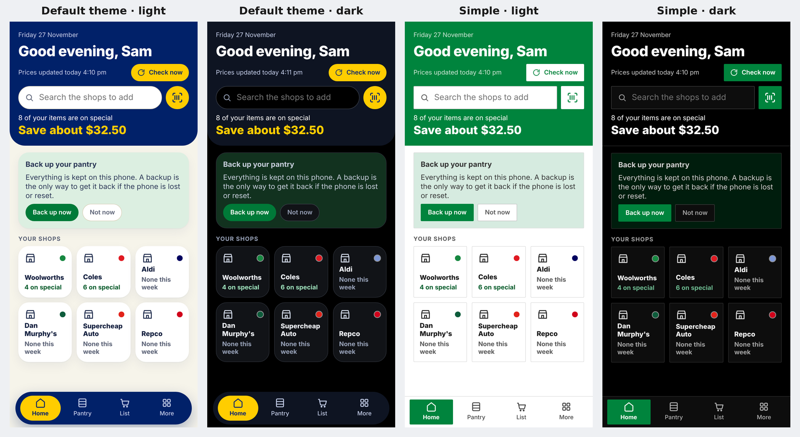</p>

**Your colours**
- **Restock's own colour wheel**, the same on every phone, tablet and the web page (it was each phone's own colour picker).
- **Theme colour**: the tops of the screens and the tab bar (navy to start with), next to the accent and app icon colours.
- **Android widgets** set to "Like the app" use your theme colour, with the title in your accent and Quick actions in your app icon's colour.
- **Animations**: one row on Look and colours opens the opening, the holiday switches and every animation to play, on one page (on the web page too).

**Admins** (with a Restock server)
- **Are you sure?** before adding a phone, removing one, or making one an admin or a user, on the phone and the web page.
- **A notification** on an admin phone when a phone joins, leaves or is removed, or becomes an admin or a user (Settings → Notifications; on to start with).
- **The last admin phone** is warned before it makes itself a user or leaves the server.
- **Activity → Admin actions** on the web page shows just what admins did.

**And**
- Share my spending, Share receipts and Share my loyalty cards ask before turning off, in one line with the rest behind ⓘ.
- An iPad (or Android tablet) held sideways shows Settings side by side: the list on the left, the page on the right.
- What's planned says what's next: the App Store and Google Play, F-Droid's main repository, widgets on iPhone and iPad, and Running low.

## New in 0.18.0

Add phones and tablets from your phone, each holiday on or off, plain colours, and lots of fixes.

**Admin phones** (with a Restock server)
- Each phone on your server is a **user** or an **admin**. Phones already on it start as users: tick the ones you want as admins on the server's Server and phones page (signed in with the passphrase).
- **An admin adds phones and tablets** from Settings → Sync → Your Restock server → Phones and tablets: name it, and it shows the code the new one scans (once, for 10 minutes). Tick Make admin to add another admin.
- **An admin removes phones, and makes others admins or users**, as the web page does. The server checks every request, and the requests and codes go sealed with your household's key.
- Phones on 0.17.0 keep syncing as before; they get the new section when they update.

**Look and colours**
- **14 plain colours** for the accent and the app icon, the same set for both, so Match my accent colour is an exact match. A colour of your own from the colour wheel gives the closest icon (phones only take icons that come with the app).
- **Each holiday has its own switch** under Holiday themes, on the phone and the web page.
- **Australia Day** shows for the week leading up to it: 19–27 January.
- **A smoother opening**: 2.5 seconds, or 3.5 on a holiday.

**Fixes and tidying**
- The tab bar on Android sat on the gesture line: it now keeps clear of it, as on iPhone.
- True black and the app icon colours say it in a line, with the rest behind ⓘ.
- Settings is in every backup, and Export and Import let you pick it.
- Code tidied for Restock 0.14.0 and newer only; every version number is checked by a test before release.

## New in 0.17.0

Tidier everywhere: the same sizes on every screen, shorter Settings, and what's new for every update you skipped.

**The same on every screen and device**
- **One size for buttons, fields and search bars**, the same on Android phones and tablets, iPhone, iPad and a Restock server's web page. Home's top is tighter ("Prices updated today 7:12 pm" and a smaller Check now) and the tab bar sits lower.
- **Pop-ups on tablets, iPads and wide windows** dim the whole screen and sit in the middle of the page (they dimmed a phone-wide strip, off to one side).

**Shorter Settings**
- **Your name** opens a page that says where it's used; the keyboard only comes up when you tap the name.
- **Setup checklist:** what's still to set up, one row each, with the done ones folded away.
- **Sync and Backups** have a page each. **Prices and deals**, **Shared prices** (a line, with How it works holding the switch) and the backup settings say it in fewer words.
- **Inventory stays out of the way** until you want it: the Inventory button only shows once it's on, and Restock asks once, after 20 things in the pantry and 3 shopping trips. It's still in Settings whenever you like.

**Look and colours**
- **11 accent colours and 11 app icons**, plus the colour wheel for any colour at all. The app icons are shown as the real icon. The app icon matches your accent unless you pick one.
- **See the animations:** each one with a picture, its dates and "showing now", and Day and Night buttons. Playing one can always be left: a tap, Back or Escape.
- **New holiday dates:** Australia Day 2–27 January, Easter the three weeks up to Easter Monday, Halloween 11 October – 1 November. Each ends the day after.

**And**
- **Skipped an update or two?** What's new shows every version since the one you had.
- **On a Restock server, each browser is named after you**, like "Sam's Chrome".
- **Fixes:** the square box behind search bars in true black, the Feedback page's layout, the Advanced icon in Settings.

## New in 0.16.0

A fresh look, your name on Home, a new logo, and holiday themes.

**A fresh look**
- **Every screen, every device:** rounder cards that float on a soft shadow, pill-shaped buttons, fields and choices, round icon buttons, a deeper curve under the navy top, and a floating tab bar with the tab you're on in a gold pill. Settings' rows have coloured icons. Nothing has moved.
- **Tablets, iPads and computers use the whole screen.** Upright, the page fills the width (it was the phone's column with empty sides); sideways, the navy top reaches right across. Android tablets get the side bar too, the same as the iPad.

**Your name**
- **"What should we call you?"** when you set up or join, and once after updating (skip it and it doesn't ask again). Home says "Good morning, Sam".
- It also names this phone in your household ("Sam's iPhone") and goes in your backup's file name; restoring a backup brings it back. Change it at the top of Settings (the ⓘ says where it's used).

**A new logo and an opening**
- **A touched-up logo** with a shine, the basket's weave and a gold price tag, on the app icon, the server and GitHub.
- **A short opening animation**, about two and a half seconds, when Restock starts from closed (not each time you come back to it). A tap ends it early. With Less motion on it's a still picture instead.

**Holiday themes**
- **Christmas** (1–26 December), **New Year** (27 December – 1 January), **Australia Day** (2–31 January), **Easter** (the two weeks up to Easter Monday) and **Halloween** (October). Each has its own opening, a sunny day look in light mode and a night look in dark mode: the kangaroos pulling Santa's sleigh over the beach, fireworks at New Year, the flag waving over the barbecue, eggs and fireflies, bats and a haunted house. On the default theme the app also takes the holiday's colours, with a little decoration in Home's top bar.
- **Settings → Look and colours:** Opening animation (off: no opening at all), Holiday themes, and **See the openings**, which plays any of them, day or night, whenever you like. Each phone and browser has its own. Your own colours stay as they are (you still get the opening).
- "Australian theme" is now called the **default theme**.

## New in 0.15.2

Faster, even while prices are being checked or the household is syncing, and the iPhone checks prices in the background.

**Faster, on every phone**
- **Screens stay quick during a price check.** Prices are saved in lots of 20 instead of one at a time, so the screens re-read once a lot, not once a product. On iPhone this was what made a tab take seconds to open mid-check.
- **No blank page between screens.** Settings, Receipts and the other screens opened now and then are loaded quietly once Restock has started, and screens show your settings straight away instead of waiting for them.
- **iPhone and iPad: reads have a lane of their own** (a second, read-only connection to the database), so a screen never waits behind a price check's saves or a sync.

**Price checks**
- **A check that's cut off carries on** where it got to (the app closed, the phone slept, Android or iOS stopped it), unless that was more than a day ago: then it starts again. Android and iPhone both.
- **iPhone and iPad check in the background:** a little at a time whenever iOS wakes Restock (about half a minute, with the household sync), and a longer check from your set time (4:00 am unless changed) while the phone is charging and on Wi-Fi. iOS picks the exact moment, so it can be later. The days and time are picked in Settings, the same as on Android.
- **Check now keeps going** when you leave Restock, with its progress on the Lock Screen (iOS 26 and later; earlier, it carries on next time).
- **Deal alerts on iPhone** after a check in the background, as on Android.

**The stores**
- The privacy policy and the fine print are on GitHub as pages ([privacy policy](docs/PRIVACY.md), [fine print](docs/TERMS.md)), made from the same words the app shows: the address both stores ask for.
- The App Store version only allows plain http on the home network (a server or Home Assistant at an IP address or a `.local` name). The version installed from a computer is unchanged.

## New in 0.15.1

A tidy-up, the iPhone's own database, and the versions Google Play and the App Store would take.

**iPhone and iPad**
- **Restock's data is now in the iPhone's own database** (the system's SQLite, as on Android). Each change is on the disk as soon as it's made, instead of the whole file being written again after every change. Nothing moves: the same files are opened as they are, and the first time, a copy of each is kept beside it.

**Fixes**
- A shop you took off Your shops no longer stays on Home because it had a saved branch.
- Home, the tabs, the list and an item's page work out their prices once and share them (Home did it twice).

**Updates and the stores**
- **Check for updates** now also offers Restock's own F-Droid repo.
- **Google Play and the App Store:** Restock isn't on either yet. Each release now has their versions attached, unsigned: an App Bundle for Google Play (it has no updater, as Play requires) and an archive for the App Store and TestFlight. [What each store needs, and what's left](docs/STORES.md). The APK stays exactly as it is.

**A Restock server**
- The setup page's first sign-in moved to the server's current address. A setup page left open from before needs reloading. Update the server to 0.15.1 with the app.

**For people who work on Restock:** the Add screen is split into its parts, the React linter rules are on and everything they found is fixed, there are tests that use the screens the way a person does, and the sync engine runs on a database that answers later (the iPhone's) as well as one that answers straight away.

## New in 0.15.0

> **Update every phone to 0.14.0 or newer.** From this version, phones and Restock servers don't sync with Restock older than 0.14.0. An older phone is told to update, keeps everything it has, and works on its own until it is. If you run a Restock server, update it to 0.15.0 too.

The iPhone and iPad catch up on sync, the server's web page looks like the iPad, and a big tidy-up.

**iPhone and iPad**
- **Make owner:** an iPhone that started a household on the Wi-Fi can hand that job to another phone, Android or iPhone.
- **Bring a household onto a server:** an iPhone that owns a household on the Wi-Fi or in iCloud can bring it onto a new Restock server. The other phones join with their own Add a phone codes.
- **Nextcloud or WebDAV:** on the iCloud sync screen, **Use Nextcloud or WebDAV instead** keeps the household's folder on your own Nextcloud (it signs you in on its own page) or any WebDAV server. The password stays in the iPhone's keychain.
- **Joining from the first screen:** **Join your household** on a brand-new iPhone now asks Scan a code or iCloud folder, and a server's code joins the server straight away.
- **Home's shop buttons fit:** long shop names and "29 on special" no longer break across lines on a narrow screen.
- Shared prices are kept in their own file, so the rest of your data saves faster.

**A Restock server's web page**
- **Looks like the iPad:** on a computer it uses the same screens as the phone, with the tabs, Your shops, Receipts, Cards and Settings down the left side.
- **Your server** holds everything about the server in one place: Server and phones, Your data, Activity, Home Assistant and Signing in. On a phone-sized window it's one row in More.
- **Server and phones** lists any phone that needs updating to 0.14.0 or newer.

**Old versions**
- A server that still keeps a household from Restock 0.9.3 says what to do first: run server 0.14.1 once and hand the household over, then update. Phones can no longer join or hand a household to such a server.

**Fixes and the rest**
- The app opens faster: screens load when they're first opened.
- **Coming soon** and a few other screens say less.
- On iPhone, **Why is this unavailable?** no longer shows under a shop's page when the page does open.
- **Diagnostics** has a new **Quiet problems** list: errors from background work (a sync, a price check, saving) that used to vanish, so one that keeps coming back can be seen and sent.

**For people who work on Restock:** the biggest screens are split into smaller files, unused code and styles are gone, more linter rules are on, and the contributor guide says where things are.

## New in 0.14.1

More on iPhone and iPad, a smaller app, less writing in Settings, and fixes.

**iPhone and iPad**
- **Shared prices both ways:** the shared price history downloads, and the prices this device reads from Coles, Woolworths and Aldi are sent back, with the same rules as Android.
- **Recall alerts:** checked when you open Restock (at most once a day) and from Check now, with a notification.
- **App icon colours:** the same 16 as Android.
- **Your data as a real file:** the database is saved as a SQLite file in the app's own storage, written safely after each change and when the app goes to the background. If a save ever fails, Home says so with Try again.
- **Recording a trolley** works in Diagnostics. **Home screen widgets** are still to come (the row is greyed).

**The photo reader downloads on first use**
- The reader's two model files (about 21 MB) are no longer inside the app. The first time you read a receipt or add something from a photo, Restock shows the size and asks. It reads receipts, and reads a product's name from a photo when you add something without a barcode.
- **Not now** still lets you keep a receipt: you fill in its details yourself.
- **Settings, Photo reader** removes it or downloads it again. Each file is checked against its fingerprint before it's kept, and photos are still read on your phone.
- The app is about 20 MB smaller. A Restock server's web page keeps the reader built in.

**Less writing**
- Settings and its screens (Sync and backups, Phone sharing, My shops, Home Assistant, Restock server, Shared prices and more) say one short line. The full explanation is behind a small **ⓘ**. Warnings stay on screen.

**Fixes**
- **Pick my …** on a General list line searches your shops for it straight away when nothing in your pantry matches, with the words already filled in.
- **An item you add takes over its General line.** A line waiting on General under the same words becomes that item's line. Nothing is left behind.
- **Pharmacy 4 Less is no longer a shop to pick.** Its website stopped listing products, so there is nothing to read. Items you saved from it stay in your pantry.
- **A shop that Unblock can't fix offers Turn off.** Once you've opened a shop's page and it still gives nothing, or after a week of nothing, the card says Restock can't find products on its website and the main button turns the shop off.
- **Adding your own shop** says up front that not every shop works or puts prices online. Save and test says plainly when a website lists nothing, with Remove this shop.

**For people who work on Restock:** a linter (`npm run lint`), tests named for what they cover, and GitHub now also runs the Android sync tests, builds the Android app, and builds the iPhone app whenever its code changes.

## New in 0.14.0

Restock on iPhone and iPad, and a household of both kinds of phone.

- **iPhone and iPad.** The same app, screens and settings as Android. Held sideways, an iPad puts the tabs down the left side. See [Restock on iPhone and iPad](docs/IPHONE.md) for installing it.
- **An Android phone and an iPhone sync over your Wi-Fi.** On the Android phone: Phone sharing → Add a phone. On the iPhone: Sync and backups → Sync with an Android phone → Join with a code. The Android phone answers in the background; the iPhone does its part while Restock is open on it. An iPhone can also start the household and an Android phone join it.
- **iCloud sync** for a household of iPhones and iPads: one shared folder in iCloud Drive, no server and no account with Restock.
- **iPhone to iPhone over Wi-Fi** is there under Advanced, for people who want it. It only works while both have Restock open at the same moment, so iCloud sync is the better choice.
- **Export data, two ways.** Pick what goes in (tabs, lists, cards, receipts, settings), then **Save to a file** or **Send to another phone**. Sending shows a QR code; the other phone scans it and the data goes straight across your Wi-Fi, sealed with a key that's only in the code. Once, nothing is paired, and it works between any two phones: Android or iPhone, either way. Prices you typed in by hand stay on your phone.
- **Import data, three ways in.** From a file, by scanning the other phone's code, or from a photo of the code. Then tick what to bring in and choose: **Add alongside what's here** (nothing is replaced; anything with the same name is skipped) or **Replace what's here** (only the parts you tick).
- **Loyalty cards can have an expiry date.** Set it when adding the card or later. Restock notifies you a month before, and Home shows "Your Flybuys card expires in 1 month" with **Update** and **Remind me later**. The date syncs with the card where your household shares cards.
- **What's recommended for syncing changed.** Android: Phone sharing first. iPhone and iPad: iCloud sync first. A Restock server is listed last, as "If you run one": most households don't have one.
- **With a Restock server, your data stays on your phone too.** The server is one more copy. Your pantry, lists, cards and settings stay on the phone in full, with as much price history as "Keep price history for" says (8 weeks unless you change it); the server keeps 12 months unless you change it on its page. Leaving the server, or being taken off it, deletes nothing on the phone.
- **Joining a server through a Cloudflare Tunnel from an iPhone** works when the server gives its address as `http://` and the tunnel sends that on to `https://`.
- **Sign in on a computer** by scanning the server page's code works from an iPhone, and an iPhone shares receipts and loyalty cards with the household like an Android phone does.
- **On the web page and iPhone web app:** the same Export data and Import data, with "Send to another phone" greyed (it works in the phone apps), and expiry dates on loyalty cards.

## Older versions

What changed before 0.14.0 is on the [releases page](https://github.com/d-plenty/Restock/releases).

## Accessibility

Restock is meant for everyone. Accessibility is the first step of setup (there's a button for it on the welcome screen too), and it has its own page in Settings:

- **Text size** in Restock, on top of your phone's own: Normal, Large, Larger, Largest. Nothing gets cut off.
- **Bold text**, **High contrast**, **Easier reading spacing** (more space between letters, words and lines, which can help with dyslexia) and **Underline links**.
- **Bigger buttons**: every button and tick box at least finger-sized.
- **No swiping**: rows stay put; everything a swipe does has a button too.
- **Less motion**: no sliding or popping (also when your phone asks for less motion).
- **Messages stay longer**: messages and their Undo stay three times as long.
- Works with **TalkBack** and your phone's own display settings. Every button says what it does, and colours are never the only way something is shown.
- **Checked against WCAG 2.2 AA:** The main screens were run through an automatic audit (axe) for 0.10.7 and again for 0.10.8, in light and dark, on the phone and the web page, and what it found was fixed. An automatic audit doesn't catch everything, so if something is hard to use, please say so in Settings → Send feedback.

## Private by design

- Everything lives in a database **on your phone**, and works offline. No account, no ads, no analytics, no tracking.
- If you run your own Restock server, it holds your household's data (what each phone chooses to share) so it can work around the clock. It's yours, at home; keep its data folder private. Card numbers and shop sign-ins stay on your phones unless you choose to share cards.
- No Google Play services, Firebase or ML Kit, so it runs on de-Googled phones (GrapheneOS, CalyxOS, /e/OS).
- Every permission is optional and explained, and asked for only when a feature needs it.
- The app talks directly to the shops and a few open services (Open Food Facts, OpenStreetMap, the official recall lists, and GitHub for updates and the shared price history), and to your own Home Assistant and Restock server if you connect them. **Nothing about you goes to the people who make Restock.** They get feedback only if you send it, and, with Shared prices on (the default), the shelf prices your phone reads from Coles, Woolworths and Aldi, which are published for everyone. Turn it off in Settings → Privacy and sharing.
- **Your server only contacts the shops if you turn on Let the web page search the shops**, and then only when someone presses Search on its web page. Nothing runs in the background, and no shop sign-ins are kept.
- **Erase everything** (at the bottom of Settings) deletes your data, signs you out of the shops inside Restock and clears what the app saved, files it shared included. Backups can be locked with a password.

Read the full **[privacy policy](PRIVACY.md)** and the **[fine print](DISCLAIMER.md)**.

## Get it

Android 8.0 or newer, including de-Googled phones. Pick one:

- **Download the APK:** **[restock.apk](https://github.com/d-plenty/Restock/releases/latest/download/restock.apk)** is always the newest version, or pick one from **[Releases](../../releases)**. Open it on your phone and allow the install. Restock can then update itself: **Settings → About and updates → Check for updates** (or turn on *Tell me when there's an update*).
- **F-Droid (Restock's own repo):** open **[d-plenty.github.io/Restock](https://d-plenty.github.io/Restock/)** on your phone and tap *Add to F-Droid*, or scan its QR code in F-Droid → Settings → Repositories. Then install Restock from F-Droid and it keeps it up to date. Works with F-Droid, Droid-ify and Neo Store. Restock isn't in the main F-Droid repository yet.
- **Obtainium:** tap the Obtainium badge at the top on your phone, or add `https://github.com/d-plenty/Restock` in [Obtainium](https://github.com/ImranR98/Obtainium).
- **iPhone and iPad:** the app is installed from a computer for now. See [iPhone and iPad](#iphone-and-ipad). 

All three Android ways are the same APK, signed with the same key, so you can switch between them and updates install over the top. Nothing is lost.

**Check your download (optional):** each release lists the APK's SHA-256 checksum. On Linux, `sha256sum restock-0.14.0.apk` (on macOS, `shasum -a 256 restock-0.14.0.apk`) should print the same.

**Moving to a new phone?** Settings → Sync and backups → **Export a backup** on the old phone, then **Restore from a backup** on the new phone's first screen. If your household syncs, the new phone can simply **Join your household** (or **Join your server**) instead.

**Build it yourself:** see **[BUILD.md](BUILD.md)**. About 20 minutes the first time, on Linux, macOS or Windows.

### Updating

- **Android:** install the new version over the one you have, from any version. Nothing is lost.
- **iPhone and iPad:** install the new `.ipa` over the top, from a computer. Your data stays.
- **On a Restock server:** update the server too. Phones and servers from 0.14.0 on work together; a phone on something older is asked to update first, and keeps everything it has.

## Your own Restock server

[Restock server](https://github.com/d-plenty/restock-server) is optional. It's a small server you run at home: on a NAS (TrueNAS, Synology, QNAP, Unraid), a Raspberry Pi 4 or 5, a mini PC, or as an app in Home Assistant. One `docker run` command, or a Compose file for Dockge, Portainer and TrueNAS. Then:

- **It's the house.** You name it on its web page and add each phone with a one-time code (from the web page, or from an admin phone). Each phone chooses what it shares: groceries always; Keg, Health, receipts and loyalty cards only if you turn them on. Gift cards never leave the phone.
- **It syncs around the clock,** at home and away, and keeps your household's history.
- **It runs your Home Assistant shopping list** for everyone, even with every phone closed.
- **Its web page looks after the server** (0.18.3): Phones and admins, Data (how much of each kind, export, import, backups, how long it's kept, delete), and Server settings: the household, the addresses at home and away, signing in, Home Assistant, updates and moving. Signing in with the passphrase, and each risky change, needs a yes on an admin phone too, like two-factor. The shopping list, pantry and shops are on the phones.
- **Server admin on an admin phone** (Settings → Sync → Restock server) does most of the same from the phone.
- **Your spending and price charts** are in Your data on each phone.

The server can read what your phones share with it, so it can do all this. It's your server, so keep its data folder and backups private. Traffic between phones and the server is encrypted, even on plain http at home. The [server's README](https://github.com/d-plenty/restock-server) has the install steps for each machine.

## Restock on iPhone

There's an iPhone and iPad app: see [iPhone and iPad](#iphone-and-ipad). Since 0.18.3 a Restock server's web page looks after the server only (its phones, data and settings), so it's no longer a way to shop on an iPhone. The first time it opens in a browser, it deletes the copy of the household the earlier page kept there.

## Home Assistant

Your shopping list in [Home Assistant](https://www.home-assistant.io), both ways: add, tick or take something off in Restock and Home Assistant's list changes too, and the other way round. Say *"Okay Nabu, add milk to my shopping list"* and milk is on your Restock list.

1. In Home Assistant, open your profile (your name, bottom left) → **Security** → **Long-lived access tokens** → **Create token**. Call it Restock and copy it.
2. In Restock, go to **Settings → Sync and backups → Home Assistant**. Type the address you open Home Assistant with (`http://homeassistant.local:8123`, its IP address like `http://192.168.1.50:8123`, your Nabu Casa `https://….ui.nabu.casa` address or a Tailscale one), paste the token and tap **Test connection**.
3. Pick the list (`todo.shopping_list` unless you use another), turn on **Sync with Home Assistant**, and tap **Save settings**.

Good to know:

- **Voice adds:** if what you said is clearly one of your items (Pantry first, then Keg, then Health), it's added to that list, with its price and cheapest shop. If it could be more than one, it's added as the words on that list, with a **Pick my milk** button on every phone and on the web. If it matches nothing at all ("chopsticks"), it goes on the **General** list.
- **Pick my milk:** pick the item, and tick *Always use this for "milk"* to have it match straight away next time, for the whole household. Or keep it as just "milk".
- **One phone per household.** Without a server, only one phone syncs with Home Assistant, so nothing gets added twice; your other phones get the changes through your household's sync. Turning it on on another phone asks to move it there.
- **With a Restock server,** Home Assistant is set up on the server's web page instead, and runs around the clock for everyone on the server. Phones on a server don't run their own.
- **If Home Assistant's list comes back empty** (while Home Assistant is starting up, say), Restock changes nothing and looks again. Only if it's still empty a couple of minutes later does it take those lines off your Restock list too.
- **Needs Home Assistant 2024.8 or newer**, with a to-do list such as the Shopping list integration. The Shopping list and General sync, plus any line that came from Home Assistant wherever it went.
- **Private:** without a server, the phone talks straight to your Home Assistant. Only the list's lines and ticks go there. The token stays on that phone, sealed, and is never shown again or synced. It only goes in a backup with **Connections** ticked, in a file locked with a password or one sent straight to another phone. Plain `http://` only works for a Home Assistant at home or on Tailscale; anywhere else use `https://`.

## Questions

<details>
<summary><strong>Do I need a server?</strong></summary>

No. Restock is local first: it works fully on your phone, with no account and no server. Phones in the same house can sync straight to each other on your Wi-Fi. A [Restock server](#your-own-restock-server) is optional: it adds sync around the clock, Home Assistant for everyone, Restock on your computer and on iPhone, and the Data tab.
</details>

<details>
<summary><strong>Is it on Google Play or the App Store?</strong></summary>

Not yet. Android phones can install it from [GitHub](https://github.com/d-plenty/Restock/releases/latest/download/restock.apk), [Restock's own F-Droid repo](https://d-plenty.github.io/Restock/) or Obtainium (see [Get it](#get-it)). It isn't in the main F-Droid repository yet. The iPhone and iPad app is installed from a computer: see [iPhone and iPad](#iphone-and-ipad). The versions for Google Play and the App Store are built with every release: [what's left before they can go on the stores](docs/STORES.md).
</details>

<details>
<summary><strong>Is it really free? What's the catch?</strong></summary>

No catch. No ads, no account, no subscription, no data collection, nothing to sell. It's [open source (GPL-3.0)](LICENSE), so anyone can read the code and check.
</details>

<details>
<summary><strong>Is installing an APK safe?</strong></summary>

Android asks you to allow installs from your browser or file app the first time; that's normal for any app outside Google Play. Every official release is built from this code and signed with Restock's own key, so Android only installs updates that come from the same place. Each release lists the APK's checksum so you can check the file you downloaded.
</details>

<details>
<summary><strong>Which shops does it work with?</strong></summary>

Coles, Woolworths and Aldi; bottle shops (Dan Murphy's, BWS, Liquorland, The Bottle-O, Cellarbrations, Thirsty Camel, Porters and more); chemists (Chemist Warehouse, Priceline, TerryWhite Chemmart, Amcal and many more); and any other shop's website you add. The full list is under [Every feature, in detail](#highlights). It's made for Australian shops.
</details>

<details>
<summary><strong>Where do the prices come from?</strong></summary>

Your phone asks each shop's own website, the same way you would by visiting it, one item at a time with a pause in between, and only for the things you track. Nothing goes through Restock's makers. With a Restock server, the server only asks the shops if you turn on **Let the web page search the shops**, and only when someone presses Search on its web page. See [Private by design](#private-by-design).
</details>

<details>
<summary><strong>Can my partner and I share one list?</strong></summary>

Yes. With **local sync**, up to 6 phones share one pantry and shopping list, straight from phone to phone on your home Wi-Fi, with no account and no server needed. Start a household on one phone (Settings → Sync and backups → **Start a household**), pick what it shares (groceries, Keg, Health), and scan its one-time code with the others. Changes made away from home catch up when you're both back on the Wi-Fi, or straight away through Nextcloud, another WebDAV server or a Syncthing folder. Or run your own [Restock server](#your-own-restock-server): phones sync through it from anywhere, and you can use Restock in a browser and on iPhone.
</details>

<details>
<summary><strong>The phones won't find each other</strong></summary>

Both need to be on the same Wi-Fi at the same time, with Restock allowed to find devices on the network. Guest networks and some routers stop phones seeing each other ("client isolation" or "AP isolation"); turn that off or use your main network. If Android is strict about battery, let Restock run in the background when it asks. Still stuck? [Open an issue](../../issues/new/choose).
</details>

<details>
<summary><strong>Will it drain my battery or data?</strong></summary>

Not noticeably. Background price checks run on Android's own scheduler, only when there's a connection and the battery isn't low, and only for the items you track. You choose how often, or turn them off. Shared price history, if you turn it on, downloads roughly 10 to 40 MB a week, on Wi-Fi only unless you change that.
</details>

<details>
<summary><strong>A price is wrong, or a shop stopped working</strong></summary>

Shops change their websites without warning, so connections break now and then. Open a [**Shop stopped working**](../../issues/new?template=store-broken.yml) or [**Wrong product or price**](../../issues/new?template=product-mismatch.yml) issue. Settings → Troubleshooting → Diagnostics → **Send search details** makes a file that usually lets it be fixed fast.
</details>

<details>
<summary><strong>I added something by mistake</strong></summary>

Tap **Undo**. It shows for a few seconds after most changes, on the phone and on the web, and puts back everything that one change did, even "Add all to my list".
</details>

<details>
<summary><strong>How do I keep my data safe?</strong></summary>

Everything lives on your phone, so keep a copy somewhere else. Any of these counts, and you can use one, two or all of them:

1. **Phone-to-phone sync:** the other phones in your household hold a copy. Works offline, with no server.
2. **Automatic backups into a folder:** a folder on the phone, or one that Nextcloud, Syncthing or a drive app keeps in the cloud.
3. **Your own Restock server in Docker,** on a Raspberry Pi, mini PC or NAS: [step-by-step guides for each](https://github.com/d-plenty/restock-server#which-machine).
4. **The same Restock server as a Home Assistant app,** if you run Home Assistant OS: [how to install it](https://github.com/d-plenty/restock-server#as-a-home-assistant-app-no-docker-needed).

Settings → **Sync and backups** shows at a glance whether everything is kept somewhere else, and names anything that needs you. With only sync or a server, Restock suggests a backup on the phone as well: sync copies mistakes to every phone, and a server can be down when you need it. Even weekly backups kept for 4 weeks (one tap: **Back up weekly, keep 4**) cover that. You can also **Export a backup** any time. Backups can include loyalty card numbers, so keep them private. Uninstalling Restock deletes its data.
</details>

## How you can help

Restock is built by one person in their spare time. Prices, shops and websites are different all over Australia, so the most useful help is often just **trying it where you live and telling us what you find**.

| If you... | You can help by... |
|---|---|
| **Shop anywhere in Australia** | Using it for a couple of weeks and telling us what you find: **Settings → Send feedback** in the app, or [an issue here](../../issues/new/choose). We especially want people in every state and territory, and in regional towns. |
| **Notice a shop isn't working** | Opening a [**Shop stopped working**](../../issues/new?template=store-broken.yml) issue. In the app, Settings → Advanced (Turn on testing features) → Diagnostics → **Send search details** saves exactly what the shop sent back. Attach that file and it can usually be fixed fast. |
| **See the wrong product or price** | Opening a [**Wrong product or price**](../../issues/new?template=product-mismatch.yml) issue with the barcode and what the shelf says. |
| **Use a bottle shop or chemist** | Testing it! These connections are the newest and least tested. |
| **Run a Restock server** | Running `docker compose exec restock-server node scripts/try-search.mjs` and telling us which shops answer your server. Problems with the server itself go in [its own issues](https://github.com/d-plenty/restock-server/issues). |
| **Have a computer** | Running the [search test tools](tools/README.md): they search every shop from your computer and save what came back, so searches can be checked and fixed against real results. |
| **Know your way around Apple** | Building a real iPhone app. See [Wanted: someone to bring Restock to iPhone](#wanted-someone-to-bring-restock-to-iphone). |
| **Write code** | Picking up an issue labelled [`good first issue`](../../labels/good%20first%20issue) or [`help wanted`](../../labels/help%20wanted). Shop connections, accessibility and the features still to come are all open. Start with [CONTRIBUTING.md](CONTRIBUTING.md). |
| **Have an idea** | Starting a thread in [Discussions → Ideas](../../discussions/categories/ideas). |
| **Like it** | Starring the repo and telling a mate. That's how a free app gets found. |

Please don't post anything private (card numbers, PINs, backup files, export files, your address) in issues. Crop screenshots if you need to.

## Wanted: someone to bring Restock to iPhone

0.15.1 update: there is an iPhone and iPad app now ([iPhone and iPad](#iphone-and-ipad)), installed from a computer, and its App Store version is built with every release ([docs/STORES.md](docs/STORES.md)). What's still wanted is help with the App Store side. The rest of this section is from before the app.

Restock works on iPhone and iPad already, installed from a computer ([iPhone and iPad](#iphone-and-ipad)). A real iPhone app would add what a web app can't do: background price checks, alerts, widgets and Wi-Fi sync between phones, with no server needed. I'm looking for a developer who knows their way around the Apple side and is willing to build it and put it on the App Store.

Why I'm asking: publishing on the App Store means paying Apple every year for a developer account, and beta testing means getting everyone onto TestFlight. As one person doing this for free, I'm not keen to take that on myself. If you already have an Apple developer account (or are happy to), this could be a good fit.

**What's there already:** Restock is a [Capacitor](https://capacitorjs.com) app, so the screens, database, shop connections and verdicts are shared TypeScript that mostly runs on iPhone as it is. What needs iPhone versions of their own is the Android-only native side: background price checks, notifications, widgets, local sync between phones, and the barcode scanner.

**What I'll do:** help with the code, explain how everything fits together, test, and keep the shared parts working on both. It stays free, open source, with no ads, no account and no tracking, and we'd sort out the details (name, licence wording for the App Store, who publishes it) together.

Interested? Say hello in [Discussions](../../discussions) or on the [iPhone issue](../../issues?q=is%3Aissue+label%3Aios).

## Roadmap

Restock is at the **release candidate** stage (the versions before 0.11.0 were betas): everything planned for 1.0 is in, and it's being tested. After 1.0 there are no dates and no version numbers for what's next: each feature comes out when it's ready, and fixes come out in small updates in between, as soon as they're done. Found something? [Report a problem](../../issues/new/choose).

**✅ Out now**
- **Your own Restock server, as the house:** name it, add phones from its web page, and each phone chooses what it shares. It syncs around the clock, runs Home Assistant for everyone, and keeps each phone's backup.
- **Restock on iPhone and iPad:** one app for both, with the same screens as Android (installed from a computer for now).
- **Data on the server:** how much of each kind, exports, backups, how long it's kept, and deleting. Spending and price charts are in Your data on each phone.
- **Server admin on an admin phone,** and a yes on that phone for risky changes on the server's page.
- **General, Health, Undo and Save settings.**
- **Shared prices** (day-one verdicts, and phones sharing the shop prices they read) and **Your data** on the phone.
- **Your shopping list in Home Assistant, both ways** (add by voice with Assist). See [Home Assistant](#home-assistant).
- **My catalogue, Shop around**, household-wide settings, a household recovery key, backup passwords, 12 months of price history, and a full security and privacy review.

**🛠️ Still to come** (in no particular order)
- **Permission from the price-history sources,** and a final read-through of the privacy policy.
- **The main F-Droid repository,** built by F-Droid from the source, alongside GitHub and Obtainium.
- **What you have at home**, **spending from receipts**, and Keg and Health **out of beta**: see [Coming soon](#coming-soon).
- **Google Drive and other big-name drives,** if people want them.
- **The iPhone and iPad app on the App Store or TestFlight,** if someone with an Apple developer account takes it on.
- **Polish:** the last fixes and adjustments testers ask for.

Restock stays focused on saving money on what you buy. Bigger ideas, like full budgeting, will be separate apps that work with it.

## Coming soon

These are planned, and each has its own page in the app under **Settings → About → Coming soon**. Want one sooner, or have a better idea? Say so in [Discussions → Ideas](../../discussions/categories/ideas).

### What you have at home
Tell Restock roughly how much of something you've got (a full bottle, two left, nearly out) and it keeps track as you buy and use things. It learns how fast you get through each one, so it can put things on your shopping list before you run out, and time it with a good price: *"You're nearly out of coffee, and it's half price at Coles this week."* Ticking things off in the shop or scanning a receipt tops your stock back up.

### Spending
It's here now: **Settings → Your data** on the phone (and the server's **Data** tab) shows what you spent each month, where you shop and what you saved on specials, from what you tick off. With a Restock server, phones share their spending with it unless you turn that off, so every phone shows the household's figures. Still to come, when reading receipts is better: a switch to use your receipts for spending instead. Full budgeting is planned as a separate app, so this stays light.

### An iPhone app
Restock works on iPhone and iPad now, installed from a computer ([iPhone and iPad](#iphone-and-ipad)). A real iPhone app, with background checks, alerts, widgets and Wi-Fi sync, needs a developer with an Apple developer account: see [Wanted: someone to bring Restock to iPhone](#wanted-someone-to-bring-restock-to-iphone).

### Shared prices
It's here now. Every price Restock sees can help everyone else: with **Shared prices** on (the default), a new item arrives with months of history, so you know straight away whether its "special" is real, and your phone shares the shelf prices it reads in return.

- **Only prices and products:** each product's shop, name, brand, size and barcode, and its prices by day (the shelf price, any special or multi-buy, the date).
- **Never anything personal:** who you are, your loyalty or gift cards, your branch or location, the words you searched, your pantry, your shopping list or what you ticked off, your receipts, or prices you typed in. No account. (A random number for each install goes with the prices, only to tell phones apart and limit how much one sends.)
- **Public and free:** the shared history is on GitHub in [restock-prices](https://github.com/d-plenty/restock-prices), for anyone to use. It will never be sold.
- **Your choice:** turn it off in Settings → Privacy and sharing. A Restock server sends nothing.

An idea for later: Restock servers sharing prices with each other directly.

### The main F-Droid repository
Restock in the main [F-Droid](https://f-droid.org) repository, built by F-Droid from the source. Until then, [Restock's own F-Droid repo](https://d-plenty.github.io/Restock/) has every release.

## How it works

Restock is a [Capacitor](https://capacitorjs.com) app: React and TypeScript for the screens, SQLite on the phone for storage, and native Android (Java) for background price checks, recall checks, widgets and notifications. It reads each shop's own public website data from the phone, one request at a time, and only for the items people track.

```
src/
  lib/          database, the verdict engine, notifications, backups, receipts, recalls, barcode lookup, undo
  stores/       the shop connections (Woolworths, Coles, Aldi, Endeavour, the general shop-website reader) and result ranking
  ui/           screens and components
  server-mode/  the Restock server's web app (and its iPhone home screen version, in pwa/)
  server-core/  what the server runs from this repo: the merge engine and the shop search
  shops.ts      every shop, which tab it's on and how it's reached
android/app/src/main/java/family/plenty/restock/
                background checks, the SQLite bridge, recalls, widgets, local sync (Sync*.java),
                and Java twins of the verdict and shop code
tools/          search test tools for a computer (see tools/README.md), and the sync scenarios
docs/           screenshots, the F-Droid recipe, the release guide, the stores (STORES.md), the server's protocol and design
```

**Local sync**, briefly: every change to a synced table is logged in the phone's database with a time and the phone it came from. Phones find each other on the Wi-Fi with Android's network service discovery (under a random name and a tag that changes every day, so a phone can't be followed from place to place), swap whatever the other hasn't seen over a direct connection encrypted with AES-256-GCM, and the later change wins; ticks and amounts are merged separately, and a delete wins over an edit that didn't know about it. The household key is made on the owner phone and handed over only through a one-time, 10-minute pairing code, with a fresh key exchange (ECDH) so even someone who saw the code can't read the hand-over; removing a phone changes the key. Changes only the owner may make are signed by the owner phone, and each phone checks the signature. Folder and WebDAV sync use the same sealed format, one file per phone, through Restock's own small WebDAV client (https only, except for servers at home or on Tailscale). The household's keys and any drive password are sealed with a key in Android's Keystore. `tools/sync-test` runs whole households of phones through the real Java code.

**Restock server**, briefly: a small Node server ([d-plenty/restock-server](https://github.com/d-plenty/restock-server)) that owns the household. Phones and browsers exchange the same sealed one-file-per-phone format as folder sync, so traffic is encrypted even over plain http; each phone joins with a one-time code and signs every request with its own ECDSA key. The server holds the household's key, merges every file into its own SQLite database with the same TypeScript merge rules the web app uses (checked against the Java code in `tools/sync-test`), and writes its own file as one more member of the household. Its web search, when turned on, runs the phone's own shop code. The protocol is in [docs/server-protocol.md](docs/server-protocol.md), the design in [docs/server-v3-design.md](docs/server-v3-design.md).

**Restock's own F-Droid repo** is built by a GitHub Action ([`fdroid-repo.yml`](.github/workflows/fdroid-repo.yml)) from each release's APK and published on GitHub Pages.

`npm test` runs the unit tests. The Java background code mirrors parts of the TypeScript (`Deals.java` ↔ `verdict.ts`, `StoreClient.java` ↔ `src/stores/`, `Shops.java` ↔ `shops.ts`), so change both together. More in [CONTRIBUTING.md](CONTRIBUTING.md).

Shops change their websites without notice, so connections break from time to time. That's normal, and exactly what the **Shop stopped working** issue is for.

## More

| | |
|---|---|
| [BUILD.md](BUILD.md) | Build the APK yourself on Linux, macOS or Windows |
| [CONTRIBUTING.md](CONTRIBUTING.md) | Report problems, suggest ideas, send code |
| [PRIVACY.md](PRIVACY.md) | The full privacy policy (the same one the app shows) |
| [DISCLAIMER.md](DISCLAIMER.md) | The fine print |
| [SECURITY.md](SECURITY.md) | Report a security problem privately |
| [docs/RELEASING.md](docs/RELEASING.md) | How official releases are made and signed |
| [tools/README.md](tools/README.md) | Search test tools for a computer |
| [Restock server](https://github.com/d-plenty/restock-server) | Your own server, for sync, the web page and Restock on iPhone |
| [Releases](../../releases) | Every version, with what changed |
| [Discussions](../../discussions) | Ideas, questions and help |

## Licence

Restock is free software under the **[GNU General Public License v3.0](LICENSE)**. You can use it, study it, change it and share it. If you share a changed version, it has to stay open source under the same licence, and you need to say what you changed.

The licence covers the code, not the name or logo. **If you publish your own version, please give it a different name and icon**, so nobody mistakes it for the official Restock.

## Fine print

Restock isn't connected with, endorsed by or paid by any supermarket, bottle shop, chemist or government agency. Prices can be wrong or out of date. Recall alerts are a helpful extra, not an official alert service. The app comes with no warranty. See [DISCLAIMER.md](DISCLAIMER.md).

## Thanks

[Open Food Facts](https://world.openfoodfacts.org) (product data, ODbL) ·
[OpenStreetMap](https://www.openstreetmap.org/copyright) contributors (shop locations, ODbL) ·
[zxing-cpp](https://github.com/zxing-cpp/zxing-cpp) (barcode scanning) ·
[PaddleOCR](https://github.com/PaddlePaddle/PaddleOCR), [OnnxOCR](https://github.com/jingsongliujing/OnnxOCR), [ONNX Runtime](https://github.com/microsoft/onnxruntime) and [paddleocr.js](https://github.com/x3zvawq/paddleocr.js) (reading receipts and packs) · [MapLibre](https://maplibre.org) and [OpenFreeMap](https://openfreemap.org) (the shop map) ·
[sql.js](https://github.com/sql-js/sql.js) ·
[Capacitor](https://capacitorjs.com) ·
[hotprices-au](https://github.com/Javex/hotprices-au) (used by the restock-prices collector) ·
Food Standards Australia New Zealand, Product Safety Australia and the TGA for publishing recalls openly.

<p align="center"><sub>Made in Australia, for Australian shoppers.</sub></p>
